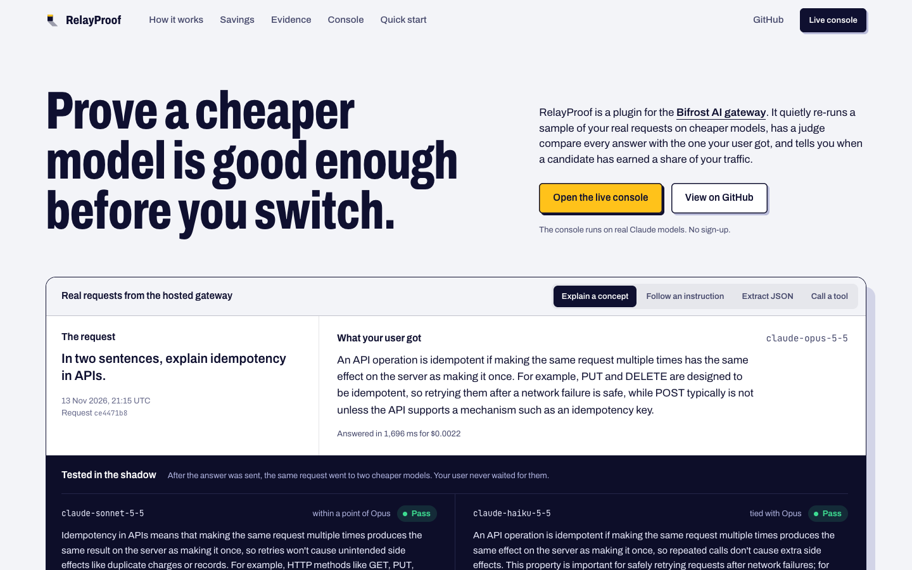
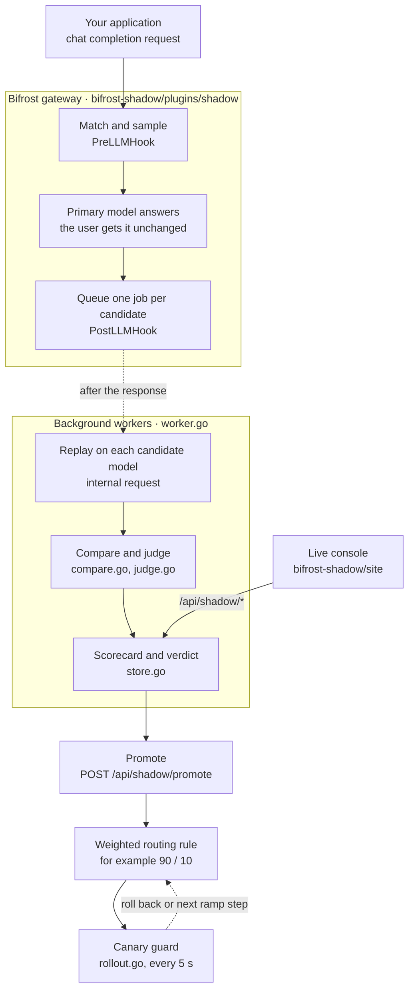
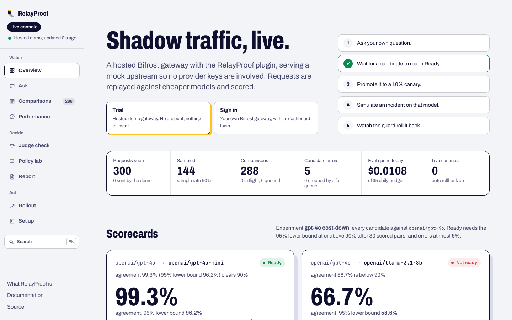
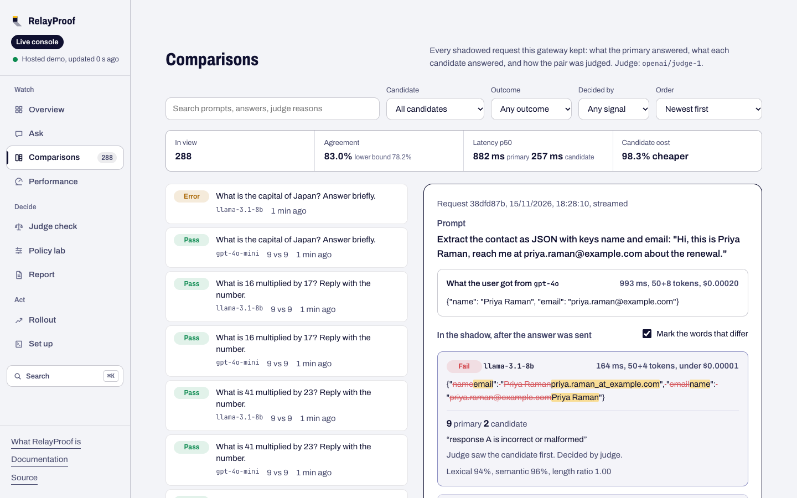
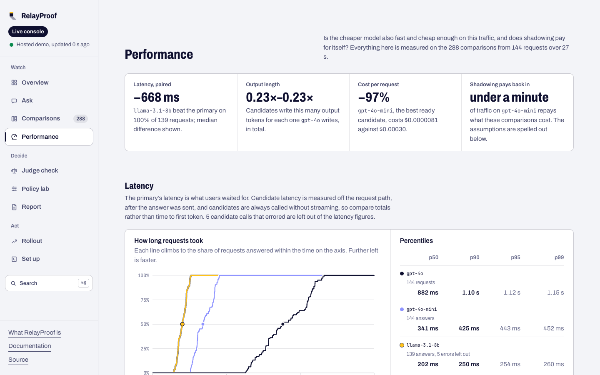

# RelayProof

**Team Vulcan**

- Aditya Arnav
- Pallab Das

Live link: [relayproof.pallabdas.me](https://relayproof.pallabdas.me/)

<p align="center">
  
</p>

RelayProof tells a team when a cheaper AI model is good enough to take over part of its traffic. It quietly sends a copy of a sample of real requests to cheaper models after the user already has the answer, has a judge compare every pair, and marks a candidate ready only when the statistics say so. A ready candidate can then be given a small share of live traffic, and the gateway takes that share back on its own if the candidate starts failing. It is for teams that run AI features in production and want to cut model spend without exposing users to a worse model first.

The repository holds a plugin and an HTTP API for the [Bifrost](https://github.com/maximhq/bifrost) AI gateway, written as an upstream contribution and applied to a pinned upstream commit by one script; a key-free demo with a mock model provider, a load generator and a fault switch; the hosted demo backend that runs on real Claude models; the landing page and the live console; a frontend contract with an OpenAPI spec and a typed TypeScript client; and the tests and CI that check all of it. It was built for the Geek Room Global AI Hackathon 2026 on HackCulture, category AI Agents and Intelligent Systems, theme Open-Source Bifrost Gateway (PS04).

## Features

| Feature | What it does |
| --- | --- |
| Shadow traffic | Copies a sample of chat completions, streaming included, to any number of cheaper candidate models after the primary answer is complete. Unsampled requests cost about 100 ns and no allocations, and the user never waits for shadow work. |
| Pair comparison | Scores every pair with an LLM judge (answer order randomized), exact match, embedding similarity, tool-call and JSON-structure checks, finish reasons, latency and cost. A candidate that picks a different tool or breaks the JSON shape fails, whatever the judge says. |
| Readiness verdict | Marks a candidate `ready` only when the 95% Wilson lower bound of its agreement rate clears the threshold (90% by default) and its error rate is within budget, so 20 passes out of 20 is still only `promising`. |
| Gated promotion | `POST /api/shadow/promote` refuses a candidate that is not ready unless an override reason is recorded, builds one weighted routing rule per source model, checks every other rule's CEL for conflicts, and offers a dry run. |
| Canary guard and rollback | Watches live traffic split by the model that served it and rolls the canary back by itself when the candidate's live error rate (95% lower bound) crosses the limit, its shadow verdict turns `not_ready`, or its p95 latency passes an optional cap. Every promotion and rollback is logged with its evidence. |
| Guarded ramp | Raises a healthy canary's share one step at a time, for example 10%, 25%, 50%, 100%, judging each step on its own traffic before moving on. |
| Live console | Shows scorecards and agreement trends, every comparison with a word-level diff, latency and cost per model, a judge check, a policy lab for other thresholds, a printable readiness report, rollout controls and a config builder. It runs on the hosted demo or signs in to your own gateway. |
| Spend limits | Caps candidate, judge and embedding spend per UTC day across restarts, bounds the queue and the workers, and lets each request opt out with the `x-bf-shadow` header. |

## How it works

Your application calls the gateway as usual; RelayProof copies a sample of those requests to cheaper models in the background, scores them, and only then lets a candidate take a share of live traffic under a guard.



A request enters the gateway, and the plugin decides in its pre-hook whether to sample it. The primary model answers and the user gets that answer untouched. Once the answer is complete, the post-hook puts one job per candidate on a bounded queue. Background workers replay the request on each candidate model as an internal request, compare the two answers, ask the judge, and store a record that feeds the scorecard. On the hosted demo every model is a Claude model; locally the key-free mock upstream plays all of them. When a candidate is ready, a promotion creates a weighted routing rule, and the canary guard checks that rule's live traffic every 5 seconds, rolling it back or moving the ramp to its next step. The console reads all of it through the `/api/shadow/*` routes. [The architecture notes](docs/ARCHITECTURE.md) have the component diagram, the request flow, the stored data and the deployment.

## Screenshots

The hero image above is the live landing page. The console shots below are from the same console running locally on the key-free demo backend (`dev.sh` with the mock upstream and a front door), so the models are mock `openai/gpt-4o`, `gpt-4o-mini` and `llama-3.1-8b`. All were taken in headless Chrome at 1440 × 900, light theme, with reduced motion turned on.

<p align="center">
  
  <br><em>The console overview: counters, then one scorecard per candidate with its verdict and 95% lower bound.</em>
</p>

<table>
  <tr>
    <td width="50%"></td>
    <td width="50%"></td>
  </tr>
  <tr>
    <td><em>Comparisons: the candidate's answer diffed word by word against the primary, with the judge's reason.</em></td>
    <td><em>Performance: whether the cheaper model is also fast and cheap enough on this traffic.</em></td>
  </tr>
</table>

## Tech stack

| Component | Purpose | License |
| --- | --- | --- |
| [Bifrost](https://github.com/maximhq/bifrost) at commit `ed62e4b` | The AI gateway the plugin extends; cloned, patched and built by `bifrost-shadow/scripts/setup.sh` | Apache-2.0 |
| Go 1.27 | The plugin, the gateway API handlers and the demo tools (mock upstream, load generator, fault proxy, front door) | BSD-3-Clause |
| google/uuid | IDs for records and rollout events | BSD-3-Clause |
| React 19, Vite 8, TypeScript 7 | The landing page and the live console in `bifrost-shadow/site` | MIT, MIT, Apache-2.0 |
| Lenis | Smooth scrolling on the landing page | MIT |
| Archivo and JetBrains Mono, from Fontsource | Fonts bundled with the site | OFL-1.1 |
| Claude models through the Anthropic API | The hosted demo: `claude-opus-5-5` serves and judges, `claude-sonnet-5-5` and `claude-haiku-5-5` are the candidates | Commercial service |
| Render | Hosts the demo backend container (`render.yaml`) | Hosting service |
| Vercel | Hosts the static site and forwards `/api/shadow/*` and `/api/demo/*` to the backend | Hosting service |

## Quick start

You need git, Go 1.27.3 or later, a C compiler (Bifrost's SQLite config store needs cgo), `curl` and Python 3 for the demo script, and Node 22 with pnpm for the site. No API keys are needed. If a step fails, see [the troubleshooting guide](docs/TROUBLESHOOTING.md).

```bash
git clone https://github.com/PDGamerSG/relayproof.git
cd relayproof

# Clone upstream Bifrost at the pinned commit into ./bifrost, add the plugin,
# apply the patches, run the tests and build the gateway (SKIP_UI=1 skips the dashboard build)
SKIP_UI=1 bifrost-shadow/scripts/setup.sh

# Key-free demo: scorecards, a refused and an accepted promotion, a simulated
# incident, the automatic rollback and a guarded ramp (BIFROST_BIN must be absolute)
BIFROST_BIN="$(pwd)/bifrost/tmp/bifrost-http" ./bifrost/examples/shadow-demo/run.sh

# Or keep a seeded gateway running for frontend work (Ctrl-C to stop)
BIFROST_BIN="$(pwd)/bifrost/tmp/bifrost-http" ./bifrost/examples/shadow-demo/dev.sh
```

`./bifrost/` is a generated build tree and Git ignores it. Edit the sources in `bifrost-shadow/` and run `setup.sh` again to copy them in.

The site and the console:

```bash
cd bifrost-shadow/site
pnpm install
pnpm dev        # http://localhost:5273, proxies /api/shadow and /api/demo to localhost:10000
```

The console needs a backend on port 10000. Build and run the hosted demo's container locally (`docker build -f bifrost-shadow/deploy/Dockerfile -t relayproof-demo .` from the repository root), or set `SHADOW_BACKEND` to another local front door. Do not point it at the hosted backend: every console call there starts paid traffic on real models. To use RelayProof on your own gateway, add the plugin block shown in [the configuration guide](docs/CONFIGURATION.md) to its `config.json`.

### Checks

After `setup.sh`, from the repository root:

```bash
(cd bifrost/plugins/shadow && go test -race -count=2 -cover ./...)
(cd bifrost/transports && go test -race -count=2 -run 'Shadow|CELOverlap' ./bifrost-http/handlers/ ./bifrost-http/lib/)
(cd bifrost/examples/shadow-demo && GOWORK=off go vet ./... && GOWORK=off go test ./...)
npx --yes -p typescript@5.6.3 tsc --noEmit --strict --target es2022 --module esnext \
  --moduleResolution bundler --lib es2022,dom --noUnusedLocals --noUnusedParameters \
  bifrost-shadow/api/client/shadowClient.ts
(cd bifrost-shadow/site && pnpm build)
```

CI (`.github/workflows/shadow.yml`) runs on pushes to `main` and on pull requests that touch `bifrost-shadow/`, `render.yaml`, `.dockerignore` or the workflow. The backend job runs `setup.sh` on a clean checkout, the race tests, `go vet` and the full key-free demo through a real gateway. The client job typechecks the TypeScript client in strict mode and checks that the site's copy of it matches. CI does not build the site or run the dashboard's vitest and Playwright suites. [The test plan](docs/testing/test-plan.md) lists every check.

### Deploy

The site is a Vercel project deployed with the Vercel CLI from `bifrost-shadow/site`; `vercel.json` forwards `/api/shadow/*` and `/api/demo/*` to the backend. The backend is a Render web service defined by `render.yaml`: one Docker container (`bifrost-shadow/deploy/Dockerfile`) with the gateway on loopback and a public front door that exposes only the shadow API and the demo controls. When `ANTHROPIC_API_KEY` is set in the Render dashboard, the gateway calls real Claude models through a fault proxy that simulates outages on demand; without it, the container starts the mock upstream instead. [The deployment guide](docs/operations/deployment.md) covers the settings, the spend caps and how to check a deploy.

## Repository map

| Path | What it holds |
| --- | --- |
| `bifrost-shadow/plugins/shadow/` | The plugin: sampling, capture, workers, comparison, judge, store and scorecards, spend ledger, canary guard, ramp and rollout log, with their tests |
| `bifrost-shadow/transports/bifrost-http/handlers/` | The `/api/shadow/*` HTTP API, including server-side promotion and rollback |
| `bifrost-shadow/patches/` | Changes to upstream Bifrost files: plugin registration, config schema, docs navigation, dashboard API and page |
| `bifrost-shadow/scripts/setup.sh` | Clones upstream at the pinned commit, copies the overlay in, applies the patches, tests and builds |
| `bifrost-shadow/examples/shadow-demo/` | Mock upstream with an incident switch, load generator, fault proxy, front door, gateway config, `run.sh` and `dev.sh` |
| `bifrost-shadow/deploy/` | The hosted demo container: Dockerfile, entrypoint and the mock and Claude gateway configs |
| `bifrost-shadow/site/` | The landing page and the live console (Vite, React, TypeScript). See [its README](bifrost-shadow/site/README.md) |
| `bifrost-shadow/api/` | The frontend contract: OpenAPI spec, typed TypeScript client and connection guide |
| `bifrost-shadow/ui/`, `bifrost-shadow/tests/e2e/` | The Shadow Traffic page for Bifrost's own dashboard and its Playwright suite |
| `bifrost-shadow/docs/features/shadow-traffic.mdx` | The feature reference written for the Bifrost docs |
| `render.yaml` | The Render Blueprint for the hosted backend |
| `.github/workflows/shadow.yml` | CI |
| `docs/` | The documentation listed below |
| `research/` | Archive of the earlier research and plan, made before this project was chosen. See [its README](research/README.md) |

## Documentation

- [Documentation index](docs/README.md): every document and a suggested reading order.
- [Architecture](docs/ARCHITECTURE.md): the parts, outside services, the main request, the stored data and the deployment.
- [Configuration](docs/CONFIGURATION.md): the plugin's settings and every environment variable the demo and the hosted backend read.
- [User guide](docs/user-guide.md): the landing page, each tab of the live console, and the dashboard page.
- [HTTP API](docs/api/README.md): the `/api/shadow/*` and `/api/demo/*` routes.
- [Troubleshooting](docs/TROUBLESHOOTING.md): build, demo and console problems and their fixes.
- [Deployment](docs/operations/deployment.md): Vercel, Render, spend caps and checks.
- [Threat model](docs/security/threat-model.md): what the hosted demo receives and sends, and how keys are kept.
- [Test plan](docs/testing/test-plan.md): what is tested and what CI runs.
- [Glossary](docs/glossary.md): shadow traffic, canary, Wilson lower bound and the other terms.
- [Plugin internals](bifrost-shadow/ARCHITECTURE.md), [verification](bifrost-shadow/TESTING.md) and [the project README](bifrost-shadow/README.md): the plugin's design, measured overhead and demo results in depth.

## Known limits

- Only chat completions are mirrored. The Responses API, embeddings, images and audio are not.
- Candidates are compared with the primary model's answer, not with ground truth, and the judge is itself a model. The console's judge check measures its position and length effects, but it cannot prove the judge right.
- Tool calls are compared, never executed, and multi-turn agents are evaluated one turn at a time.
- Records, spend, canary health and the rollout log are kept per gateway node (optionally saved beside `persist_path`). Promoted routing rules are shared through the config store, but the guard on each node only sees that node's traffic.
- The overlay targets upstream commit `ed62e4b`. The patches may not apply to a newer Bifrost without changes.
- The Shadow Traffic page for Bifrost's own dashboard predates server-side promotion and writes the routing rule directly through the routing-rules API, so a canary promoted there skips the readiness gate, the rollout log and the canary guard. Use the live console or `POST /api/shadow/promote` instead.
- The hosted demo's front door sends at most 400 requests to the gateway per UTC day and takes 20 questions per hour from each client address; the candidate and judge calls each request triggers fall under the plugin's $5 daily budget instead. The request counter lives in memory, so a restart resets it, and the per-address limit trusts the `X-Forwarded-For` header.
- Sampling and the demo's simulated incident are random, so the demo's numbers change between runs.
- CI does not build the site or run the dashboard's vitest and Playwright suites.

## License

The repository has no license file, so no license is granted for its own code yet. The upstream Bifrost code that `setup.sh` downloads is Apache-2.0. Third-party code and fonts the project uses are listed in the [third-party notices](THIRD_PARTY_NOTICES.md).
