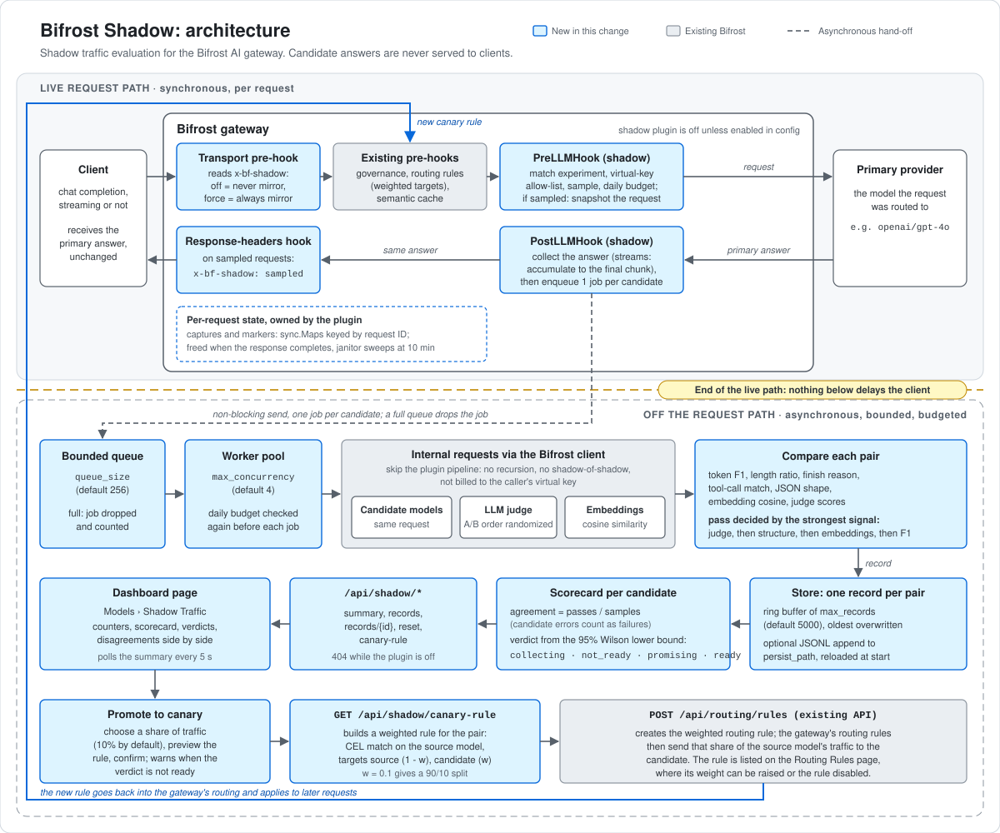

# Bifrost Shadow architecture

The diagram has two halves. Above the dashed line is the live request path: everything there
runs inside a client's request, so it is kept to a few checks. Below the line is the
evaluation pipeline: background workers that call candidate models, judge and score the pairs,
and feed the scorecard. The client only ever receives the primary model's answer.

Code references are to `plugins/shadow/` unless noted. Patches are against
`maximhq/bifrost@ed62e4b`.

## Live-path guarantees

| Guarantee | How the code provides it |
|---|---|
| Off by default | The plugin is registered only when `config.json` (or `/api/plugins`) lists it with `enabled: true` (`patches/0001`, `loadBuiltinPlugins`); otherwise it is marked disabled and none of its hooks run. The `/api/shadow/*` routes are always registered and answer `404` while the plugin is off. |
| No allocations for unsampled requests | `PreLLMHook` returns early for non-chat requests, requests without an ID, `x-bf-shadow: off`, and requests outside the virtual-key allow-list. For the rest it matches each experiment's source and draws a sample; the slice of sampled experiments is only created when something is sampled. `PostLLMHook` and the response-headers hook return after one atomic load while no sampled request is in flight. Measured in `TESTING.md` (medians): 67.8 ns and 98.6 ns for the two `PreLLMHook` paths, 2.9 ns and 2.2 ns for the other two hooks, 160 ns for an unsampled request while a sampled one is in flight, 0 allocations each. |
| The primary never waits for shadow work | Candidate, judge and embedding calls start only after the primary answer is complete (the final chunk for streams). The hand-off is a `select` with a `default` branch on a buffered channel, so it never blocks. `PostLLMHook` returns the response object it was given, and the stream-chunk hook passes chunks through. A sampled request pays for its own snapshot and hand-off: about 9,600 ns and 33 allocations in `BenchmarkSampledRequest`. |
| Bounded queue, drop on overflow | The queue is a channel of `queue_size` jobs (default 256) drained by `max_concurrency` workers (default 4). When it is full, the job is dropped and `counters.dropped` is incremented. Each internal call has a `timeout_seconds` deadline (default 60). |
| Daily budget | `daily_budget_usd` caps candidate, judge and embedding spend per UTC day (0 means unlimited). It is checked in `PreLLMHook` before a request is snapshotted, and in the worker each job reserves its expected cost (a moving average of recent jobs) before any call starts, so concurrent jobs cannot all slip under the cap. Skipped work is counted in `counters.budget_skipped`. The total lives in a spend ledger (`ledger.go`) shared across plugin instances in the process, and written to `<persist_path>.spend.json` when a persist path is set, so neither a settings update, a reload nor a restart lifts the budget. Spend is priced from the `pricing` overrides first, then the model catalog (`CalculateCostForUsage`, wired in `patches/0001`). |
| Per-request opt-out | The HTTP transport pre-hook reads `x-bf-shadow`. `off`, `false`, `0`, `no` or `skip` stop the request from being mirrored; `force`, `on`, `true`, `1` or `yes` mirror it regardless of the sample rate, but only when `allow_force_header` is on (off by default: shadow calls skip governance, so any caller could otherwise spend the shadow budget). A forced request must still match an experiment, pass the virtual-key allow-list and fit the budget. |
| Virtual-key allow-list | With `virtual_keys` set, only requests whose governance virtual-key ID, virtual-key name, or raw `x-bf-vk` value is on the list are eligible. An empty list allows all traffic. |
| Shadow calls are not user traffic | Workers call the Bifrost client with a context prepared by `bifrost.PrepareContextForInternalRequest`, the helper upstream plugins use for their own sub-requests. It skips the plugin pipeline, so a candidate call cannot be mirrored again or billed to the caller's virtual key, and it clears the caller's key-routing state. Each internal call gets its own `shadow-<uuid>` request ID. |
| A failing candidate cannot crash the gateway | A panic inside a job is recovered and recorded as a candidate error. |

The plugin is placed at built-in order 10, after governance, routing rules and the semantic
cache (`patches/0001`), so a cache hit short-circuits before the request is sampled.
`PostLLMHook` also skips responses marked as cache hits and failed primaries.

## Data flow

1. **Header.** The transport pre-hook records the `x-bf-shadow` mode on the request context.
2. **Match and sample.** `PreLLMHook` runs for each chat completion attempt, streaming or not,
   after the existing routing has chosen the provider and model. It matches the experiments'
   `source`, applies the allow-list and the sample rate, checks the budget, and for a sampled
   request serializes a snapshot of the messages, tools, parameters and `extra_params`, leaving
   out tools MCP added to the request. The capture is stored in the plugin under the request ID,
   claimed with a per-request token so two in-flight requests that share a caller-supplied ID
   never pair one's prompt with the other's answer, and the request ID is remembered as a marker.
3. **Collect.** `PostLLMHook` finds the capture by request ID. For streams it accumulates text,
   tool calls, the finish reason and usage under a mutex until `bifrost.IsFinalChunk`.
4. **Hand off.** With the answer complete, the capture is deleted and one job per candidate goes
   onto the queue. A candidate identical to the model that actually served the request is
   skipped.
5. **Mark.** The response-headers hook finds the marker through the `X-Bifrost-Request-Id`
   response header and sets `x-bf-shadow: sampled`. The marker lives in the plugin because the
   gateway runs LLM hooks on a child of the transport context
   (`TestShadowResponseHeaderAcrossContexts`).
6. **Replay.** A worker decodes the snapshot, swaps in the candidate's provider and model, and
   calls the candidate as an internal request with empty MCP client and tool allow-lists: MCP
   runs outside the plugin pipeline, so skipping plugins alone would not stop it.
7. **Compare.** The pair gets token F1, length ratio and finish-reason agreement, plus tool-call
   matching and JSON-shape matching when they apply. With `embedding` set, both answers are
   embedded in one internal request and compared by cosine similarity. With `judge` set, a
   `judge.sample_rate` share of pairs goes to the judge model, with the candidate placed in slot
   A or B at random; the reply is mapped back to primary and candidate scores.
8. **Store.** The worker prices the call, adds it to today's spend, and writes one record to the
   store, at most once per job: a panic anywhere in the job, pricing included, becomes a
   candidate error, and a job whose calls were cancelled by shutdown is dropped.
9. **Report.** `GET /api/shadow/summary` rebuilds the scorecards from the stored records on each
   call. That work is proportional to `max_records` and happens only when someone asks, never
   on the request path. The dashboard polls it every 5 seconds while the page is open.

## Where state lives and how much

| State | Keyed by | Size of an entry | Bound | Freed when |
|---|---|---|---|---|
| Captures (`sync.Map`) | request ID | The request snapshot (JSON of messages, tools and parameters, not truncated), the last user turn truncated to `max_payload_chars` (default 8,000), and for streams an accumulator whose text and per-call tool arguments stop growing once they pass 64 KiB | One per sampled request whose response is not complete yet. There is no fixed count limit. | The final `PostLLMHook`, a failed primary, a cache hit, a retried attempt with the same request ID, or the janitor, which runs every minute and drops captures older than 10 minutes |
| Markers (`sync.Map`) | request ID | One timestamp | One per sampled request until its headers are written | The response-headers hook, or the janitor after 10 minutes (Go SDK callers and requests that fail before headers never reach the hook) |
| Job queue (buffered channel) | none | A reference to the snapshot, the prompt, the primary answer and usage | `queue_size` jobs | A worker takes the job |
| Ring buffer | none | One record. With `store_payloads: true`, the prompt and both answer texts, each truncated to `max_payload_chars`; tool-call arguments are kept as returned | `max_records` (default 5,000) | Overwritten oldest-first when the ring wraps; cleared by reset |
| JSONL file (optional) | none | One line per record | `2 × max_records` lines: past that the file is rewritten (temp file and rename) with the newest `max_records` records | Compaction or reset. At startup only the last `max_records` lines stay in the ring buffer |
| Traffic counters | experiment index | Count and first timestamp as atomics in a cache-line-padded slot, so eligible requests never take a lock | One per experiment | Reset |
| Spend | none | Spend ledger: today's total, in-flight reservations, cost estimate; process-wide per persist path | `<persist_path>.spend.json`, rewritten atomically after each job | Rolls over at UTC midnight. Reset, reloads and restarts keep it, so none of them lifts the budget |
| Rollout book | experiment + candidate | Active canaries (rule, weight, since, optional ramp of at most 20 steps; per-target counts and the last 512 latencies) and the rollout log | 500 events; one canary per pair; `<persist_path>.rollouts.json` with the ramps, without live statistics | A rollback (manual or automatic) ends a canary and its ramp; reset keeps both |

No stream-sized data is stored in `BifrostContext`; the context carries only the
`x-bf-shadow` mode. This follows the `AGENTS.md` rule for per-request state.

## How the verdict is computed

**Per pair.** `decidePass` (`worker.go`) applies two required gates, then the strongest
quality signal available:

1. Gate: if either side called tools and the two did not select the same tools (multiset of
   names), the pair fails (`tool_selection`). An agent executes whatever the model picks, so a
   different tool is a different trajectory.
2. Gate: if the primary answered with a JSON document and the candidate's answer is not JSON with
   the same keys and value kinds, the pair fails (`json_schema`).
3. If the judge returned a verdict: pass when the candidate's score is at least the primary's
   score minus `quality_tolerance` (default 1.0 point out of 10).
4. Else, if the answers match exactly (text equal after case and whitespace normalization, or
   equal JSON values, and the same tool calls): pass (`exact`).
5. Else, if a judge was asked and failed: the pair is **unscored**. A weaker signal does not
   stand in for a failed evaluator.
6. Else, if the same tools were called with different arguments: fail (`tool_arguments`).
7. Else, if embeddings ran: pass when the cosine similarity is at least `semantic_threshold`
   (default 0.85).
8. Else, only with `quality_fallback: "lexical"`: pass when the token F1 is at least
   `lexical_threshold` (default 0.6). Otherwise the pair is unscored.

A candidate error (failed call, timeout, recovered panic) is a failure. Matching JSON structure
alone never passes a pair: `{"approved":false}` and `{"approved":true}` have the same shape.

**Per candidate.** The summary groups records by experiment and candidate. Evidence is scored
comparisons plus candidate errors; unscored comparisons are reported but are not evidence:

- agreement rate = passes / (scored + errors)
- lower bound = the lower end of the 95% Wilson score interval for passes out of scored + errors
  (`wilsonLowerBound` in `compare.go`, z = 1.96)
- error rate = candidate errors / samples
- judge error rate = failed judge calls / judge calls

The verdict is checked in this order (`verdictFor` in `store.go`):

| Verdict | Condition |
|---|---|
| `collecting` | scored + errors < `min_samples` (default 20); the reason names why pairs went unscored |
| `not_ready` | error rate > `max_error_rate` (default 0.05) |
| `not_ready` | judge error rate > `max_judge_error_rate` (default 0.1) |
| `ready` | lower bound >= `min_agreement` (default 0.9) |
| `promising` | agreement rate >= `min_agreement`, lower bound not yet |
| `not_ready` | otherwise |

Scorecards also carry `pass_basis_counts` (which signal decided how many pairs) and agent
metrics for tool-calling turns: `tool_turns`, `tool_name_match_rate`, `tool_call_match_rate` and
`tool_diffs` (`missing`, `extra`, `different_tool`, `different_args`).

The lower bound stops a short lucky streak from promoting a model: 20 passes out of 20 has a
lower bound of 84%, so with the default threshold that candidate is `promising` until more
samples arrive. Scorecards cover the records currently in the ring buffer, that is, the most
recent `max_records` comparisons.

## How promotion works

Promotion runs on the server (`promoteShadowCandidate` in
`transports/bifrost-http/handlers/shadow_rollout.go`), serialized by one mutex so two
promotions cannot both read and rewrite the same rule.

1. **Gate.** `PairScorecard` returns the pair's current scorecard. A verdict other than `ready`
   is refused with `409` (`verdict`, `verdict_reason`, `evidence`) unless the request carries an
   `override_reason`.
2. **Plan.** `BuildCanaryRule` (`api.go`) gives the source, the candidate and the CEL expression
   (`provider == "openai" && model == "gpt-4o"`). For a wildcard source the most frequently
   observed primary model is used; with no traffic yet the call fails with `400`.
3. **Merge.** Existing rules are read from the config store. A global rule whose name starts
   with `Shadow canary: <source> ->` and whose expression is the plan's is the source's canary
   rule: the candidate's share is set in it (added or changed), other candidates keep theirs, and
   the source gets `1 - Σ shares`. Shares above 100% are refused. Weights are rounded to four
   decimals and sum to exactly 1. Otherwise a new rule is created with the first free global
   priority from 10, or the requested one. One rule per source matters: the routing engine stops
   at the first matching terminal rule, so a second rule for the same source would never serve
   traffic (this was finding 2 of the project review, reproduced on a real gateway: 87/13/0).
4. **Conflict check.** Every other enabled rule's CEL is partially evaluated (`celOverlap`, cel-go
   with `OptPartialEval`) with `provider`, `model` and both chat request types known and every
   request-scoped variable unknown. `overlapYes` means it matches every chat request for the
   source; `overlapMaybe` means it depends on headers, keys, teams, budgets or complexity. A
   global, non-chain rule that is `overlapYes` and runs first (lower priority number) refuses the
   promotion (`409`, `conflicts`). Scoped rules, `overlapMaybe` rules that run first, and rules
   that run after the canary are returned as `warnings`.
5. **Write.** The rule is validated with the routing-rules API's own checks
   (`rules.ValidateCELExpression`, `validateRoutingTargets`), saved to the config store and
   reloaded into the routing engine (`ReloadRoutingRule`), so it serves the next request. The
   promotion is audited and recorded in the rollout log with the scorecard as evidence.
   `dry_run` stops before the write and returns the plan.

The merge, the conflict check and the rule write (steps 3 to 5, without the rollout log) are
`planShareEdit` and `saveShareEdit`; the canary guard's ramp uses the same two functions to move
a candidate's share (see below), restricted to the existing rule.

**Ramp.** With `ramp` in the body, `PlanRamp` (`rollout.go`) validates it first (2 to 20 strictly
ascending steps at four decimals, the first equal to `weight`, `min_requests` at least
`canary.min_requests`, `hold_seconds` from 0 to 7 days) and the promotion starts at `steps[0]`.
The merge also checks every promotion against the ramps already on the rule (`checkRampPeaks`):
its own peak plus, for each other candidate, the larger of its current share and its unfinished
ramp's last step must fit in 100%, so neither a new ramp nor a second candidate can leave a ramp
unable to finish (`400` against current shares only, `409` naming the ramp otherwise). The promote event carries the ramp; the book stores it on the
canary.

**Rollback** (`rollbackShadowCanary`) removes the candidate's target from the source's canary
rule and gives its share back to the source; a rule left with only the source is deleted. The
HTTP route records a `rollback` event; a canary whose rule was already removed by hand is
closed with `action: none`.

## Canary guard

Promoted candidates are watched on live traffic (`rollout.go`):

- **Observation.** `PostLLMHook` first loads an atomic pointer to the list of active canaries
  (nil when there are none: one atomic load). For each response or error it reads
  `RoutingInfo.RequestedModel` (what the caller asked for, before routing rules) and
  `RoutingInfo.Model` (what served it). A request for a canary's source model is counted
  against the candidate or the source target: requests, errors and a ring of the last 512
  latencies. Streams count once, at the final chunk. 14 ns for a response to another model,
  25 ns for a counted one, no allocations.
- **Health** (`judgeCanary`): `watching` below `min_requests` candidate requests; `unhealthy` when
  the 95% Wilson lower bound of the candidate's error rate is above the limit (the limit is
  `canary.max_error_rate`, raised to the source's own error rate when the source fails as much),
  when candidate p95 latency exceeds `max_latency_ratio` × the source's p95, or (unless the canary
  was promoted with an override) when the pair's shadow verdict has turned `not_ready`;
  otherwise `healthy`. Using the lower bound keeps one failed request in a handful from rolling
  back a healthy candidate.
- **Action.** A goroutine checks every 5 s (`guardPass`). With `canary.auto_rollback` on, an
  unhealthy canary is rolled back through a `RollbackFunc` the gateway wires
  (`NewShadowRollbackHook`, the same code as the rollback route), at most once at a time per
  canary, and an `auto_rollback` event with the triggering health is recorded.
- **Ramp.** For a canary promoted with a ramp, `rampDue` decides whether the current step is
  done: at least `min_requests` candidate requests at this step, `hold_seconds` since
  `step_started_at`, and health `healthy` (an unhealthy canary is rolled back, or with
  `auto_rollback` off holds its step). A done step moves on through a `RampFunc` the gateway wires
  (`NewShadowRampHook`): under the promotion lock it re-checks that the canary is the one judged
  (same state, weight, step and step start), sets the candidate's share in the existing canary
  rule with the promotion merge, never creating a rule and never enabling a disabled one (it
  holds instead), and then records a `ramp` event
  (`ramp_complete` for the last step) with the health the step rested on. Recording the event
  replaces the canary's `CanaryRamp` (ramps are never edited in place) and resets its live
  statistics, so each step is judged on its own traffic; a response whose latency reaches back
  before `step_started_at` was routed at the old weight and is skipped (one clock read, about
  40 ns, for ramping canaries only). A step the hook refuses is remembered with its cause, logged
  once, and shown in `ramp.reason` until a new step starts. A promotion of the same pair replaces
  or cancels the ramp; a rollback ends it. The ramp is persisted with the canary, so a restart
  resumes at the same step, with the step's request count back at zero.
- **State.** An event is applied in memory before the book is saved; a failed save returns
  `ErrRolloutNotSaved`, which callers treat as done with a warning, since the routing rule has
  already changed. The rollout log (last 500 events) and the active canaries live in a `rolloutBook`
  shared per process and persist path, like the spend ledger, so a settings update or reload
  keeps watching. With `persist_path` they are written atomically to
  `<persist_path>.rollouts.json` after each event; live statistics restart with the process.

## Wiring into the gateway

`patches/0001` adds the plugin to the built-in list and, on bootstrap and on every plugin reload,
calls `SetExecutors` with the client's `ChatCompletionRequest` and `EmbeddingRequest` and a price
function backed by the model catalog, `SetRollbackHook` with the canary guard's rollback, and
`SetRampHook` with its ramp step.
Promotion, rollback and the guard write routing rules through `NewShadowRoutingRules`: the config
store first, then the routing engine's in-memory rules (`ReloadRoutingRule`/`RemoveRoutingRule`,
the same calls the routing-rules API makes). Without a config store that is nil and promotion
answers `503`. The HTTP handler resolves the current plugin instance on every API call, so
enabling or reloading the plugin through `/api/plugins` takes effect without a restart. A reload
starts a fresh instance; stored records survive it only when `persist_path` is set, while the
spend ledger and the rollout book are shared with the new instance. On shutdown, `Cleanup` stops
the workers and waits up to 5 seconds for in-flight calls.
