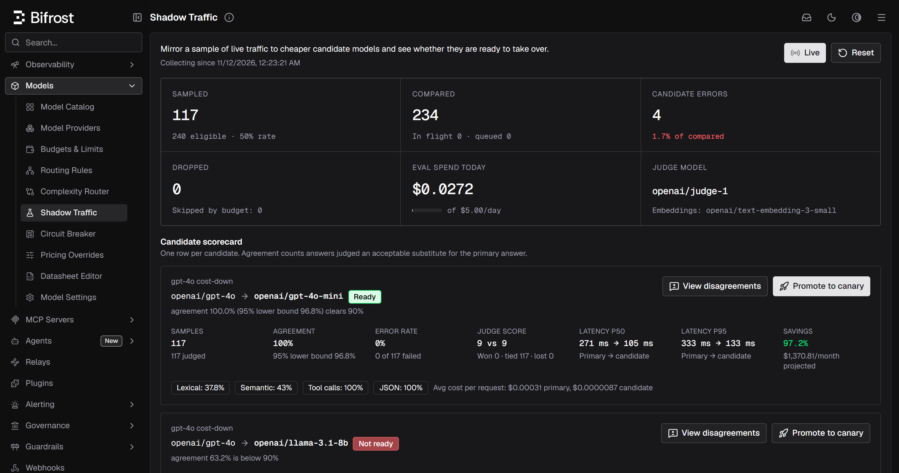
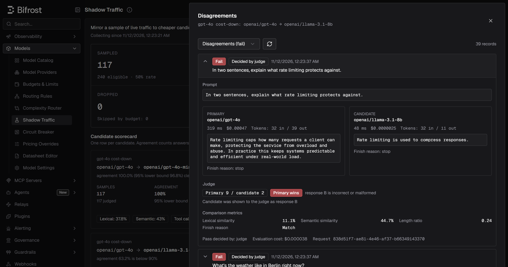

# Bifrost Shadow

Shadow traffic evaluation for the [Bifrost](https://github.com/maximhq/bifrost) AI gateway.

> Prove a cheaper model is good enough on your real production traffic before you switch,
> roll it out to a slice of users, and let the gateway pull it back on its own if it misbehaves.

Built for the Geek Room Global AI Hackathon 2026 (HackCulture), category **AI Agents &
Intelligent Systems**, theme **Open-Source Bifrost Gateway** (PS04: extend the gateway with a
practical feature through supported extension points). Everything here is written as an
upstream contribution: a built-in plugin, a gateway API, a dashboard page, schema, docs and
tests, applied to `maximhq/bifrost@ed62e4b` by one script.

## The problem

Model spend is the largest line item for most AI products, and the cheapest fix is a cheaper
model. Teams rarely switch because they cannot answer one question with confidence: *on our
traffic, is the cheaper model as good?* Offline eval sets do not look like production prompts,
and an A/B test exposes real users before the answer is known.

Bifrost already has the pieces around that question (routing rules, weighted targets, a model
catalog with prices, plugins), but no way to test a model on live traffic without serving its
answers. Neither the open-source gateway nor its enterprise docs offer shadow or mirrored
traffic.

## What it does

```
client ──► Bifrost ──► primary model ──► answer to client (unchanged)
              │
              └─ sampled copy, after the response ──► candidate models
                                                       LLM judge (order randomized)
                                                       embeddings, JSON + tool-call checks
                                                         │
                       scorecard ◄── records ◄───────────┘
                           │
                           └─ POST /api/shadow/promote ──► weighted routing rule (90/10)
                                 (verdict gate, conflict check)        │
                                                                        ▼
                                            canary guard: live error rate and latency per target
                                            ──► automatic rollback when the candidate misbehaves
```

- **Mirror** a sample of chat completions (streaming included) to any number of candidates per
  source model. Unsampled requests pay about 100 ns and no allocations; the primary answer
  never waits for shadow work.
- **Compare** every pair with an LLM judge (position-randomized), exact matching, embedding
  similarity, tool-call and JSON-structure checks, finish reasons, latency and cost.
- **Gate on what agents depend on**: a candidate that selects a different tool, or breaks the
  JSON structure the application parses, fails whatever the judge says. Scorecards carry agent
  metrics: tool-name match rate and missing, extra or changed tool calls.
- **Decide** with statistics, not anecdotes: a candidate is `ready` only when the 95% Wilson
  lower bound of its agreement rate clears the threshold, its error rate is within budget and the
  judge is healthy. A failed judge call leaves a pair unscored instead of passing it on weaker
  evidence.
- **Inspect** every disagreement side by side with the judge's reason.
- **Promote** on the server: `POST /api/shadow/promote` refuses a candidate that is not ready
  (unless an override reason is recorded), merges candidates for one source into a single
  weighted rule, and checks every other routing rule's CEL so the canary cannot be silently
  shadowed. A dry run shows the plan first.
- **Guard the canary**: live requests are split by the model that served them; when the
  candidate's error rate (95% lower bound), latency or shadow verdict crosses a limit, the
  gateway rolls it back by itself and logs why. Every promotion and rollback is kept with the
  evidence it rested on.
- **Export** scorecards and records as CSV or JSON for review.
- **Stay safe**: bounded queue and workers, a daily budget that holds across reloads and
  restarts and reserves the cost of running jobs, per-request opt-out header (the
  force header is off unless the operator allows it), virtual-key allow-list, payload storage
  switch. Shadow calls are internal requests: no plugin recursion, no billing to the caller's
  virtual key, and no MCP tools run on them.

## Demo result (no API keys)

`examples/shadow-demo` runs a deterministic mock upstream behind a real Bifrost gateway and
replays 300 mixed requests (QA, arithmetic, JSON mode, tool calls, writing; 25% streamed):

```
CANDIDATE            SAMPLES  AGREE   LOWER95  ERRORS  JUDGE (P/C)  P50 (P/C)     SAVINGS  $/1M REQ  VERDICT
openai/gpt-4o-mini   146      100.0%  97.4%    0.0%    9.0 / 9.0    883 / 342 ms  97.2%    $301      READY
openai/llama-3.1-8b  146      67.1%   59.1%    2.7%    9.0 / 6.8    883 / 201 ms  99.3%    $307      NOT READY
```

Both candidates are much cheaper; only one is safe. The script then runs a full rollout
through the gateway API:

```
promote llama-3.1-8b         HTTP 409: not_ready - agreement 67.1% is below 90%
promote gpt-4o-mini (10%)    HTTP 200: create, agreement 100.0% (95% lower bound 97.4%)
split check                  gpt-4o-mini served 20 of 200 requests (expected 20)
canary health                healthy: live error rate 0.0% over 20 requests
provider incident            gpt-4o-mini fails 60% of requests (mock upstream switch)
canary guard                 rolled back: live error rate 19.2% (95% lower bound 8.5%) exceeds 5.0%
after rollback               gpt-4o-mini served 0 of 100 requests, 0 failed
```

Sampling is random, so numbers move between runs; the verdicts do not. Five user requests
failed during the simulated incident before the guard acted. The whole script takes under two
minutes.

## Dashboard

**Models → Shadow Traffic** in the Bifrost UI:



- Counters for sampled, compared, failed and dropped comparisons, and eval spend against the
  daily budget.
- One scorecard row per candidate: verdict, agreement with its 95% lower bound, error rate,
  judge record, p50/p95 latency, savings and projected monthly cost.
- **View disagreements**: failing pairs side by side with the judge's scores and reason, and
  which label (A or B) the candidate had in the judge's randomized order.
- **Promote to canary**: choose a share of traffic, preview the routing rule, create it.
- **Reset**: clear results. Today's eval spend is kept, so the daily budget still applies.



Both screenshots are from the key-free demo (`examples/shadow-demo`), so the answers come
from the mock upstream.

## Quick start

From the repository root:

```bash
# Clone upstream at the pinned commit into ./bifrost, add the plugin, apply patches, build
bifrost-shadow/scripts/setup.sh                 # SKIP_UI=1 to skip the dashboard build

# Run the key-free demo (the binary path must be absolute: run.sh changes directory)
BIFROST_BIN="$(pwd)/bifrost/tmp/bifrost-http" ./bifrost/examples/shadow-demo/run.sh

# Or keep a seeded gateway running for frontend work (Ctrl-C to stop)
BIFROST_BIN="$(pwd)/bifrost/tmp/bifrost-http" ./bifrost/examples/shadow-demo/dev.sh
```

A frontend connects to the gateway's `/api/shadow/*` routes: see [`api/README.md`](api/README.md)
for auth, CORS, the [OpenAPI spec](api/openapi.yaml) and a typed
[TypeScript client](api/client/shadowClient.ts).

Requirements: git, Go 1.27+, a C compiler (SQLite config store), and for the dashboard the
Node version in Bifrost's `ui/.nvmrc` (26 at the pinned commit).

Minimal `config.json` for real providers:

```json
{
  "plugins": [{
    "enabled": true,
    "name": "shadow",
    "config": {
      "sample_rate": 0.1,
      "experiments": [{
        "source": { "provider": "openai", "model": "gpt-4o" },
        "candidates": [{ "provider": "openai", "model": "gpt-4o-mini" }]
      }],
      "judge": { "provider": "openai", "model": "gpt-4o" },
      "daily_budget_usd": 20,
      "persist_path": "shadow.jsonl",
      "canary": { "auto_rollback": true }
    }
  }]
}
```

Full reference: [`docs/features/shadow-traffic.mdx`](docs/features/shadow-traffic.mdx).

## Layout

This directory mirrors the Bifrost source tree. New files are copied in; changes to existing
upstream files are patches against `ed62e4b`.

| Path | What |
|---|---|
| `plugins/shadow/` | The plugin (Go module `github.com/maximhq/bifrost/plugins/shadow`): sampling, capture, workers, comparison, judge, store, scorecards, spend ledger (`ledger.go`), canary guard and rollout log (`rollout.go`) |
| `transports/bifrost-http/handlers/shadow.go` | `/api/shadow/*` HTTP API |
| `transports/bifrost-http/handlers/shadow_rollout.go` | Server-side promotion and rollback: verdict gate, rule merge, CEL conflict check |
| `examples/shadow-demo/` | Mock upstream (with an incident switch), load generator, gateway config, `run.sh`, `dev.sh` |
| `api/` | Frontend contract: OpenAPI spec, typed TypeScript client, connection guide; not copied into the Bifrost tree |
| `docs/features/shadow-traffic.mdx` | Feature documentation |
| `ui/app/workspace/shadow/` | Dashboard page: counters, scorecard, disagreements sheet, promote dialog |
| `ui/lib/` | RTK Query client (`shadowApi.ts`), types, formatting helpers and their vitest cases |
| `tests/e2e/features/shadow-traffic/` | Playwright suite for the dashboard page: page object, data factories, specs |
| `patches/0001-register-shadow-plugin.patch` | Built-in plugin registration, executor, pricing and rollback wiring, routes |
| `patches/0002-config-schema.patch` | `config.schema.json` entry and schema tests |
| `patches/0003-docs-nav.patch` | Docs navigation |
| `patches/0004-dashboard-api.patch` | Cache tags and API client export |
| `patches/0005-dashboard-page.patch` | Sidebar entry, canary form schema, strings in all 11 UI languages |
| `scripts/setup.sh` | Clone, overlay, patch, test, build |

## Design notes

- **Hooks.** `PreLLMHook` matches, samples and snapshots; `PostLLMHook` collects the primary
  answer (accumulating stream chunks until `IsFinalChunk`) and enqueues one job per candidate.
  HTTP transport hooks read the `x-bf-shadow` header and mark sampled responses.
- **No stream data in context.** Captures live in a `sync.Map` keyed by request ID, as
  `AGENTS.md` requires, with a janitor that sweeps captures whose response never completed.
- **Internal sub-requests.** Candidate, judge and embedding calls go through the Bifrost client
  with `PrepareContextForInternalRequest`, the same mechanism the semantic cache uses: no plugin
  pipeline, no governance billing, no shadow-of-shadow.
- **Pricing.** Costs come from the model catalog (`CalculateCostForUsage`), with optional manual
  overrides for self-hosted models.
- **Readiness.** Agreement uses a Wilson score interval, so 20/20 passes (lower bound 84%) is
  `promising`, not `ready`. The canary guard uses the same interval on live error rates.
- **Promotion.** One routing rule per source model holds every candidate's share, because the
  routing engine stops at the first matching rule. Other rules are checked by partially
  evaluating their CEL with only the provider and model known.

## Overhead

`go test -bench . -benchmem -count=5` in `plugins/shadow`, medians (windows/amd64, 32 threads):

| Path | ns/op | allocs/op |
|---|---|---|
| Request not matching any experiment | 68 | 0 |
| Matching but not sampled | 99 | 0 |
| Matching but not sampled, every core at once | 54 | 0 |
| Not sampled while another sampled request is in flight | 160 | 0 |
| PostLLMHook with nothing captured | 3 | 0 |
| Response-header hook, not sampled | 2 | 0 |
| The plugin's own work per streamed chunk | 0.4 | 0 |
| Sampled request (snapshot + hand-off) | 9,600 | 33 |

With a canary live, `PostLLMHook` adds 14 ns (another model) or 25 ns (a counted response), no
allocations (macOS arm64, 10 cores).

## Limitations

- Chat completions only; the Responses API, embeddings, images and audio are not mirrored.
- Records, spend, canary health and the rollout log are per gateway node (optionally persisted
  beside `persist_path`); promoted routing rules are shared through the config store.
- Candidates are compared with the primary, not with ground truth.
- Tool calls are compared, never executed; multi-turn agents are evaluated one turn at a time.
- The bundled dashboard page (`ui/`) predates server-side promotion and still creates rules
  through the routing-rules API; the new endpoints are for the separate frontend.
