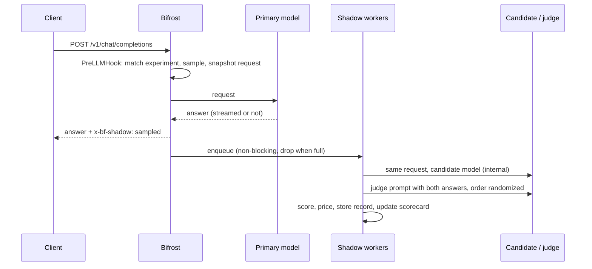

## Overview

Switching models is the biggest cost lever a gateway has, and the riskiest. An offline eval set rarely matches production prompts, and an A/B test exposes real users to the candidate before you know it is good enough.

Shadow traffic answers the question with your own traffic and no user impact. The `shadow` plugin copies a sample of live chat requests, replays each one against one or more **candidate** models after the primary answer has been sent, and compares the answers. Per candidate you get:

- an **agreement rate** with a 95% confidence lower bound, decided by an LLM judge, exact matches or embedding similarity, behind required tool-selection and JSON-structure checks;
- **agent metrics**: on turns where a tool is called, how often the candidate picks the same tools, and whether it misses, adds or changes tool calls;
- the candidate's **error rate** and **latency** next to the primary's;
- the **cost per request**, the saving, and a monthly projection at your current request rate;
- a **verdict** (`ready`, `promising`, `not_ready`, `collecting`) and every disagreement, side by side;
- a one-click **Promote to canary** that creates a weighted [routing rule](/features/governance/routing) sending a slice of the primary's traffic to the candidate, watched by a **canary guard** that rolls it back on its own if it misbehaves and, with a **guarded ramp**, raises its share step by step while it stays healthy.

The client always gets the primary model's answer, unchanged. Shadow calls run on a bounded worker pool after the response, never on the request path.

---

## How it works



1. **Match and sample.** For each chat completion (streaming or not), the plugin checks the request's provider and model against the experiments' `source`, applies the virtual-key allow-list and the `x-bf-shadow` header, and samples at the experiment's rate. An unsampled request costs about 100 ns and no allocations.
2. **Capture.** A sampled request is snapshotted once. The capture lives in the plugin, keyed by request ID, never in the request context. Streams are accumulated chunk by chunk until the final chunk.
3. **Hand off.** When the primary answer is complete, one job per candidate goes onto a bounded queue. A full queue drops the job and counts it, and the primary is never slowed down. Cache hits, failed primaries and candidates identical to the model that actually served the request are skipped.
4. **Replay.** A worker sends the same messages, tools and parameters to the candidate as an internal request: it skips the plugin pipeline, so it cannot recurse, is not billed to the caller's virtual key, and does not appear as user traffic. Provider-specific `extra_params` go too when the request opted into passing them through. Tools that [MCP](/mcp/overview) added to the request are left out, and MCP is off for the shadow call, so the candidate gets the caller's own tools and never runs an MCP tool.
5. **Compare.** Every pair gets lexical similarity (token F1), length ratio, finish-reason agreement, an exact-match check (text equal after case and whitespace normalization, or equal JSON values), and, when they apply, tool-call matching (tool names, then arguments) and JSON-structure matching. Optional embedding similarity and an optional LLM judge add semantic and quality signals. The judge sees both answers in a random order to cancel position bias.
6. **Decide.** Two deterministic checks are required gates: a candidate that selects different tools than the primary, or breaks the JSON structure the primary returned, fails whatever else says. After the gates the strongest signal decides: the judge score (the candidate may trail by `quality_tolerance`), then an exact match, then embedding similarity, then, only with `quality_fallback: "lexical"`, token overlap. Same tools with different arguments fail unless the judge accepted them. A pair with no usable signal, including every pair whose judge call failed, is **unscored**: it counts toward neither agreement nor `min_samples`. A candidate error is a failure.
7. **Report.** Records go into a bounded ring buffer (optionally a JSONL file) and roll up into per-candidate scorecards.

### Verdicts

| Verdict | When |
|---|---|
| `collecting` | Fewer than `min_samples` scored comparisons (candidate errors count; unscored pairs do not) |
| `not_ready` | Error rate above `max_error_rate`, judge error rate above `max_judge_error_rate`, or agreement rate below `min_agreement` |
| `promising` | Agreement rate meets `min_agreement` but the 95% Wilson lower bound does not yet |
| `ready` | The 95% Wilson lower bound of agreement meets `min_agreement`, and errors are within budget |

The lower bound keeps a lucky streak from promoting a model: 20 out of 20 passes has a lower bound of 84%, so with the default `min_agreement` of 0.9 a candidate needs more evidence before it is `ready`.

---

## Configuration

<Tabs group="config-method">

<Tab title="Web UI">

1. Enable the plugin with `config.json` or the API (the tabs alongside this one).
2. Open **Models → Shadow Traffic** in the sidebar. The page polls the scorecard every 5 seconds.
3. Use **View disagreements** on a candidate to read failing pairs side by side with the judge's reason. The judge saw each pair in a random order, so its reason refers to "response A" or "response B"; the record states which one was the candidate.
4. Use **Promote to canary**, pick the share of traffic (10% by default), check the rule preview, and confirm. The rule appears under **Routing Rules**, where you can raise its weight or disable it. The dialog picks a priority no other global rule uses. Promoting the same candidate again changes the share on its existing canary rule instead of creating a second one; the rule keeps its priority, scope and enabled state.

<Frame>
  
</Frame>

<Frame>
  
</Frame>

</Tab>

<Tab title="API">

The plugin is managed through the plugins API like any built-in plugin:

```bash
curl -X POST http://localhost:8080/api/plugins \
  -H "Content-Type: application/json" \
  -d '{
    "name": "shadow",
    "enabled": true,
    "path": "",
    "config": {
      "sample_rate": 0.1,
      "experiments": [
        {
          "name": "gpt-4o cost-down",
          "source": { "provider": "openai", "model": "gpt-4o" },
          "candidates": [
            { "provider": "openai", "model": "gpt-4o-mini" },
            { "provider": "anthropic", "model": "claude-haiku-4-5" }
          ]
        }
      ],
      "judge": { "provider": "openai", "model": "gpt-4o", "sample_rate": 0.5 },
      "daily_budget_usd": 20
    }
  }'
```

Update it with `PUT /api/plugins/shadow`. An update starts a fresh plugin instance: in-memory records are reloaded only when `persist_path` is set.

</Tab>

<Tab title="config.json">

```json
{
  "plugins": [
    {
      "enabled": true,
      "name": "shadow",
      "config": {
        "sample_rate": 0.1,
        "experiments": [
          {
            "name": "gpt-4o cost-down",
            "source": { "provider": "openai", "model": "gpt-4o" },
            "candidates": [
              { "provider": "openai", "model": "gpt-4o-mini" },
              { "provider": "anthropic", "model": "claude-haiku-4-5" }
            ]
          }
        ],
        "judge": { "provider": "openai", "model": "gpt-4o", "sample_rate": 0.5 },
        "embedding": { "provider": "openai", "model": "text-embedding-3-small" },
        "daily_budget_usd": 20,
        "max_concurrency": 4,
        "persist_path": "./shadow-records.jsonl",
        "thresholds": { "min_samples": 100, "min_agreement": 0.9 }
      }
    }
  ]
}
```

</Tab>

</Tabs>

Every provider named in `experiments`, `judge` and `embedding` must be configured in Bifrost with an enabled key.

### Field reference

| Field | Default | Description |
|---|---|---|
| `sample_rate` | `0.1` | Share of eligible requests mirrored, in (0, 1]. |
| `allow_force_header` | `false` | Honour `x-bf-shadow: force`. Shadow calls skip governance, so with this on any caller can spend the shadow budget on demand; turn it on only where callers are trusted, such as tests and demos. |
| `experiments[].name` | `"<source> vs <candidates>"` | Unique name; used in the API and the UI. |
| `experiments[].source` | required | `provider` and `model` of the primary. `model: "*"` matches every model; an empty provider matches any provider. |
| `experiments[].candidates` | required | Models each sampled request is replayed against. |
| `experiments[].sample_rate` | plugin rate | Per-experiment override. |
| `judge` | none | `provider`, `model`, `sample_rate` (default `1.0`, the share of pairs judged), `max_tokens` (default `300`, the cap on the judge's reply) and `effort` (sent as the request's reasoning effort; unset leaves the model's default). Models that think before answering, such as `claude-opus-5-5`, count thinking against `max_tokens`: give them more room (the hosted Claude demo uses `2048` with `effort: "low"`). The judge is asked for temperature 0; Bifrost drops it for models that reject sampling parameters. |
| `embedding` | none | `provider` and `model` for semantic similarity. |
| `max_concurrency` | `4` | Shadow workers. |
| `queue_size` | `256` | Pending jobs. A full queue drops new jobs; see `counters.dropped`. |
| `timeout_seconds` | `60` | Timeout for each candidate, judge and embedding call. |
| `daily_budget_usd` | `0` (unlimited) | Cap on shadow, judge and embedding spend per UTC day. Each job reserves its expected cost before it starts, so running jobs count against the cap. When no further job fits, sampling stops until the next day. The day's total survives plugin reloads and settings updates, and with `persist_path` also restarts (it is kept in `<persist_path>.spend.json`). |
| `virtual_keys` | all | Only mirror requests made with these virtual keys (ID, name or value). |
| `max_records` | `5000` | Comparisons kept in memory. |
| `store_payloads` | `true` | Keep prompts and answers for the disagreement viewer. Set `false` to keep only scores. |
| `max_payload_chars` | `8000` | Truncation limit for stored prompts and answers. |
| `persist_path` | none | JSONL file that records are appended to and reloaded from at startup. When it passes twice `max_records` lines, it is rewritten with only the newest `max_records` records, so the file and the startup replay stay bounded. |
| `pricing` | catalog | Manual prices keyed by `"provider/model"` or `"model"`: `{ "input_per_million": 0.15, "output_per_million": 0.6 }`. They take precedence over the [model catalog](/features/governance/budget-and-limits). |
| `thresholds.min_samples` | `20` | Comparisons needed before a verdict. |
| `thresholds.min_agreement` | `0.9` | Required 95% lower bound of agreement for `ready`. |
| `thresholds.max_error_rate` | `0.05` | Maximum candidate error rate. |
| `thresholds.quality_tolerance` | `1.0` | Judge points (out of 10) a candidate may trail the primary by and still pass. |
| `thresholds.semantic_threshold` | `0.85` | Embedding cosine needed to pass when no judge verdict is available. |
| `thresholds.lexical_threshold` | `0.6` | Token F1 needed to pass with `quality_fallback: "lexical"` when no stronger signal decided. |
| `thresholds.max_judge_error_rate` | `0.1` | Share of judge calls that may fail before the verdict is withheld (`not_ready`). A failing evaluator cannot vouch for a candidate. |
| `canary.auto_rollback` | `false` | Roll an unhealthy canary back automatically. Without it the guard only reports health. |
| `canary.min_requests` | `20` | Live candidate requests before health is judged. |
| `canary.max_error_rate` | `thresholds.max_error_rate` | Limit for the 95% lower bound of the candidate's live error rate; never below the source's own rate. |
| `canary.max_latency_ratio` | `0` (off) | Limit on candidate p95 latency as a multiple of the source's p95. |
| `canary.rollback_on_not_ready` | `true` | Also treat a canary as unhealthy when its shadow verdict turns `not_ready`. |
| `quality_fallback` | `"none"` | What scores a pair that no judge, exact match or embedding could: `"none"` leaves it unscored; `"lexical"` uses token overlap. Overlap does not check meaning (`"approved": true` and `"approved": false` overlap heavily), so it is an explicit choice for setups without a judge or embeddings. |

A threshold set to `0` is used as `0`, not replaced by its default: `quality_tolerance: 0` passes only candidates that the judge scores at least as high as the primary. Negative thresholds are rejected.

---

## Per-request control

| Header | Direction | Effect |
|---|---|---|
| `x-bf-shadow: force` | request | Mirror this request even if it was not sampled (it must still match an experiment). Only honoured with `allow_force_header: true`; otherwise the request is sampled as usual. Also accepts `on`, `true`, `1`, `yes`. |
| `x-bf-shadow: off` | request | Never mirror this request, for example for sensitive tenants. Also accepts `false`, `0`, `no`, `skip`. |
| `x-bf-shadow: sampled` | response | Set on responses whose request was mirrored. |

---

## Promoting a candidate

The scorecard tells you a candidate is safe on the traffic it has seen. A canary confirms it on real users with a small, reversible share, and the canary guard watches it while it runs.

```bash
# See the plan first: the rule, the traffic split, and any rule that would interfere
curl -s -X POST http://localhost:8080/api/shadow/promote -H "Content-Type: application/json" \
  -d '{"experiment":"gpt-4o cost-down","candidate":"openai/gpt-4o-mini","weight":0.1,"dry_run":true}'

# Promote: 10% of openai/gpt-4o traffic to openai/gpt-4o-mini
curl -s -X POST http://localhost:8080/api/shadow/promote -H "Content-Type: application/json" \
  -d '{"experiment":"gpt-4o cost-down","candidate":"openai/gpt-4o-mini","weight":0.1}'
```

`POST /api/shadow/promote` writes the routing rule itself and records the promotion, with the scorecard it rested on, in the rollout log:

- **Gated on the verdict.** A candidate that is not `ready` is refused with `409` and its verdict and reason. To promote it anyway, send `override_reason`; it is recorded with the promotion.
- **One rule per source.** The rule matches `provider == "openai" && model == "gpt-4o"` and sends `weight` to the candidate and the rest to the source. Promoting a second candidate for the same source adds it to that rule (for example 70/10/20) instead of creating a second rule: the routing engine stops at the first matching rule, so a second rule would never serve traffic. Promoting the same candidate again changes its weight.
- **Checked against your rules.** Every other enabled rule's CEL expression is partially evaluated for a chat request to the source model. A global rule that matches every such request and runs first refuses the promotion with `409` and names the rule; rules that may match some requests, scoped rules, and rules the canary will now run ahead of come back as `warnings`.
- **Priority.** A new rule takes the first free global priority from 10, or the `priority` you pass.

`POST /api/shadow/rollback` with `experiment` and `candidate` gives the candidate's share back to the source; a rule left with only the source is deleted. For a wildcard source the most frequently observed primary model is used, because a routing rule needs a concrete model. Keep the experiment running after promotion: the sampled share of the traffic the source still serves keeps the scorecard current.

### Canary guard

While a canary runs, the plugin counts live responses to the source model by the target that served them: requests, errors, p50 and p95 latency, for the candidate and for the source. `GET /api/shadow/rollouts` shows each canary with its health:

| Status | When |
|---|---|
| `watching` | Fewer than `canary.min_requests` candidate requests so far |
| `healthy` | Within every limit |
| `unhealthy` | The 95% lower bound of the candidate's live error rate is over `canary.max_error_rate` (never below the source's own error rate on the same traffic), its p95 latency is over `canary.max_latency_ratio` times the source's, or continued shadow evaluation turned its verdict to `not_ready` |

With `canary.auto_rollback: true` the guard rolls an unhealthy canary back on its own within a few seconds and records an `auto_rollback` event with the health that triggered it. A canary promoted with an override reason is guarded on live health only, since its verdict was overridden. Without `auto_rollback` the guard only reports. The lower bound keeps a single failed request among a handful from rolling a healthy canary back.

```json
"canary": { "auto_rollback": true, "min_requests": 20, "max_latency_ratio": 3 }
```

The rollout log and the watched canaries survive plugin reloads and, with `persist_path`, restarts (`<persist_path>.rollouts.json`).

### Guarded ramp

A canary at a fixed 10% still has to be raised by hand. Add `ramp` to the promotion and the canary guard raises it for you, one step at a time, while the canary stays healthy:

```bash
curl -s -X POST http://localhost:8080/api/shadow/promote -H "Content-Type: application/json" -d '{
  "experiment": "gpt-4o cost-down",
  "candidate": "openai/gpt-4o-mini",
  "weight": 0.1,
  "ramp": { "steps": [0.1, 0.25, 0.5, 1], "min_requests": 50, "hold_seconds": 300 }
}'
```

The canary starts at the first step. On every check (every 5 seconds) the guard looks at each ramping canary:

1. **Unhealthy** (the same limits as any canary): with `canary.auto_rollback` it is rolled back and the ramp ends. Without it the ramp holds at its step; nothing moves until the canary is healthy again or an operator acts.
2. **Step done**: the step has served `min_requests` candidate requests, `hold_seconds` have passed since it started, and the canary is `healthy`. The guard writes the next weight into the same routing rule, through the same merge a promotion uses (other candidates keep their shares, the source serves the rest), and records a `ramp` event by `canary_guard` with the new weight, the health the finished step rested on, and the new ramp state. Live statistics restart, so every step is judged on its own traffic.
3. **Last step**: the event is `ramp_complete` instead of `ramp`, and `ramp.completed` is `true`. The canary stays watched and is still rolled back if it turns unhealthy, but it moves no further. A last step of `1` is a full cutover: the rule then routes every source request to the candidate.

| Field | Default | Description |
|---|---|---|
| `ramp.steps` | required | 2 to 20 shares of source traffic, strictly ascending (compared at the four decimals routing rules keep), each from `0.0001` to `1`. The first is the promoted weight: leave `weight` out or send the same value. |
| `ramp.min_requests` | `canary.min_requests` | Live candidate requests each step must serve before the guard moves on. It cannot be lower than `canary.min_requests`, since the guard judges health only after that many. |
| `ramp.hold_seconds` | `60` | Minimum time at each step, `0` to `604800` (7 days). An explicit `0` is kept: the step then ends as soon as it has enough healthy requests. |

A ramp that breaks a rule above is refused with `400` and a message naming the field, as is a ramp whose last step would not fit next to the shares other candidates of the same source already hold (for example a ramp to 100% while another candidate has 20%). A dry run returns the plan with `ramp` filled in.

`GET /api/shadow/rollouts` shows where each ramp stands:

```json
"ramp": {
  "steps": [0.1, 0.25, 0.5, 1],
  "current_step": 1,
  "step_started_at": "2026-11-15T01:21:07.869+05:30",
  "step_requests": 12,
  "min_requests": 50,
  "hold_seconds": 300,
  "next_weight": 0.5,
  "completed": false,
  "reason": "step 2 of 4 (25%): 12 of 50 candidate requests"
}
```

| Field | Description |
|---|---|
| `current_step` | Index into `steps` of the weight served now (the canary's `weight`). |
| `step_started_at` | When the canary reached the current step; the hold counts from here. |
| `step_requests` | Live candidate requests at this step. The canary's `health` covers this step only. |
| `next_weight` | The next step's weight; absent once the ramp is complete. |
| `completed` | The canary reached the last step. |
| `reason` | What the ramp waits for: requests, the rest of the hold, a health verdict, or why it holds. |

Promotion events that start a ramp, and `ramp` and `ramp_complete` events, carry the same `ramp` object as it was after the action. A canary without a ramp has no `ramp` field anywhere, exactly as before.

How a ramp ends or changes:

- **Promoting the same candidate again** replaces its ramp (the new ramp starts at its first step, on fresh statistics), or cancels it when the new promotion has none: the weight is then whatever that promotion sets, the statistics gathered so far are kept, and the guard moves it no further. The promotion's `warnings` say which.
- **A rollback**, by an operator or by the guard, ends the canary and its ramp.
- **An override.** A canary promoted with `override_reason` is ramped on live health only, the same way it is guarded.
- **Restarts.** With `persist_path` the ramp is saved with the canary, so a restarted gateway resumes it at the same step. The step's request count starts again from zero; its hold time does not. A plugin reload keeps the ramp without interruption.
- **A rule changed by hand.** The guard only edits the source's existing canary rule. If that rule, or the candidate's target in it, was removed outside the shadow API, the ramp holds and the gateway logs why; a rollback closes the canary.

The model is the one progressive delivery tools use. The ramp's `steps` play the part of [Argo Rollouts](https://argo-rollouts.readthedocs.io/en/stable/features/canary/) `setWeight` steps and [Flagger](https://docs.flagger.app/usage/deployment-strategies)'s `stepWeights`; `hold_seconds` is Argo's `pause.duration` or Flagger's analysis `interval`; `min_requests` is the minimum number of contexts a [LaunchDarkly guarded rollout](https://launchdarkly.com/docs/home/releases/creating-guarded-rollouts) needs at each step before it advances; and the canary guard's health check is the analysis. As in all three, a failed check stops the rollout: Argo aborts it, Flagger rolls it back, and LaunchDarkly rolls it back or, without automatic rollback, pauses it. Here too rolling back is a choice (`canary.auto_rollback`); without it the ramp holds. Unlike Flagger, failed checks are not counted toward a `threshold`: the guard already acts only on a 95% lower bound, so one unhealthy verdict rolls the canary back.

`GET /api/shadow/canary-rule` still returns a bare routing-rule body for `POST /api/routing/rules`, without the checks above.

---

## API reference

| Method | Path | Description |
|---|---|---|
| `GET` | `/api/shadow/summary` | Counters, spend, thresholds, experiments, guard state and per-candidate scorecards (`pairs`). |
| `GET` | `/api/shadow/records` | Comparisons, newest first. Query: `experiment`, `candidate` (`provider/model`), `outcome` (`pass`, `fail`, `error`), `limit` (default 50, max 500), `offset`. |
| `GET` | `/api/shadow/records/{id}` | One comparison with both answers, metrics and the judge verdict. |
| `DELETE` | `/api/shadow/records` | Clear records and counters and restart `started_at` (audited). Today's spend, the rollout log and canaries are kept, so a reset never lifts the daily budget. |
| `POST` | `/api/shadow/promote` | Promote a candidate to a canary (audited). Body: `experiment`, `candidate`, `weight` (default `0.1`, or `ramp.steps[0]`), `priority`, `override_reason`, `dry_run`, `ramp` (`steps`, `min_requests`, `hold_seconds`; see [Guarded ramp](#guarded-ramp)). `400` for an invalid ramp; `409` when not ready or when an earlier rule would shadow the canary; `503` without a config store. |
| `POST` | `/api/shadow/rollback` | Remove a candidate from its canary rule (audited). Body: `experiment`, `candidate`, `reason`. |
| `GET` | `/api/shadow/rollouts` | Active canaries with live health and, when ramping, `ramp`; the rollout log, newest first (`promote`, `rollback`, `auto_rollback`, `ramp`, `ramp_complete`). |
| `GET` | `/api/shadow/export` | `format=json` (summary, records, rollouts) or `format=csv` with `kind=scorecards` or `kind=records`. Record filters apply. |
| `GET` | `/api/shadow/canary-rule` | A routing-rule body for `POST /api/routing/rules`. Query: `experiment`, `candidate`, `weight` from `0.0001` to `1` (default `0.1`), `priority` (default `10`). |

All routes answer `404` with a message when the plugin is not enabled. An OpenAPI description and a typed TypeScript client are in the repository's `api/` directory.

---

## Cost, privacy and overhead

- **Spend.** Each sampled request costs one candidate call per candidate, plus a judge call and an embedding call when they are configured. Bound it with `sample_rate`, `judge.sample_rate` and `daily_budget_usd`. The summary reports `spend_today_usd` and `spend_reserved_usd` (running jobs), and every record carries its own costs.
- **Internal calls.** Candidate, judge and embedding calls run as internal requests: they skip plugins, governance and logging, and are not billed to virtual keys. MCP is switched off for them, so no MCP tool or agent loop runs on a shadow call. Their cost is tracked by the shadow plugin only, including embedding calls whose vectors could not be compared.
- **Payloads.** With `store_payloads: true` the plugin keeps the last user turn and both answers (truncated to `max_payload_chars`) in memory and, if set, in `persist_path`. Use `store_payloads: false`, `virtual_keys`, or `x-bf-shadow: off` to keep sensitive traffic out.
- **Memory.** Bounded by `max_records` records (a few KB each with payloads) and `queue_size` pending snapshots. Captures whose response never completes are swept after 10 minutes.
- **Request path.** Measured with `go test -bench . -benchmem -count=5` in `plugins/shadow` (medians):

| Path | ns/op | allocs/op |
|---|---|---|
| Request not matching any experiment | 68 | 0 |
| Matching but not sampled | 99 | 0 |
| Matching but not sampled, every core at once | 54 | 0 |
| Not sampled while another sampled request is in flight | 160 | 0 |
| PostLLMHook with nothing captured | 3 | 0 |
| Response header hook, not sampled | 2 | 0 |
| The plugin's own work per streamed chunk | 0.4 | 0 |
| Sampled request (snapshot + hand-off) | 9,600 | 33 |

With a canary active, `PostLLMHook` also counts live responses for the canary's source model (macOS arm64, 10 cores, `-count=3`): 14 ns and no allocations for a response to another model, 25 ns and no allocations for one the canary counts. With no canary it is a single atomic load.

## Limitations

- Chat completions only (`/v1/chat/completions` and the SDK integrations that map to it, streaming included). Responses API, embeddings, images and audio are not mirrored.
- Records, spend, canary health and the rollout log live in each gateway node. In a cluster, each node reports on the traffic it served and enforces its own daily budget; routing rules written by promotion are shared through the config store. A ramp is driven by the node it was promoted on, from that node's traffic.
- The conflict check evaluates other rules for a chat request to the source model with only provider, model and request type known. Rules that depend on headers, keys, teams, budgets or complexity are reported as warnings, not refused.
- A candidate is compared with the primary, not with ground truth. A judge measures "as good as the primary", which is the question a cost-down switch needs answered.
- Multi-turn agents that execute tools are evaluated one turn at a time: each sampled turn compares the candidate's tool selection and arguments with the primary's. The candidate's tool calls are never executed.

## Try it without API keys

`examples/shadow-demo` runs a deterministic mock upstream, a Bifrost gateway with the plugin, and a load generator. It shows the weak candidate refused, promotes the ready one to a 10% canary, checks the split, simulates a provider incident and checks that the canary guard rolls it back, then promotes it again with a ramp that the guard takes from 10% to 100% on its own. `dev.sh` in the same directory keeps a seeded gateway running for frontend work. See its README.
