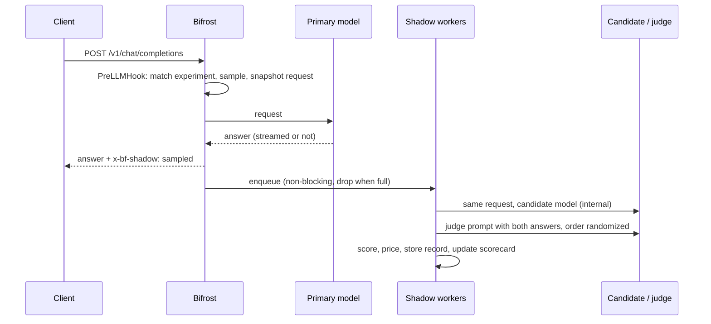

## Overview

Switching models is the biggest cost lever a gateway has, and the riskiest. An offline eval set rarely matches production prompts, and an A/B test exposes real users to the candidate before you know it is good enough.

Shadow traffic answers the question with your own traffic and no user impact. The `shadow` plugin copies a sample of live chat requests, replays each one against one or more **candidate** models after the primary answer has been sent, and compares the answers. Per candidate you get:

- an **agreement rate** with a 95% confidence lower bound, decided by an LLM judge, structural checks for JSON and tool calls, or embedding and lexical similarity;
- the candidate's **error rate** and **latency** next to the primary's;
- the **cost per request**, the saving, and a monthly projection at your current request rate;
- a **verdict** (`ready`, `promising`, `not_ready`, `collecting`) and every disagreement, side by side;
- a one-click **Promote to canary** that creates a weighted [routing rule](/features/governance/routing) sending a slice of the primary's traffic to the candidate.

The client always gets the primary model's answer, unchanged. Shadow calls run on a bounded worker pool after the response, never on the request path.

---

## How it works



1. **Match and sample.** For each chat completion (streaming or not), the plugin checks the request's provider and model against the experiments' `source`, applies the virtual-key allow-list and the `x-bf-shadow` header, and samples at the experiment's rate. An unsampled request costs about 100 ns and no allocations.
2. **Capture.** A sampled request is snapshotted once. The capture lives in the plugin, keyed by request ID, never in the request context. Streams are accumulated chunk by chunk until the final chunk.
3. **Hand off.** When the primary answer is complete, one job per candidate goes onto a bounded queue. A full queue drops the job and counts it, and the primary is never slowed down. Cache hits, failed primaries and candidates identical to the model that actually served the request are skipped.
4. **Replay.** A worker sends the same messages, tools and parameters to the candidate as an internal request: it skips the plugin pipeline, so it cannot recurse, is not billed to the caller's virtual key, and does not appear as user traffic. Provider-specific `extra_params` go too when the request opted into passing them through. Tools that [MCP](/mcp/overview) added to the request are left out, and MCP is off for the shadow call, so the candidate gets the caller's own tools and never runs an MCP tool.
5. **Compare.** Every pair gets lexical similarity (token F1), length ratio, finish-reason agreement, and, when they apply, tool-call and JSON-structure matching. Optional embedding similarity and an optional LLM judge add semantic and quality signals. The judge sees both answers in a random order to cancel position bias.
6. **Decide.** Each pair passes or fails on the strongest signal available: judge score (the candidate may trail by `quality_tolerance`), then tool-call match, then JSON shape (when the shapes match and embeddings are on, embedding similarity still decides), then embedding similarity, then lexical similarity. A candidate error is a failure.
7. **Report.** Records go into a bounded ring buffer (optionally a JSONL file) and roll up into per-candidate scorecards.

### Verdicts

| Verdict | When |
|---|---|
| `collecting` | Fewer than `min_samples` comparisons |
| `not_ready` | Error rate above `max_error_rate`, or agreement rate below `min_agreement` |
| `promising` | Agreement rate meets `min_agreement` but the 95% Wilson lower bound does not yet |
| `ready` | The 95% Wilson lower bound of agreement meets `min_agreement`, and errors are within budget |

The lower bound keeps a lucky streak from promoting a model: 20 out of 20 passes has a lower bound of 84%, so with the default `min_agreement` of 0.9 a candidate needs more evidence before it is `ready`.

---

## Configuration

<Tabs group="config-method">

<Tab title="Web UI">

1. Enable the plugin with `config.json` or the API (the tabs alongside this one).
2. Open **Models → Shadow Traffic** in the sidebar. The page polls the scorecard every 5 seconds.
3. Use **View disagreements** on a candidate to read failing pairs side by side with the judge's reason. The judge saw each pair in a random order, so its reason refers to "response A" or "response B"; the record states which one was the candidate.
4. Use **Promote to canary**, pick the share of traffic (10% by default), check the rule preview, and confirm. The rule appears under **Routing Rules**, where you can raise its weight or disable it. The dialog picks a priority no other global rule uses. Promoting the same candidate again changes the share on its existing canary rule instead of creating a second one; the rule keeps its priority, scope and enabled state.

<Frame>
  
</Frame>

<Frame>
  
</Frame>

</Tab>

<Tab title="API">

The plugin is managed through the plugins API like any built-in plugin:

```bash
curl -X POST http://localhost:8080/api/plugins \
  -H "Content-Type: application/json" \
  -d '{
    "name": "shadow",
    "enabled": true,
    "path": "",
    "config": {
      "sample_rate": 0.1,
      "experiments": [
        {
          "name": "gpt-4o cost-down",
          "source": { "provider": "openai", "model": "gpt-4o" },
          "candidates": [
            { "provider": "openai", "model": "gpt-4o-mini" },
            { "provider": "anthropic", "model": "claude-haiku-4-5" }
          ]
        }
      ],
      "judge": { "provider": "openai", "model": "gpt-4o", "sample_rate": 0.5 },
      "daily_budget_usd": 20
    }
  }'
```

Update it with `PUT /api/plugins/shadow`. An update starts a fresh plugin instance: in-memory records are reloaded only when `persist_path` is set.

</Tab>

<Tab title="config.json">

```json
{
  "plugins": [
    {
      "enabled": true,
      "name": "shadow",
      "config": {
        "sample_rate": 0.1,
        "experiments": [
          {
            "name": "gpt-4o cost-down",
            "source": { "provider": "openai", "model": "gpt-4o" },
            "candidates": [
              { "provider": "openai", "model": "gpt-4o-mini" },
              { "provider": "anthropic", "model": "claude-haiku-4-5" }
            ]
          }
        ],
        "judge": { "provider": "openai", "model": "gpt-4o", "sample_rate": 0.5 },
        "embedding": { "provider": "openai", "model": "text-embedding-3-small" },
        "daily_budget_usd": 20,
        "max_concurrency": 4,
        "persist_path": "./shadow-records.jsonl",
        "thresholds": { "min_samples": 100, "min_agreement": 0.9 }
      }
    }
  ]
}
```

</Tab>

</Tabs>

Every provider named in `experiments`, `judge` and `embedding` must be configured in Bifrost with an enabled key.

### Field reference

| Field | Default | Description |
|---|---|---|
| `sample_rate` | `0.1` | Share of eligible requests mirrored, in (0, 1]. |
| `allow_force_header` | `false` | Honour `x-bf-shadow: force`. Shadow calls skip governance, so with this on any caller can spend the shadow budget on demand; turn it on only where callers are trusted, such as tests and demos. |
| `experiments[].name` | `"<source> vs <candidates>"` | Unique name; used in the API and the UI. |
| `experiments[].source` | required | `provider` and `model` of the primary. `model: "*"` matches every model; an empty provider matches any provider. |
| `experiments[].candidates` | required | Models each sampled request is replayed against. |
| `experiments[].sample_rate` | plugin rate | Per-experiment override. |
| `judge` | none | `provider`, `model`, and `sample_rate` (default `1.0`, the share of pairs judged). |
| `embedding` | none | `provider` and `model` for semantic similarity. |
| `max_concurrency` | `4` | Shadow workers. |
| `queue_size` | `256` | Pending jobs. A full queue drops new jobs; see `counters.dropped`. |
| `timeout_seconds` | `60` | Timeout for each candidate, judge and embedding call. |
| `daily_budget_usd` | `0` (unlimited) | Cap on shadow, judge and embedding spend per UTC day. When it is reached, sampling stops until the next day. |
| `virtual_keys` | all | Only mirror requests made with these virtual keys (ID, name or value). |
| `max_records` | `5000` | Comparisons kept in memory. |
| `store_payloads` | `true` | Keep prompts and answers for the disagreement viewer. Set `false` to keep only scores. |
| `max_payload_chars` | `8000` | Truncation limit for stored prompts and answers. |
| `persist_path` | none | JSONL file that records are appended to and reloaded from at startup. When it passes twice `max_records` lines, it is rewritten with only the newest `max_records` records, so the file and the startup replay stay bounded. |
| `pricing` | catalog | Manual prices keyed by `"provider/model"` or `"model"`: `{ "input_per_million": 0.15, "output_per_million": 0.6 }`. They take precedence over the [model catalog](/features/governance/budget-and-limits). |
| `thresholds.min_samples` | `20` | Comparisons needed before a verdict. |
| `thresholds.min_agreement` | `0.9` | Required 95% lower bound of agreement for `ready`. |
| `thresholds.max_error_rate` | `0.05` | Maximum candidate error rate. |
| `thresholds.quality_tolerance` | `1.0` | Judge points (out of 10) a candidate may trail the primary by and still pass. |
| `thresholds.semantic_threshold` | `0.85` | Embedding cosine needed to pass when no judge decided. |
| `thresholds.lexical_threshold` | `0.6` | Token F1 needed to pass when no judge or embedding decided. |

A threshold set to `0` is used as `0`, not replaced by its default: `quality_tolerance: 0` passes only candidates that the judge scores at least as high as the primary. Negative thresholds are rejected.

---

## Per-request control

| Header | Direction | Effect |
|---|---|---|
| `x-bf-shadow: force` | request | Mirror this request even if it was not sampled (it must still match an experiment). Only honoured with `allow_force_header: true`; otherwise the request is sampled as usual. Also accepts `on`, `true`, `1`, `yes`. |
| `x-bf-shadow: off` | request | Never mirror this request, for example for sensitive tenants. Also accepts `false`, `0`, `no`, `skip`. |
| `x-bf-shadow: sampled` | response | Set on responses whose request was mirrored. |

---

## Promoting a candidate

The scorecard tells you a candidate is safe on the traffic it has seen. A canary confirms it on real users with a small, reversible share.

```bash
# 1. Build the rule: 10% of openai/gpt-4o traffic to openai/gpt-4o-mini
curl -s "http://localhost:8080/api/shadow/canary-rule?experiment=gpt-4o%20cost-down&candidate=openai/gpt-4o-mini&weight=0.1" > rule.json

# 2. Create it
curl -X POST http://localhost:8080/api/routing/rules \
  -H "Content-Type: application/json" -d @rule.json
```

The generated rule matches `provider == "openai" && model == "gpt-4o"`, keeps 90% on the primary and sends 10% to the candidate. It is named `Shadow canary: <source> -> <candidate>` and has priority 10 unless you pass `priority`; the routing API allows one rule per priority in a scope, so pass a free one when 10 is taken. To ramp an existing canary, build the rule again with the new `weight` and send its `targets` to `PUT /api/routing/rules/{rule_id}`. For a wildcard source, the most frequently observed primary model is used, because a routing rule needs a concrete model. Keep the experiment running after promotion: the sampled share of the remaining primary traffic keeps the scorecard current.

---

## API reference

| Method | Path | Description |
|---|---|---|
| `GET` | `/api/shadow/summary` | Counters, spend, thresholds, experiments and per-candidate scorecards (`pairs`). |
| `GET` | `/api/shadow/records` | Comparisons, newest first. Query: `experiment`, `candidate` (`provider/model`), `outcome` (`pass`, `fail`, `error`), `limit` (default 50, max 500), `offset`. |
| `GET` | `/api/shadow/records/{id}` | One comparison with both answers, metrics and the judge verdict. |
| `DELETE` | `/api/shadow/records` | Clear records and counters and restart `started_at` (audited). Today's evaluation spend is kept, so a reset never lifts the daily budget. |
| `GET` | `/api/shadow/canary-rule` | A routing-rule body for `POST /api/routing/rules`. Query: `experiment`, `candidate`, `weight` from `0.0001` to `1` (default `0.1`), `priority` (default `10`). |

All routes answer `404` with a message when the plugin is not enabled.

---

## Cost, privacy and overhead

- **Spend.** Each sampled request costs one candidate call per candidate, plus a judge call and an embedding call when they are configured. Bound it with `sample_rate`, `judge.sample_rate` and `daily_budget_usd`. The summary reports `spend_today_usd`, and every record carries its own costs.
- **Internal calls.** Candidate, judge and embedding calls run as internal requests: they skip plugins, governance and logging, and are not billed to virtual keys. MCP is switched off for them, so no MCP tool or agent loop runs on a shadow call. Their cost is tracked by the shadow plugin only, including embedding calls whose vectors could not be compared.
- **Payloads.** With `store_payloads: true` the plugin keeps the last user turn and both answers (truncated to `max_payload_chars`) in memory and, if set, in `persist_path`. Use `store_payloads: false`, `virtual_keys`, or `x-bf-shadow: off` to keep sensitive traffic out.
- **Memory.** Bounded by `max_records` records (a few KB each with payloads) and `queue_size` pending snapshots. Captures whose response never completes are swept after 10 minutes.
- **Request path.** Measured with `go test -bench . -benchmem -count=5` in `plugins/shadow` (medians):

| Path | ns/op | allocs/op |
|---|---|---|
| Request not matching any experiment | 68 | 0 |
| Matching but not sampled | 99 | 0 |
| Matching but not sampled, every core at once | 54 | 0 |
| Not sampled while another sampled request is in flight | 160 | 0 |
| PostLLMHook with nothing captured | 3 | 0 |
| Response header hook, not sampled | 2 | 0 |
| The plugin's own work per streamed chunk | 0.4 | 0 |
| Sampled request (snapshot + hand-off) | 9,600 | 33 |

## Limitations

- Chat completions only (`/v1/chat/completions` and the SDK integrations that map to it, streaming included). Responses API, embeddings, images and audio are not mirrored.
- Records live in each gateway node. In a cluster, each node reports on the traffic it served.
- A candidate is compared with the primary, not with ground truth. A judge measures "as good as the primary", which is the question a cost-down switch needs answered.
- Multi-turn agents that execute tools see only the turn that was sampled. The candidate's tool calls are compared, never executed.

## Try it without API keys

`examples/shadow-demo` runs a deterministic mock upstream, a Bifrost gateway with the plugin, and a load generator. It ends by promoting the ready candidate and checking the 90/10 split. See its README.
