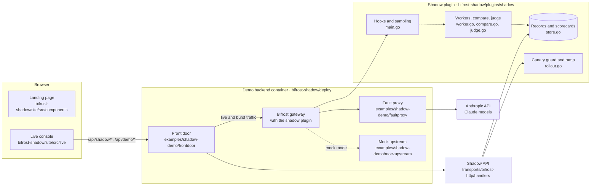
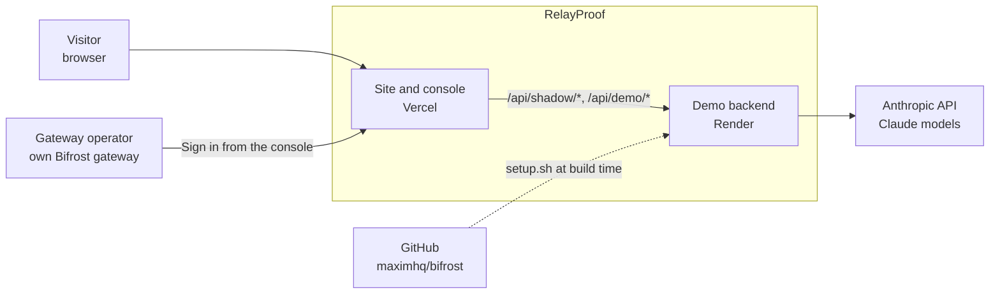
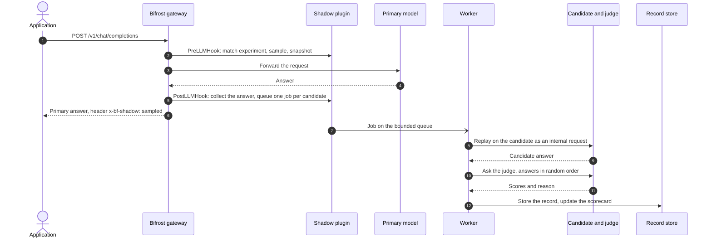
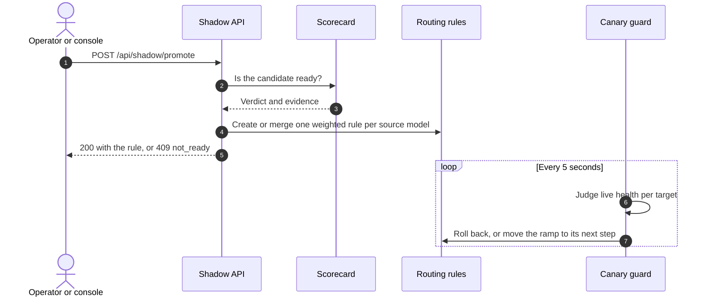
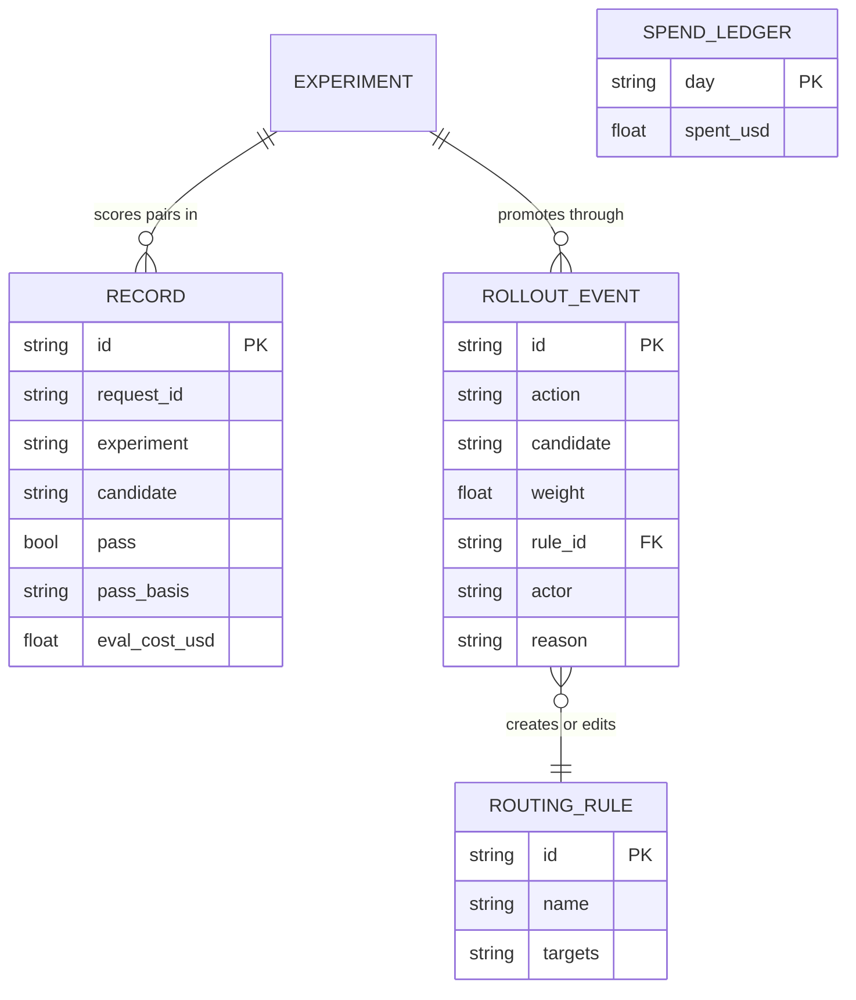
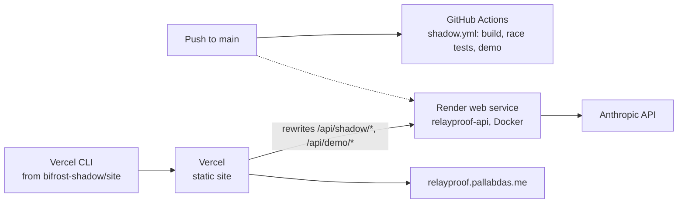

# Architecture

How the parts of RelayProof fit together, for anyone reading the code for the first time. The [README](../README.md) shows how to run it, [CONFIGURATION.md](CONFIGURATION.md) lists every setting, and [TROUBLESHOOTING.md](TROUBLESHOOTING.md) helps with setup problems. The plugin's own design, its live-path guarantees and its data flow step by step are in [`bifrost-shadow/ARCHITECTURE.md`](../bifrost-shadow/ARCHITECTURE.md); this page covers the whole system around it.

Each part below has a status: **Implemented** (works end to end), **Partial** (code exists but is not wired up) or **Planned** (only the docs or the UI expect it). Every diagram is followed by the files it was drawn from. Paths are relative to the repository root.

## The parts

Sources: `bifrost-shadow/deploy/entrypoint.sh:24`, `bifrost-shadow/deploy/entrypoint.sh:52`, `bifrost-shadow/deploy/entrypoint.sh:66`, `bifrost-shadow/deploy/entrypoint.sh:70`, `bifrost-shadow/examples/shadow-demo/frontdoor/main.go:295`, `bifrost-shadow/transports/bifrost-http/handlers/shadow.go:57`, `bifrost-shadow/plugins/shadow/main.go:363`, `bifrost-shadow/plugins/shadow/worker.go:50`.

- **The plugin** (`bifrost-shadow/plugins/shadow/`, Go): samples chat completions in `PreLLMHook` (`main.go:363`), collects the primary answer and queues one job per candidate in `PostLLMHook` (`main.go:459`), replays and scores each job in a worker (`worker.go:50`), keeps records and scorecards (`store.go`), tracks daily spend (`ledger.go`), and runs the canary guard and ramp (`rollout.go`).
- **The shadow API** (`bifrost-shadow/transports/bifrost-http/handlers/shadow.go`, `shadow_rollout.go`): nine routes under `/api/shadow/` (`shadow.go:57` to `shadow.go:65`) for the summary, records, export, the canary rule, promotion, rollback and the rollout log. Promotion edits Bifrost's routing rules through the config store.
- **The patches** (`bifrost-shadow/patches/*.patch`): register the plugin as a built-in, wire pricing and the rollback hooks, add the routes, the config schema entry, the docs navigation and the dashboard page.
- **The demo tools** (`bifrost-shadow/examples/shadow-demo/`): a mock upstream with OpenAI and Anthropic faces and an incident switch, a load generator, a fault proxy that fails a share of one model's calls on demand, and the front door.
- **The front door** (`frontdoor/main.go`): the only public port of the hosted backend. It forwards a fixed list of shadow routes with the gateway's setup token attached (`frontdoor/main.go:276`), serves the `/api/demo/*` controls (status, incidents, traffic bursts, visitor questions), sends background traffic while the console is open, and enforces the daily request cap.
- **The site** (`bifrost-shadow/site/`, Vite, React, TypeScript): the landing page, built from static snapshots in `src/data/`, and the live console in `src/live/`, which talks to the gateway through `src/live/shadowClient.ts`, a copy of `bifrost-shadow/api/client/shadowClient.ts`.

| Folder | What it holds | Status |
| --- | --- | --- |
| `bifrost-shadow/plugins/shadow/` | Sampling, comparison, judge, scorecards, spend ledger, canary guard, ramp, rollout log | Implemented |
| `bifrost-shadow/transports/bifrost-http/handlers/` | The `/api/shadow/*` routes, server-side promotion and rollback | Implemented |
| `bifrost-shadow/patches/` | Changes to upstream Bifrost files | Implemented |
| `bifrost-shadow/examples/shadow-demo/` | Mock upstream, load generator, fault proxy, front door, `run.sh`, `dev.sh` | Implemented |
| `bifrost-shadow/deploy/` | The hosted backend container | Implemented |
| `bifrost-shadow/site/` | Landing page and live console | Implemented |
| `bifrost-shadow/api/` | OpenAPI spec, typed TypeScript client, connection guide | Implemented |
| `bifrost-shadow/ui/app/workspace/shadow/` | The Shadow Traffic page for Bifrost's own dashboard | Partial: it predates server-side promotion and creates rules through the routing-rules API |

## Context

Who uses RelayProof and which outside services it talks to.

*C4 level 1, system context: RelayProof and the outside services it calls.*

| Outside service | Data sent | When |
| --- | --- | --- |
| Anthropic API | The demo's prompts (a fixed dataset and visitors' questions), the candidates' replays, and the judge's prompts holding both answers | When `ANTHROPIC_API_KEY` is set and the console is open or a visitor asks a question (`bifrost-shadow/deploy/entrypoint.sh:26`, `bifrost-shadow/deploy/gateway-claude.json`) |
| A visitor's own Bifrost gateway | The console's `/api/shadow/*` calls with the visitor's dashboard credentials or setup token, straight from the browser | When the visitor picks Sign in (`bifrost-shadow/site/src/live/backend.ts`) |
| GitHub | A clone of `maximhq/bifrost` at the pinned commit | At build time, in `bifrost-shadow/scripts/setup.sh` |

## Main request

What happens when an application sends a chat completion through a gateway with the plugin on, and the request is sampled.

Sources: `bifrost-shadow/plugins/shadow/main.go:363`, `bifrost-shadow/plugins/shadow/main.go:459`, `bifrost-shadow/plugins/shadow/worker.go:50`, `bifrost-shadow/plugins/shadow/judge.go`, `bifrost-shadow/plugins/shadow/store.go:19`.

The application gets its answer at step 6. Everything after that runs in the background, and a full queue drops the job instead of waiting.

### Promotion and the canary guard

Sources: `bifrost-shadow/transports/bifrost-http/handlers/shadow.go:226`, `bifrost-shadow/transports/bifrost-http/handlers/shadow_rollout.go`, `bifrost-shadow/plugins/shadow/rollout.go:53`, `bifrost-shadow/plugins/shadow/rollout.go:797`, `bifrost-shadow/plugins/shadow/rollout.go:923`, `bifrost-shadow/plugins/shadow/rollout.go:975`.

## Data model

The plugin keeps three kinds of data in memory and, when `persist_path` is set, writes each beside it. Routing rules created by a promotion live in Bifrost's own config store.

Sources: `bifrost-shadow/plugins/shadow/store.go:19`, `bifrost-shadow/plugins/shadow/store.go:175`, `bifrost-shadow/plugins/shadow/rollout.go:98`, `bifrost-shadow/plugins/shadow/rollout.go:392`, `bifrost-shadow/plugins/shadow/ledger.go:77`.

| Entity | Stored in | What it holds |
| --- | --- | --- |
| Record | Memory, and `<persist_path>` as JSON lines | One primary and candidate pair: prompt, both answers, latency, tokens, cost, the comparison, the judge's verdict, pass or fail and what decided it |
| Rollout event | Memory, and `<persist_path>.rollouts.json` | Every promotion, ramp step, rollback and ramp completion, with the evidence or live health it rested on |
| Spend ledger | Memory, shared across plugin instances in the process, and `<persist_path>.spend.json` | The day's evaluation spend, so a reload or restart does not lift the budget |
| Routing rule | Bifrost's config store | The weighted canary rule a promotion creates and the guard edits |

## Deployment

Sources: `.github/workflows/shadow.yml`, `render.yaml`, `bifrost-shadow/site/vercel.json`, `bifrost-shadow/deploy/Dockerfile`.

CI checks the code but deploys nothing. `render.yaml` sets `autoDeployTrigger: commit` with a build filter on `bifrost-shadow/**`; the dashed arrow marks that the service was created from the public repository URL, so a deploy can also need a manual trigger in the Render dashboard (see [the deployment guide](operations/deployment.md)). The site is deployed by hand with the Vercel CLI and is not connected to Git.

## What is not built yet

| Part | Status | Evidence |
| --- | --- | --- |
| Dashboard page using server-side promotion | Partial | `bifrost-shadow/ui/app/workspace/shadow/` creates rules through the routing-rules API |
| Mirroring for the Responses API, embeddings, images and audio | Planned | `PreLLMHook` returns early for non-chat requests (`bifrost-shadow/plugins/shadow/main.go:363`) |
| Shared state across gateway nodes | Planned | Records, spend and canary health are per node (`bifrost-shadow/README.md`, Limitations) |
