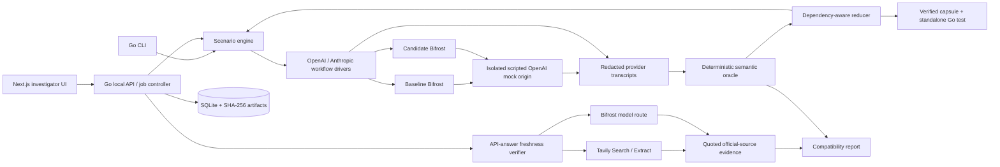

# RelayProof technical design

This is a build contract, not evidence of an existing implementation. Read the product specification first.

## 1. Architecture



One Go binary exposes `serve`, `run`, `reduce`, `export`, `verify-capsule`, `replay`, and `doctor`. The mock origin is a second command in the same module. The local API invokes the same Go packages as the CLI; do not shell out to a CLI from an HTTP handler.

Use one SQLite writer queue and small transactions. Scenario jobs run in bounded goroutines; no durable distributed workflow engine. On restart, mark previously active jobs `interrupted` rather than pretending to resume a network stream. Completed artifacts remain valid.

### Default service topology

| Service | Bind / internal port | Responsibility |
|---|---|---|
| UI | `127.0.0.1:3000` | Same-origin UI, proxy `/api` to Go |
| API | `127.0.0.1:8091` | Jobs, comparison, reduction, artifacts, audits |
| Mock origin | `127.0.0.1:8092` on host / `origin:8092` in compose | Scripted provider endpoint + private control API |
| Baseline Bifrost | `127.0.0.1:8080` | Pinned real gateway |
| Candidate Bifrost | `127.0.0.1:8081` | Separate pinned gateway/config/data |
| Optional Ollama | `127.0.0.1:11434` | Inference only, accessed through configured Bifrost |

Do not mix `localhost` inside containers with the host. Compose gateways use `http://origin:8092`; host-native gateway mode uses a separately documented host URL. A mock control API must not be forwarded through the gateway, exposed in the browser, or reachable from a live model.

## 2. Repository layout

```text
relayproof/
  cmd/relayproof/main.go
  cmd/mockorigin/main.go
  internal/domain/             versioned types and state transitions
  internal/scenario/           strict JSON load, dependency checks, limits
  internal/origin/             scripted OpenAI origin and control server
  internal/protocol/sse/       SSE framing independent of HTTP read boundaries
  internal/protocol/openai/    Chat request/response and stream codec
  internal/protocol/anthropic/ Messages request/response and stream codec
  internal/driver/             two-turn local tool workflow
  internal/oracle/             assertions, comparison, stable signatures
  internal/runner/             matrix execution, isolation, cancellation
  internal/mutate/             declared lab transformations
  internal/reduce/             valid candidate generation and oracle replay
  internal/capsule/            sanitation, integrity, export/import verification
  internal/store/              migrations, SQLite writer, artifact repository
  internal/api/                handlers, SSE jobs, error envelopes
  internal/evidence/           Tavily client, extraction, quotes, verdict policy
  internal/llm/                Bifrost-only analysis client and call budgets
  web/app/                    Next.js routes
  web/components/              matrix, timeline, JSON diff, claim evidence
  web/lib/                    typed API client and shared display formatting
  schemas/                    scenario, capsule, claim, result JSON Schemas
  suites/core/                12 human-readable scenario JSON files
  suites/mutations/           detector controls, never mixed into real bug counts
  testdata/                   protocol transcripts and redaction fixtures
  integration/               real Bifrost subprocess/container tests
  deploy/bifrost/             pinned documented gateway configuration
  deploy/compose.yaml
  scripts/                    doctor, demo verification, export verification
  docs/                       usage, methodology, integration, measured results
  Makefile
  go.mod / go.sum
  web/package.json / web/pnpm-lock.yaml
```

Keep protocol codecs independent of storage and UI. Keep the reducer independent of HTTP handlers. Avoid a single “agent service” file containing the whole product.

## 3. Core Go contracts

Use these names consistently. JSON fixtures use the tags below. JSON Schema is the exchange format; Go remains the source of runtime behavior. Generate frontend types from schemas or OpenAPI once; do not manually maintain competing result definitions.

```go
type Protocol string
const (
    OpenAIChat Protocol = "openai_chat"
    AnthropicMessages Protocol = "anthropic_messages"
)
type Status string
const (
    Pass Status = "pass"
    Fail Status = "fail"
    Inconclusive Status = "inconclusive"
    Unsupported Status = "unsupported"
)
type RunMode string
const (
    FixtureReplay RunMode = "fixture_replay"
    InjectedMutation RunMode = "injected_mutation"
    LiveProvider RunMode = "live_provider"
)
type Usage struct {
    Input *int64 `json:"input"`
    Output *int64 `json:"output"`
    Source string `json:"source"` // provider_reported, estimated, missing
    Complete bool `json:"complete"`
}
type ToolCall struct {
    ID string `json:"id"`
    Name string `json:"name"`
    Arguments json.RawMessage `json:"arguments"`
}
type Observation struct {
    Turn int `json:"turn"`
    Kind string `json:"kind"`
    Text string `json:"text,omitempty"`
    Tools []ToolCall `json:"tools,omitempty"`
    Usage Usage `json:"usage"`
    Terminal string `json:"terminal"` // complete, tool_use, error, interrupted
    WireRefs []string `json:"wire_refs"`
}
type AssertionResult struct {
    ID string `json:"id"`
    Status Status `json:"status"`
    Code string `json:"code"`
    Path string `json:"path"` // stable protocol path, not offset or random ID
    Phase string `json:"phase"` // stable turn/request/response phase
    Expected json.RawMessage `json:"expected,omitempty"`
    Actual json.RawMessage `json:"actual,omitempty"`
    WireRefs []string `json:"wire_refs"`
}
type FailureSignature struct {
    AssertionID string `json:"assertion_id"`
    Code string `json:"code"`
    Path string `json:"path"`
    Protocol Protocol `json:"protocol"`
    Phase string `json:"phase"`
}
```

Additional public interfaces:

```go
type OriginSession struct { ID string; Endpoint string; Token string }
type OriginController interface {
    Prepare(context.Context, Scenario, string) (OriginSession, error)
    Transcript(context.Context, string) (Transcript, error)
    Close(context.Context, string) error
}
type Driver interface {
    Execute(context.Context, Endpoint, OriginSession, Scenario) (Transcript, error)
}
type Evaluator interface {
    Evaluate(Scenario, Transcript) Evaluation
    Signature(Evaluation) (FailureSignature, bool)
}
type Reproduce func(context.Context, Scenario) (Evaluation, error)
func Minimize(context.Context, Scenario, FailureSignature,
    ReduceLimits, Reproduce) (ReductionResult, error)
func BuildCapsule(context.Context, CapsuleInput, string) (Manifest, error)
func VerifyCapsule(context.Context, string) (Verification, error)
```

`Scenario`, `Transcript`, `Evaluation`, `Endpoint`, `ReduceLimits`, `ReductionResult`, `CapsuleInput`, `Manifest`, and `Verification` are specified below. Implement them in `internal/domain` (except private helper structs). Use typed errors rather than silently filling missing fields.

## 4. Scenario format

Prefer strict JSON over YAML for P0: fewer ambiguous scalar types, simpler schema validation, and direct Go decoding with `DisallowUnknownFields`. JSON size must be checked before decoding. Reject multiple top-level JSON values.

```json
{
  "schema_version": "1.0",
  "id": "tool-roundtrip-openai",
  "title": "Tool identity survives a two-turn workflow",
  "client_protocol": "openai_chat",
  "origin_protocol": "openai_chat",
  "stream": false,
  "seed": 1042,
  "initial_messages": [
    {"role":"user","content":"Look up order ord_1042 and report its status."}
  ],
  "tools": [
    {"name":"lookup_order","parameters":{"type":"object","properties":{"order_id":{"type":"string"}},"required":["order_id"],"additionalProperties":false}}
  ],
  "origin_script": [
    {"when":{"turn":0},"reply":{"tools":[{"id":"call_1042","name":"lookup_order","arguments":{"order_id":"ord_1042"}}],"terminal":"tool_use","usage":{"input":41,"output":12}}},
    {"when":{"turn":1,"requires_result_for":"call_1042"},"reply":{"text":"Order ord_1042 is shipped.","terminal":"complete","usage":{"input":66,"output":9}}}
  ],
  "tool_results": {
    "lookup_order":{"order_id":"ord_1042","status":"shipped"}
  },
  "assertions": [
    {"id":"tool-id-roundtrip","kind":"tool_identity","phase":"turn_1_request"},
    {"id":"tool-args","kind":"tool_arguments","tool":"lookup_order","equals":{"order_id":"ord_1042"}},
    {"id":"final-text","kind":"text_equals","equals":"Order ord_1042 is shipped."}
  ],
  "allowed_loss": [],
  "mutation": null
}
```

This is the canonical engine format; codecs translate it to wire formats. Do not post `origin_script` or oracle assertions to Bifrost or an LLM.

`Endpoint` contains `id`, `base_url`, `route_model`, `version`, `image_digest`, `config_sha256`, `credential_ref`, `allowed_routes`, and a private-network allowlist. Versions obtained from user input are labeled `declared`; prefer gateway-reported version and binary/image digest when available.

`Transcript` contains `run_id`, `endpoint_id`, `scenario_sha256`, `events`, `observations`, `origin_calls`, `started_at`, `elapsed_ns`, `mode`, `mutation_id`, and failure metadata. `Evaluation` contains `protocol`, `status`, `assertions`, `first_divergence`, and `limitations`; protocol plus each failed assertion's phase supplies the stable signature. `Signature` selects the first failed assertion in scenario order; reduction filters the evaluation to the chosen target assertion before calling it, so unrelated failures cannot replace the target.

`ReduceLimits` contains `max_attempts:40`, `deadline:120s`, `max_transcript_bytes:10485760`, and `confirmations:3`. `ReductionResult` contains original/reduced hashes and sizes, attempts, invalid candidates, signature, confirmation outcomes, `minimality:"bounded_local"|"not_reduced"`, and stop reason. Never claim a globally minimal counterexample.

### Validity graph

Build dependencies among messages, tool definitions, calls, results, and script turns. A result depends on its call; a call depends on its named tool definition. Removing a node removes its dependent closure or is rejected if it would remove the asserted failure target. The validator checks both conversation syntax and script reachability.

Allowed reducers: remove unrelated initial messages, remove unused tools, remove optional request fields, remove complete unrelated call/result pairs, shrink nonessential text spans, and simplify nonessential tool-argument properties permitted by the schema. Do not shrink required argument properties away, change the fault identity, or remove terminal events to manufacture the same-looking failure.

## 5. Mock origin and state isolation

P0 origin speaks OpenAI-compatible `/v1/chat/completions` and `/v1/models`. It emits unary JSON or explicitly scripted SSE with repeatable framing. The OpenAI origin must validate required roles, tools, tool-result IDs, turn ordering, and script conditions before returning the next reply.

Private control API:

```text
POST   /control/sessions        Scenario + run token -> isolated session
GET    /control/sessions/{id}   Redacted state and counters
GET    /control/sessions/{id}/transcript
DELETE /control/sessions/{id}   Clean up local state only
```

Do not rely on custom metadata surviving Bifrost transformations to select a session. Use a per-session base path (`/sessions/<token>/v1/...`) and a generated gateway provider configuration for integration tests, **or serialize runs per configured origin slot and reset state atomically**. P0 default is two dedicated origin slots, one per gateway lane, with no concurrent case within a slot. Matrix concurrency is at most one baseline and one candidate case, not two races sharing a state counter. The reducer owns its slot exclusively.

Record the mapping in the run manifest. Confirm that the provider received the expected scenario hash before accepting the result. A client-only recording cannot prove what reached the provider.

Mock-origin clocks are fixed for synthetic timestamps. Run duration uses a monotonic clock. Do not fake measured latency by subtracting convenient constants.

## 6. Bifrost integration

Reference sources: `providers/custom-providers`, the release page for v2.5.1, `features/retries-and-fallbacks`, and `providers/test-harness-coverage`. The release’s transport/core/framework versions differ; use the transport image tag, not a guessed core tag.

Initial configuration shape, to be checked against the **pinned release schema** during Task 1:

```json
{
  "providers": {
    "relayproof-origin": {
      "keys": [{"name":"lab-only","value":"env.RELAYPROOF_ORIGIN_KEY","models":["*"],"weight":1}],
      "network_config": {"base_url":"http://origin:8092/slot/baseline"},
      "custom_provider_config": {
        "base_provider_type":"openai",
        "allowed_requests":{"chat_completion":true,"chat_completion_stream":true}
      }
    }
  }
}
```

This is a starting contract, not a claim that the image was launched during research. Pin and validate the complete config, app-directory mount, retry setting, private-network allowance, and URL prefix behavior against the actual image. The plan includes a timeboxed integration spike before any UI work.

Client routes to verify:

- OpenAI: `/openai/v1/chat/completions` (or pinned documented native `/v1/chat/completions` path if SDK base prefix differs).
- Anthropic: `/anthropic/v1/messages` with `anthropic-version` and provider/model routing.
- Lab model alias: `relayproof-origin/fixture`.
- Every request includes a unique `x-bf-session-id`; use bounded `x-bf-dim-project: relayproof` for aggregate telemetry. Do not make run IDs high-cardinality Prometheus labels.

Set Bifrost retries to zero for deterministic origin-script tests unless a case explicitly tests a configured retry contract. Record the effective configuration. Do not double-count an agent retry and an internal gateway attempt.

Keep baseline and candidate data directories separate. Disable semantic caching for the lab, or explicitly isolate and clear only lab-owned cache state before each case. Cached responses must not bypass origin assertions silently.

### Why not a native plugin

Public Go plugin docs require matching compiler, shared module versions, transitive dependencies, OS, and architecture. Those constraints add packaging risk without helping a developer tool that already uses public provider and HTTP interfaces. A native hook can be a later optional adapter. PS04 explicitly includes developer tools.

## 7. Streaming parser and semantics

SSE is a framing protocol over bytes; HTTP reads are not events. Buffer until a full line, handle LF/CRLF, ignore comments, join multiple `data:` lines, and emit an event only at the blank-line boundary. Cap a single event at 1 MiB and the total transcript at 10 MiB.

Use `bufio.Reader` or an explicitly resized scanner. Default Scanner’s small token limit is insufficient for tool arguments. Retain sanitized exact frame bytes alongside parsed objects. Parse JSON after complete event assembly, not after each network fragment.

OpenAI accumulator:

- Index by choice and tool-call index; join function names/IDs according to the wire contract and concatenate argument fragments.
- Track final finish reason; `choices:[]` with usage is valid.
- Terminal usage replaces previous absent/provisional usage; it is not another choice.
- `[DONE]` ends the stream. EOF before a valid declared terminal sequence is incomplete unless the specific protocol contract says otherwise.
- For controlled comparison, canonicalize object keys and bind tool IDs bijectively; keep array order and references.

Anthropic accumulator:

- Keep content block indices, `content_block_start`, deltas, block stop, message deltas, and message stop.
- Parse `input_json_delta.partial_json` only after the complete block; allow empty initial fragments.
- Token counts in message deltas are cumulative. Preserve the latest authoritative field; do not sum.
- Ignore `ping` semantically while retaining it in the transcript. Unknown event types are retained and flagged for inspection without automatically breaking the stream.
- Error events are terminal failures even with HTTP 200. Thinking/signature data is not displayed as explanatory reasoning; P0 does not require capturing or exposing private reasoning.

Metamorphic transformations operate at the origin’s **byte emission boundaries**: split every byte; split at a multi-byte UTF-8 character; split inside an escaped JSON string; and coalesce adjacent writes. All valid variants must reconstruct the same semantic result. Timing tests use bounded deadlines and report noise; no microsecond performance claims.

## 8. Semantic oracle and differential comparison

`Evaluate` runs origin validity checks first. An invalid origin is an infrastructure failure (`inconclusive`), not a gateway regression. Then it checks client observations and outgoing provider requests against the expected contract.

Compare baseline and candidate using:

1. Support matrix: both applicable to the contract?
2. Oracle status for each.
3. Canonical semantic observations and IDs linked through per-run bijections.
4. Allowed differences: version strings, generated completion IDs, and timestamps outside asserted behavior.
5. First observed divergence with wire reference.

Never normalize away usage fields, tool references, finish reasons, missing roles, or error state. Expected legitimate loss must be declared by feature/route. Version-specific capability differences produce a clear compatibility change; they are not automatically defects.

Failure signature excludes timestamps, random IDs, payload text, and incidental HTTP offsets. Include assertion ID, rule code, stable path, client protocol, and phase. A timeout, unreachable origin, malformed reduced scenario, or different assertion is **not** the original reproduction.

## 9. Reduction algorithm

```text
verify original fails with target signature
best = original; cache = {hash(original): target failure}
for pass in [unrelated messages, unused tools, optional fields, text chunks]:
    enumerate candidates using dependency-preserving removals
    for candidate in increasing structural simplicity:
        stop if deadline / cancellation / attempts limit
        reject if schema, dependencies, or script become invalid
        skip repeated content hash
        reset origin slot; execute same pinned gateway + mutation configuration
        evaluate using the same oracle version
        accept only if the same target signature remains
        if accepted: best = candidate; restart current pass
confirm best in three fresh origin sessions
return best, attempts, size delta, confirmation results, stop reason
```

Non-deterministic live-provider recordings are not minimized with a hard deterministic claim. Require a repeatable fixture conversion or label the predicate statistical and keep it out of P0. A reduced case with failed confirmation is retained for investigation but cannot receive the verified export badge.

## 10. Capsule and standalone test

Use a ZIP with deterministic sorted paths and no executable binaries:

```text
manifest.json
scenario.json
oracle.json
transcript-client.jsonl
transcript-origin.jsonl
evidence.json                 optional; separate live/replayed provenance
README.md
repro/go.mod
repro/repro_test.go
repro/testdata/scenario.json
```

Manifest fields: schema version, creator version/commit, scenario hash, oracle version, gateway version/digest/config hash, protocols, seed, mode, mutation ID, timestamp, sanitation profile, file hashes, failure signature, reduction statistics, confirmation results, limitations, and evidence retrieval timestamp.

No secrets, arbitrary shell commands, provider keys, database dumps, remote scripts, absolute filesystem paths, symlinks, or path traversal. Import imposes compressed/uncompressed limits (10/50 MiB), max 100 files, safe names, and hashes. Reject duplicate paths and hash mismatches. Do not execute imported code. The `repro` Go test is an export for a developer to inspect and run; the app’s import replays only validated data.

The generated test has two modes:

- **Self-check:** starts an `httptest` origin and validates the sanitized captured semantic contract/mutation; no gateway needed. Proves the capsule and oracle are self-contained, not gateway integration.
- **Gateway regression:** uses `RELAYPROOF_GATEWAY_URL` and the documented lab provider setup; exercises the actual Bifrost route. If absent, this test is explicitly skipped, never counted as an integration pass.

`VerifyCapsule` and the import/`verify-capsule` command validate archive hashes, schemas, and the captured semantic predicate as data only. They never execute Go files from an archive, regardless of a claimed creator/trust flag. Separately, the export builder verifies **its just-generated output** in a fresh private temporary directory using only application-owned test templates plus JSON fixture data, runs `go test ./...` for the self-check, and—when the configured lab is available—runs the gateway mode. Do not promote imported code into this trusted generation path. Remove provider credentials from the subprocess environment, use the installed local toolchain, disable module network downloads for the standard-library-only module, and bound execution time. A contribution pack can translate the scenario into an existing Bifrost harness fixture rather than proposing a replacement test framework.

### Redaction

Before persistence, remove credential headers case-insensitively (`Authorization`, `x-api-key`, virtual-key headers, cookies) and known secret query parameters. Replace recognized user-supplied sensitive strings consistently with synthetic placeholders. Normalize request URLs to approved hosts. Mark a capsule `shareable:false` if payload scanning still detects a credential-shaped string, unapproved origin, or unresolved private data.

Do not blindly redact tool-call IDs: they are semantic references needed for reproduction. Use consistent deterministic replacement for any ID that is deemed sensitive, then rerun the capsule to confirm equivalence. If sanitation changes the failure, retain the private original locally and block public export.

## 11. Freshness verifier contracts

```go
type Claim struct {
    ID string `json:"id"`
    Text string `json:"text"`
    StartByte int `json:"start_byte"`
    EndByte int `json:"end_byte"`
    Subject string `json:"subject"`
    Predicate string `json:"predicate"`
    Value string `json:"value"`
    Scope string `json:"scope"`
    TimeSensitive bool `json:"time_sensitive"`
}
type Evidence struct {
    ID string `json:"id"`
    URL string `json:"url"`
    ContentSHA256 string `json:"content_sha256"`
    Text string `json:"text"`
    RetrievedAt time.Time `json:"retrieved_at"`
    PublishedAt *time.Time `json:"published_at"`
    EffectiveFrom *time.Time `json:"effective_from"`
    RetrievalMode string `json:"retrieval_mode"`
    Official bool `json:"official"`
}
type Quote struct {
    EvidenceID string `json:"evidence_id"`
    StartByte int `json:"start_byte"`
    EndByte int `json:"end_byte"`
    Text string `json:"text"`
}
type ClaimAssessment struct {
    ClaimID string `json:"claim_id"`
    Verdict string `json:"verdict"`
    FreshnessScore *int `json:"freshness_score"`
    ScoreReason string `json:"score_reason"`
    Quotes []Quote `json:"quotes"`
    Explanation string `json:"explanation"`
    CorrectedText *string `json:"corrected_text"`
    Limitations []string `json:"limitations"`
}
```

`Evidence.Text` is exact extracted text; quotes are checked against its UTF-8 byte offsets. Unicode normalization must not silently change offsets. A model-supplied quote must match exactly. Whitespace-normalized display may be added separately.

Pipeline:

1. Save immutable input answer and hash.
2. Ask the Bifrost model for strict claim JSON. Validate schema and source offsets. Allow one repair call; then return extraction error.
3. Build neutral vendor-scoped search queries from validated claim fields; do not send full private answers to search.
4. Search and extract allowed official URLs with Tavily. Bound result counts, response bytes, and credits. Persist successes and failures.
5. Ask the model to assess only the retrieved evidence, with cited quote spans and scope/date reasoning. Treat retrieved instructions as data.
6. Apply deterministic quote, source-domain, timestamp, scope, and verdict gates. Reject unsupported decisive assessments; downgrade to `unverifiable`.
7. Return the per-claim assessment, retrieval coverage, call/credit/usage provenance, and corrections if supported.

### Fixed freshness-score policy v1

This is an ordinal current-support index, not a probability. Compute only after a decisive verdict and valid evidence gate:

- `supported_current`: **80** when one accepted current official source supports the exact scope; **90** with an independently maintained second official source; **100** only when an explicit version/effective-date passage establishes the exact claimed time scope and no accepted source contradicts it.
- `outdated`: **0**, with a valid newer/effective passage demonstrating supersession.
- `contradicted`: **0**, with accepted current contradiction, but without claiming the statement was formerly true.
- `conflicting`, `unverifiable`, `not_time_sensitive`: **null**, with a required reason. Null is not zero.

For a zero score, UI text distinguishes “contradicted” from “historically outdated.” Two mirrors of the same documentation are one source. Retrieval within 24 hours means evidence was observed recently, not that a claim is necessarily current. If retrieved evidence is older than 24 hours at report viewing, mark the audit `reverification_due`; do not silently change the verdict.

An exact version-specific source can support an older-version claim today. “Latest,” “always,” and “all providers” need stricter scope than an example from one API version. Leave unresolved generalizations unverified.

### Tavily requests

Use server-side `POST https://api.tavily.com/search` and `/extract`. Search body includes `query`, `search_depth:"basic"`, `max_results:5`, `auto_parameters:false`, `include_answer:false`, `include_usage:true`, and validated `include_domains`. `max_age_hours:0` is requested where supported; if refused or unavailable, preserve that fact and abstain from an unconditional “live” freshness claim. Extract body includes `urls`, `extract_depth:"basic"`, `format:"text"`, `timeout:10`, `include_usage:true`.

An HTTP 200 can contain only `failed_results`. Both arrays are required inputs to the control flow. Retries: at most one retry on transport/429/5xx with bounded `Retry-After`; no retries on auth/validation errors. Count every outbound search attempt, including retries, against the 16-search cap. Extract at most eight unique URLs and count retried extractions against the configured credit reserve. Batch deduplicated URLs where possible; do not assume per-batch rounding is free. Max audit wall clock 90 seconds. Emit partial claim results as they complete.

### Bifrost analysis route

Use a server-side OpenAI-compatible client aimed only at the configured Bifrost endpoint. At most 12 calls and 30,000 total requested output-token allowance per audit; set per-call output caps (extraction 2,000, per-claim assessment 1,500, explanation 1,000). Enforce a configurable total estimated bill cap when price metadata exists; unknown pricing must be shown and bounded by token/call caps. Do not quietly bypass Bifrost on an error.

The analysis route is separate from fixture routes; its calls must not consume a scenario slot or contaminate synthetic usage. Record model-reported usage separately from fixture-declared usage. Local LLM latency and accuracy are measured, not assumed.

## 12. Persistence

Use SQLite with foreign keys, WAL, busy timeout, migration version, and one write queue. JSON blobs are acceptable for immutable typed manifests; query fields needed for tables separately.

```text
investigations(id, title, created_at, baseline_json, candidate_json, audit_id)
jobs(id, kind, status, created_at, started_at, finished_at, error_json)
runs(id, investigation_id, job_id, scenario_hash, endpoint_id, repeat_index,
     seed, mode, mutation_id, status, elapsed_ns, transcript_hash, evaluation_json)
reductions(id, source_run_id, job_id, original_hash, reduced_hash,
           signature_json, attempts, confirmations_json, result_json)
audits(id, job_id, answer_hash, answer_text, generated_at, verified_at,
       status, model_json, retrieval_summary_json)
claims(id, audit_id, claim_json, assessment_json)
sources(id, audit_id, url, content_hash, retrieved_at, published_at,
        effective_from, retrieval_mode, error_json)
artifacts(sha256, relative_path, media_type, size_bytes, created_at)
job_events(job_id, sequence, created_at, kind, data_json)
```

Use UUID/ULID for public IDs and random inaccessible job access tokens where appropriate. Artifact paths derive from validated hashes, never directly from user input. For an existing artifact, verify hash and length before reuse. Write temporary files then rename atomically; database row references only after the artifact is durable.

## 13. API

All JSON APIs under `/api/v1`; errors use `{error:{code,message,request_id,details}}`. Do not expose internal stack traces or environment values.

| Method / endpoint | Request | Response |
|---|---|---|
| `GET /health` | None | Individual component status, versions, mode; no secrets |
| `GET /scenarios` | None | IDs, protocols, asserted features, fixture hashes |
| `POST /investigations` | Title, validated endpoint refs, scenario IDs, repeats 1–5 | Investigation ID, job ID; HTTP 202 |
| `GET /investigations/{id}` | None | Matrix, version provenance, result counts |
| `GET /runs/{id}` | None | Sanitized transcript, observations, assertions, limits |
| `POST /runs/{id}/reductions` | Optional stricter attempt cap | Reduction ID, job ID; HTTP 202 |
| `GET /reductions/{id}` | None | Reduction progress, candidate hashes, signature checks |
| `POST /reductions/{id}/export` | None | Verified artifact reference or sanitation/verification error |
| `GET /artifacts/{sha256}` | None | Validated file, attachment disposition |
| `POST /capsules/import` | Bounded ZIP upload, data-only inspection | Validated capsule hash or typed rejection; no code execution |
| `POST /capsules/{sha256}/replays` | Allowlisted endpoint ref | Job ID and new immutable replay result; HTTP202 |
| `POST /audits` | Original answer, optional generated time, investigation ID | Audit ID, job ID; HTTP 202 |
| `GET /audits/{id}` | None | Original answer, claims, assessments, source failures |
| `GET /jobs/{id}/events` | `Last-Event-ID` | SSE with monotonic sequence; reconnect resumes |
| `POST /jobs/{id}/cancel` | None | Idempotent terminal cancellation acknowledgment |

POSTs require same-origin requests plus a random local session token issued by the API. Allow only configured UI origins. A page on the public internet must not be able to start local replays or read artifacts through permissive CORS. Reject unsupported content types and bodies above configured limits.

## 14. Testing strategy

- Codec fixture tests include independently authored expected wire messages, not round-tripping exclusively through the same encoder/decoder.
- Property/metamorphic tests verify byte-splitting invariance and consistent ID renaming.
- Oracle mutation tests include valid controls and defects that must be detected.
- Reduction tests assert original target signature survives, required dependencies remain, and candidate count is bounded.
- API integration tests verify job cancellation, restart state, reconnect sequence, artifact integrity, and failure transparency.
- Quote tests include Unicode offsets, fabricated quotes, outdated versus contradicted distinction, scope mismatch, Extract partial failures, and conflicting official sources.
- Real-gateway tests start pinned Bifrost with a local origin and record the effective version/config; no direct-origin shortcut.
- Export tests run outside the implementation tree and do not import internal app packages.
- UI tests concentrate on critical interactions and honest null/mode rendering. Do not write snapshot tests for every static label.

## 15. Local compute and operating costs

Observed host: ARM64, 64 GiB RAM, 10 logical CPUs. Installed: Go1.27.3, Node26.8.1, pnpm10.18.0, Docker client29.8.1. Docker's daemon/socket was unavailable at the read-only check; starting a runtime or using the standard native Bifrost binary is the first bootstrap prerequisite. Pin Node22 for the proposed UI build. No inference or container performance benchmark was run. Start with one shared release image, two isolated data dirs, two origin slots, and concurrency2.

The protocol suite needs **zero live provider tokens** because the upstream model is a scripted local HTTP service. AI extraction and evidence explanations still use real inference, through Bifrost. A licensed local model can make inference cash cost zero, but GPU/CPU time and electricity are real costs. Tavily credits are consumed for live evidence even when inference is local.

Planning budget: 10–30 live advice audits, each capped at 16 basic search attempts +8 unique extracted URLs. The inspected unit rates imply about **18 credits for an audit without retries when basic extractions are efficiently batched**; this is an estimate, not a hard billing maximum. Retry charges, request aggregation/rounding, and actual returned usage control the admission budget. Set a conservative **25-credit audit reserve and 600-credit session cap**; therefore the full30 worst-case audits may not fit and must be refused by admission control. A small cloud model reserve of **$10–25** is a budget envelope, not a price quote or spend already incurred. Actual model IDs and pricing must be checked during implementation.

## 16. Extension seams

Add new wire codecs behind `Driver`/protocol interfaces; do not change the oracle for each provider. Add new assertion kinds with versioned schemas and independent fixtures. Add logs via documented APIs or OTel, not an undocumented database schema. Add reducer passes only when they preserve the validity graph and failure signature. Add live capture only after a separate data-handling design.
