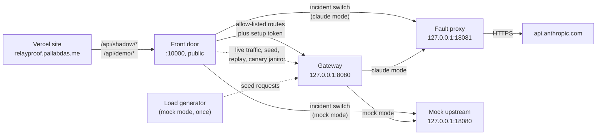

# Deployment and operations

Where RelayProof runs, how it gets there, and where to look when it breaks.

## Hosted site

The live site is at [relayproof.pallabdas.me](https://relayproof.pallabdas.me/), with the live console at [/live](https://relayproof.pallabdas.me/live). Vercel serves the static Vite and React build of `bifrost-shadow/site`. Two pages are built: `index.html` (the overview) and `live.html` (the console) (`bifrost-shadow/site/vite.config.ts:23-30`). `cleanUrls` serves `live.html` at `/live` (`bifrost-shadow/site/vercel.json:7`).

`vercel.json` sets the build: `pnpm install --frozen-lockfile`, then `pnpm build`, which runs `tsc --noEmit && vite build`, with output in `dist` (`bifrost-shadow/site/vercel.json:3-6`, `bifrost-shadow/site/package.json:8`). It also rewrites two paths to the backend on Render (`bifrost-shadow/site/vercel.json:8-11`):

| Source | Destination |
| --- | --- |
| `/api/shadow/:path*` | `https://relayproof-api.onrender.com/api/shadow/:path*` |
| `/api/demo/:path*` | `https://relayproof-api.onrender.com/api/demo/:path*` |

The console calls these paths on its own origin, so the browser never talks to Render directly and needs no CORS (`bifrost-shadow/site/src/live/backend.ts:4-7`).

The site is deployed with the Vercel CLI from `bifrost-shadow/site`:

```bash
cd bifrost-shadow/site
pnpm install
pnpm build        # optional local check: typecheck and build into dist/
vercel --prod     # deploy to production with the Vercel CLI
```

Operating note: the Vercel project is not connected to the Git repository, so a push to `main` does not update the site. Run the CLI after every site change. The CLI's local project link lives in `.vercel`, which Git ignores (`bifrost-shadow/site/.gitignore:1`). The Vercel project name, team and settings are not recorded in the repository.

## Backend on Render

Render builds the backend from the Blueprint in `render.yaml` at the repository root. The file defines one service (`render.yaml:5-43`):

| Key | Value | Line |
| --- | --- | --- |
| `type` | `web` | `render.yaml:6` |
| `name` | `relayproof-api` | `render.yaml:7` |
| `runtime` | `docker` | `render.yaml:8` |
| `plan` | `starter`. The file's comment gives 512 MB and 0.5 CPU, and says the free plan is too slow to boot the gateway and sleeps when idle. | `render.yaml:9-12` |
| `region` | `virginia` | `render.yaml:13` |
| `dockerfilePath` | `./bifrost-shadow/deploy/Dockerfile` | `render.yaml:14` |
| `dockerContext` | `.` (the repository root) | `render.yaml:15` |
| `healthCheckPath` | `/healthz` | `render.yaml:16` |
| `autoDeployTrigger` | `commit` | `render.yaml:17` |
| `buildFilter.paths` | `bifrost-shadow/**`, `render.yaml`, `.dockerignore` | `render.yaml:18-22` |
| `buildFilter.ignoredPaths` | `bifrost-shadow/site/**` | `render.yaml:23-24` |
| `envVars` | `BIFROST_SETUP_TOKEN` (generated), `ANTHROPIC_API_KEY` (set in the dashboard), `DAILY_REQUESTS` `400`, `CANARY_TTL` `30m`, `INCIDENT_TTL` `3m`, `GOMEMLIMIT` `320MiB` | `render.yaml:25-43` |

As written, a commit that changes a file under `bifrost-shadow/` (outside the site), `render.yaml` or `.dockerignore` triggers a deploy, and a commit that only changes the site does not. The file names no branch. See [CONFIGURATION.md](../CONFIGURATION.md) for what each variable does.

Operating note: the service was created from the public repository URL, so Render may not start a deploy on a new commit even though the file sets `autoDeployTrigger: commit`. After pushing a backend change, check the service in the Render dashboard and use Manual Deploy if no deploy started. How the service is connected to the repository is not recorded in the repository.

### What the image contains

The Dockerfile has two stages (`bifrost-shadow/deploy/Dockerfile:11-36`):

- Build, on `golang:1.27-bookworm`. It copies `bifrost-shadow/` and runs `setup.sh` with `SKIP_UI=1 SKIP_TESTS=1`, which clones upstream Bifrost at the pinned commit, overlays the plugin, applies the patches and builds `bifrost-http` with cgo (`bifrost-shadow/deploy/Dockerfile:13-17`, `bifrost-shadow/scripts/setup.sh:19`, `bifrost-shadow/scripts/setup.sh:85-87`). It then builds `mockupstream`, `loadgen`, `frontdoor` and `faultproxy` without cgo (`bifrost-shadow/deploy/Dockerfile:18-21`). The image build skips the tests; CI runs them.
- Runtime, on `debian:bookworm-slim` with `ca-certificates`, `curl` and `tini`. It runs as user `demo` (uid 10001), copies both gateway configs to `/etc/relayproof/`, sets `PORT=10000` and `WORK_DIR=/home/demo/gateway`, and exposes port 10000 (`bifrost-shadow/deploy/Dockerfile:23-34`). A Docker health check calls `/healthz` every 30 seconds with a 5 second timeout after a 60 second start period (`bifrost-shadow/deploy/Dockerfile:35`). `tini` starts the entrypoint (`bifrost-shadow/deploy/Dockerfile:36`).

`.dockerignore` keeps the build context to `bifrost-shadow/` without the site and without `node_modules` (`.dockerignore:1-5`).

### What the container runs

`entrypoint.sh` chooses a mode. With `DEMO_MODE` unset (`auto`), it runs claude mode when `ANTHROPIC_API_KEY` is set and mock mode otherwise (`bifrost-shadow/deploy/entrypoint.sh:24-27`).

- Claude mode copies `gateway-claude.json` (`bifrost-shadow/deploy/entrypoint.sh:33`). `claude-opus-5-5` answers, `claude-sonnet-5-5` and `claude-haiku-5-5` are shadowed on every request, and `claude-opus-5-5` judges each pair (`bifrost-shadow/deploy/gateway-claude.json:29-41`).
- Mock mode copies `gateway.json` (`bifrost-shadow/deploy/entrypoint.sh:55`). The deterministic mock upstream plays `gpt-4o`, the candidates `gpt-4o-mini` and `llama-3.1-8b`, the judge and the embedding model, with no keys and no spend (`bifrost-shadow/deploy/gateway.json:30-41`).

| Process | Listens on | Mode | Started at |
| --- | --- | --- | --- |
| Mock upstream | `127.0.0.1:18080` | Mock mode. In claude mode only with `START_MOCK=1` and `ANTHROPIC_UPSTREAM` set. | `bifrost-shadow/deploy/entrypoint.sh:48-51`, `bifrost-shadow/deploy/entrypoint.sh:61` |
| Fault proxy, forwarding to `ANTHROPIC_UPSTREAM` or `https://api.anthropic.com` | `127.0.0.1:18081` | Claude mode | `bifrost-shadow/deploy/entrypoint.sh:52` |
| Gateway (`bifrost-http`, app directory `WORK_DIR`) | `127.0.0.1:8080` | Both | `bifrost-shadow/deploy/entrypoint.sh:66` |
| Front door, the only public listener | `:$PORT` (10000) | Both | `bifrost-shadow/deploy/entrypoint.sh:68-70` |
| Load generator, one run of `SEED` (300) requests, 16 at a time | None | Mock mode, after the gateway is healthy | `bifrost-shadow/deploy/entrypoint.sh:87-89` |



Sources: `bifrost-shadow/site/vercel.json`, `bifrost-shadow/deploy/entrypoint.sh`, `bifrost-shadow/deploy/gateway-claude.json`, `bifrost-shadow/deploy/gateway.json`, `bifrost-shadow/examples/shadow-demo/frontdoor/main.go`.

At start the entrypoint waits up to `BOOT_TIMEOUT` (300) seconds for the gateway's `/health`, because the gateway runs its store migrations and loads the model catalog first. If it never answers, the container exits (`bifrost-shadow/deploy/entrypoint.sh:73-83`). After that, `wait -n` watches every process: if any one exits, the container exits with status 1 so the platform restarts it (`bifrost-shadow/deploy/entrypoint.sh:91-93`).

### Spend caps and self-reset

The front door is `bifrost-shadow/examples/shadow-demo/frontdoor/main.go`. Line numbers without a file name refer to it.

| Limit | Value on Render (claude mode) | How it works |
| --- | --- | --- |
| Requests per UTC day | 400 (`render.yaml:35-36`) | Every request the front door sends to the gateway takes one unit: live traffic, bursts, questions, the start-up seed and the replay after an outage (`:542-559`). The count starts again at UTC midnight (`:535-540`). Past the cap, bursts and questions answer 429 (`:637-641`, `:776-779`). The plugin's candidate and judge calls do not count against it; the plugin's budget caps them. In mock mode the load generator's start-up seed goes straight to the gateway and does not count either (`bifrost-shadow/deploy/entrypoint.sh:87-89`). |
| Background traffic only while watched | One request every 15 seconds, only within 3 minutes of the last console call (`bifrost-shadow/deploy/entrypoint.sh:41-42`) | A console call is any allowed `/api/shadow/*` call (`:340`), `GET /api/demo/status` (`:372`), `POST /api/demo/ask` (`:756`), or `POST /api/demo/incident`, which answers with the status (`:439`). The open console polls the status every 3 seconds (`bifrost-shadow/site/src/live/LiveApp.tsx:145`). With nobody watching, the loop sends nothing (`:672-674`). In mock mode `WATCHED_FOR` is unset, so traffic runs every second all the time (`:94`, `:107`), until the 400 cap from `render.yaml` stops it for the rest of the UTC day (`:675-677`). |
| Questions per visitor | 20 per client address per hour, up to 600 characters each (`:109-110`) | Checked on `POST /api/demo/ask` (`:767-775`). The client address is the first `X-Forwarded-For` entry, or the socket address (`:976-988`). |
| POST calls per visitor | 30 per client address per minute (`:98`) | Applies to every POST: promote, rollback, incident, burst and ask (`:962-974`). |
| Burst size | Up to 30 requests per call, one burst at a time (`bifrost-shadow/deploy/entrypoint.sh:46`) | `POST /api/demo/traffic` refuses a second burst while one runs (`:629-636`). Mock mode allows 60 (`bifrost-shadow/deploy/entrypoint.sh:60`). |
| Answer length | `max_tokens` 1024 and `reasoning_effort` low on the front door's requests; the judge gets `max_tokens` 2048 and effort low (`bifrost-shadow/deploy/entrypoint.sh:37-38`, `bifrost-shadow/deploy/gateway-claude.json:41`) | Added to every request the front door sends (`:725-733`). |
| Plugin daily budget | $5 per UTC day (`bifrost-shadow/deploy/gateway-claude.json:45`) | Caps candidate and judge spend; primary calls are not in it. Mock mode allows $50 (`bifrost-shadow/deploy/gateway.json:45`). |

The demo returns to its starting point on its own:

- A simulated outage clears after `INCIDENT_TTL`, 3 minutes (`render.yaml:39-40`, `:467-480`).
- When the last outage clears, the front door waits `RESET_AFTER_INCIDENT` (20 seconds), deletes the records and replays `SEED` requests, 40 in claude mode. Spend, canaries and the rollout log are kept (`:456-465`, `:508-533`, `bifrost-shadow/deploy/entrypoint.sh:43`).
- The janitor checks every 30 seconds and rolls back any canary live longer than `CANARY_TTL`, 30 minutes (`render.yaml:37-38`, `:880-930`).
- At start, in claude mode, the front door sends `SEED` (40) requests if the gateway has no completed comparisons yet (`:561-585`, `bifrost-shadow/deploy/entrypoint.sh:69-70`).

The `bifrost-shadow/README.md` "Try it live" section describes the same caps (`bifrost-shadow/README.md:32-40`).

## Check a deploy

1. In the Render dashboard, confirm the deploy finished and the health check passes. `/healthz` answers `ok` only when the gateway's `/health` answers 200, and it does not count as a console visit (`bifrost-shadow/examples/shadow-demo/frontdoor/main.go:312-333`).
2. Read the demo status once and check `upstream`: `anthropic` in claude mode, `mock` in mock mode (`bifrost-shadow/examples/shadow-demo/frontdoor/main.go:401`, `bifrost-shadow/deploy/entrypoint.sh:35`, `bifrost-shadow/deploy/entrypoint.sh:56`).

   ```bash
   curl -s https://relayproof.pallabdas.me/api/demo/status \
     | python3 -c 'import json,sys; d=json.load(sys.stdin); print(d["upstream"], d["primary_model"], d["requests_today"], d["daily_request_cap"], d["live_traffic_only_when_watched"])'
   ```

   Expect `anthropic claude-opus-5-5 <n> 400 True` in claude mode. This call counts as a console visit (`bifrost-shadow/examples/shadow-demo/frontdoor/main.go:372`), so in claude mode it starts paid background traffic for 3 minutes: about 12 requests, each shadowed to two candidates and judged twice. Do not poll it.
3. Optionally confirm the route boundary. The front door refuses these calls before forwarding anything, and they do not count as a console visit (`bifrost-shadow/examples/shadow-demo/frontdoor/main.go:301-308`, `bifrost-shadow/examples/shadow-demo/frontdoor/main.go:336-339`):

   ```bash
   curl -s -o /dev/null -w '%{http_code}\n' -X DELETE https://relayproof.pallabdas.me/api/shadow/records   # 403: reset is not exposed
   curl -s -o /dev/null -w '%{http_code}\n' https://relayproof-api.onrender.com/v1/chat/completions        # 404: inference is not exposed
   ```

   The second call goes to the Render URL because Vercel rewrites only `/api/shadow/*` and `/api/demo/*`, so the same path on the site never reaches the front door.

## Environments

| Environment | URL | Deploys from | Settings |
| --- | --- | --- | --- |
| Production site | https://relayproof.pallabdas.me/ (console at `/live`) | `bifrost-shadow/site`, with the Vercel CLI | `bifrost-shadow/site/vercel.json`. Vercel project settings are not recorded in the repository. |
| Production backend | https://relayproof-api.onrender.com (`bifrost-shadow/site/vercel.json:9-10`) | The Blueprint in `render.yaml`, on a matching commit or by Manual Deploy. No branch is named in `render.yaml`. | Render dashboard, service `relayproof-api`, Environment |
| Preview | Not recorded in the repository. | Not recorded in the repository. CI runs on pull requests but deploys nothing (`.github/workflows/shadow.yml:7-8`). | Not recorded in the repository. |
| Local | `http://localhost:5273` (site dev server, `bifrost-shadow/site/vite.config.ts:16`) and `http://localhost:10000` (the container) | The working tree | `SHADOW_BACKEND` for the site, `docker run -e` for the container (`bifrost-shadow/deploy/Dockerfile:4-9`) |

## Domain

`relayproof.pallabdas.me` serves the Vercel site. The DNS records and where the domain is registered are not recorded in the repository. The backend has no custom domain: the site reaches it at `relayproof-api.onrender.com` through the rewrites (`bifrost-shadow/site/vercel.json:8-11`). The local demo gateway lists the domain as an allowed origin, so the hosted console can sign in to a local gateway (`bifrost-shadow/examples/shadow-demo/gateway/config.json:7`).

## CI

`.github/workflows/shadow.yml` runs on pushes to `main` and on pull requests that touch `bifrost-shadow/**`, the workflow, `render.yaml` or `.dockerignore`, and on manual dispatch (`.github/workflows/shadow.yml:3-9`). A newer run on the same ref cancels the older one (`.github/workflows/shadow.yml:11-13`).

| Job | Runs | Lines |
| --- | --- | --- |
| `backend` ("Plugin, gateway API and key-free demo") | On Go 1.27: `setup.sh` with `SKIP_UI=1` (clone, overlay, patches, plugin and handler tests, gateway build); the plugin tests with the race detector, twice, with coverage; the gateway handler and schema tests with the race detector; `go vet` on the plugin, the handlers and the demo module, plus `go test ./...` in the demo module, which covers the front door, fault proxy and load generator; then the key-free `run.sh` demo against the built gateway. | `.github/workflows/shadow.yml:16-46` |
| `client` ("TypeScript client") | On Node 22: a strict TypeScript 5.6.3 typecheck of `bifrost-shadow/api/client/shadowClient.ts`, and a check that the site's copy is identical. | `.github/workflows/shadow.yml:48-60` |

CI does not deploy anything, does not build the Docker image and does not build the site.

## Logs

Backend runtime logs are in the Render dashboard, service `relayproof-api`, Logs. The entrypoint starts every process from one shell without redirecting output, so all of them write to the container's output (`bifrost-shadow/deploy/entrypoint.sh:49-70`). Both deploy configs turn the gateway's own request logging off (`client.enable_logging: false`, `bifrost-shadow/deploy/gateway-claude.json:5`, `bifrost-shadow/deploy/gateway.json:5`). The plugin's records are the request history instead.

Lines worth searching for:

| Line starts with | Meaning | Source |
| --- | --- | --- |
| `relayproof-demo: mode` | `claude` or `mock`: which upstream the container chose | `bifrost-shadow/deploy/entrypoint.sh:64` |
| `relayproof-demo: gateway healthy` | Boot finished; the front door is serving | `bifrost-shadow/deploy/entrypoint.sh:83` |
| `relayproof-demo: gateway did not become healthy` | The gateway missed `BOOT_TIMEOUT`; the container exits | `bifrost-shadow/deploy/entrypoint.sh:79-81` |
| `relayproof-demo: seeding failed` | The mock-mode load generator failed | `bifrost-shadow/deploy/entrypoint.sh:88` |
| `relayproof-demo: a demo process exited` | One process died; the container exits so Render restarts it | `bifrost-shadow/deploy/entrypoint.sh:92` |
| `frontdoor: listening on` | The front door is up, with its live traffic interval | `bifrost-shadow/examples/shadow-demo/frontdoor/main.go:140` |
| `frontdoor: gateway:` | The front door could not reach the gateway; visitors get 502 | `bifrost-shadow/examples/shadow-demo/frontdoor/main.go:266-268` |
| `frontdoor: seeding` | Start-up seed in claude mode | `bifrost-shadow/examples/shadow-demo/frontdoor/main.go:583` |
| `frontdoor: incident on` | An outage was set or cleared | `bifrost-shadow/examples/shadow-demo/frontdoor/main.go:458`, `bifrost-shadow/examples/shadow-demo/frontdoor/main.go:482` |
| `frontdoor: scorecards cleared after the incident` | The post-outage reset and replay started | `bifrost-shadow/examples/shadow-demo/frontdoor/main.go:531` |
| `frontdoor: rolled back` | The janitor ended a canary after `CANARY_TTL` | `bifrost-shadow/examples/shadow-demo/frontdoor/main.go:927` |
| `frontdoor: janitor:`, `frontdoor: reset:`, `frontdoor: clearing incident` | A janitor, reset or incident call to the gateway failed | `bifrost-shadow/examples/shadow-demo/frontdoor/main.go:894`, `bifrost-shadow/examples/shadow-demo/frontdoor/main.go:524`, `bifrost-shadow/examples/shadow-demo/frontdoor/main.go:477` |
| `frontdoor: ignoring` | A duration variable could not be read; the default applies | `bifrost-shadow/examples/shadow-demo/frontdoor/main.go:171` |
| `faultproxy: incident:` | The fault proxy's failure share for a model changed | `bifrost-shadow/examples/shadow-demo/faultproxy/main.go:122` |
| `faultproxy: upstream:` | The fault proxy could not reach Anthropic | `bifrost-shadow/examples/shadow-demo/faultproxy/main.go:61` |

The front door's log lines carry no visitor questions, client addresses or tokens. The list above covers every `log.Printf` call in the front door and fault proxy.

Image build logs are in the Render deploy's build output. `setup.sh` marks each step with a `==>` heading (`bifrost-shadow/scripts/setup.sh:21`). Site build output appears in the terminal that runs the Vercel CLI; where Vercel keeps deployment and rewrite logs is not recorded in the repository.

Local runs keep their logs on disk: `run.sh` and `dev.sh` write `mock.log` and `gateway.log` into their work directory and print its path when they stop (`bifrost-shadow/examples/shadow-demo/run.sh:30-35`, `bifrost-shadow/examples/shadow-demo/dev.sh:23-29`).
