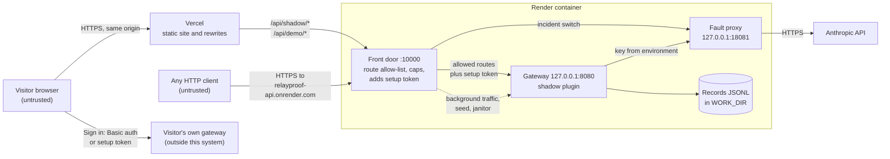

# Threat model

What data RelayProof handles, where it goes, and how it is protected. This covers the hosted demo (the site on Vercel and the backend on Render) and the console's Sign in mode. The hosted demo has no accounts and takes no payments, but it calls a paid API (Anthropic) with an operator key and stores what visitors type.

## Data the site handles

The front door is `bifrost-shadow/examples/shadow-demo/frontdoor/main.go`.

| Data | Stored in | Sent to | Who can read it |
| --- | --- | --- | --- |
| Visitor questions to `POST /api/demo/ask`, up to 600 characters (`bifrost-shadow/examples/shadow-demo/frontdoor/main.go:755-779`) | The plugin's records: in memory, up to `max_records` (2000), and appended to `shadow-records.jsonl` in `WORK_DIR` (`bifrost-shadow/deploy/gateway-claude.json:46-47`). Each record keeps the last user turn and both answers, truncated to 8000 characters, because `store_payloads` defaults to on (`bifrost-shadow/plugins/shadow/store.go:30-32`, `bifrost-shadow/plugins/shadow/config.go:22`, `bifrost-shadow/plugins/shadow/config.go:234-237`). The file is created with mode 0600 (`bifrost-shadow/plugins/shadow/store.go:175`). | Anthropic, up to five times: the primary (`claude-opus-5-5`), each candidate (`claude-sonnet-5-5`, `claude-haiku-5-5`), and the judge (`claude-opus-5-5`) once per candidate, which receives the conversation, up to 12,000 characters, and both answers (`bifrost-shadow/deploy/gateway-claude.json:29-41`, `bifrost-shadow/plugins/shadow/judge.go:31-47`). Once the plugin's daily budget is used up, only the primary call is made (`bifrost-shadow/plugins/shadow/main.go:401-402`). | Anyone. `GET /api/shadow/records`, `/api/shadow/records/{id}` and `/api/shadow/export` are public through the front door (`bifrost-shadow/examples/shadow-demo/frontdoor/main.go:278-286`). The Ask tab warns that questions are stored in the public demo's records (`bifrost-shadow/site/src/live/Ask.tsx:107-108`). |
| Model answers, judge scores and reasons, latency, tokens and cost per pair | The same records (`bifrost-shadow/plugins/shadow/store.go:19-59`) | Nowhere else | Anyone, through the same routes |
| Synthetic prompts from the demo dataset, sent as background traffic, bursts and seed requests (`bifrost-shadow/examples/shadow-demo/frontdoor/main.go:592-617`, `bifrost-shadow/examples/shadow-demo/frontdoor/main.go:650-683`) | The same records | Anthropic, as above | Anyone |
| Client address: the first `X-Forwarded-For` entry, or the socket address (`bifrost-shadow/examples/shadow-demo/frontdoor/main.go:976-988`) | Front door memory only, as rate-limit counters cleared at the end of each one-minute or one-hour window (`bifrost-shadow/examples/shadow-demo/frontdoor/main.go:990-1015`) | Nowhere. No log line includes it. | Nobody through the API |
| Demo state: outages, counters, requests today | Front door memory (`bifrost-shadow/examples/shadow-demo/frontdoor/main.go:175-202`) | Nowhere | Anyone, through `GET /api/demo/status` (`bifrost-shadow/examples/shadow-demo/frontdoor/main.go:371-410`) |
| Canary rules and the rollout log | Routing rules in the gateway's config store, and `shadow-records.jsonl.rollouts.json` (`bifrost-shadow/ARCHITECTURE.md:76`) | Nowhere | Anyone can read them (`/api/shadow/rollouts`, `/api/shadow/canary-rule`) and change them (`POST /api/shadow/promote`, `POST /api/shadow/rollback`) (`bifrost-shadow/examples/shadow-demo/frontdoor/main.go:278-289`) |
| `ANTHROPIC_API_KEY` | Render's environment, inherited by every process in the container (`render.yaml:30-33`) | Anthropic, by the gateway, through the fault proxy, which forwards it unchanged (`bifrost-shadow/deploy/gateway-claude.json:9-21`, `bifrost-shadow/examples/shadow-demo/faultproxy/main.go:1-5`) | People with access to the Render service. Who that is is not recorded in the repository. |
| `BIFROST_SETUP_TOKEN` | Render's environment, exported to the gateway and the front door (`render.yaml:26-29`, `bifrost-shadow/deploy/entrypoint.sh:21`) | The gateway on loopback, from the front door only (`bifrost-shadow/examples/shadow-demo/frontdoor/main.go:259`, `bifrost-shadow/examples/shadow-demo/frontdoor/main.go:946`) | People with access to the Render service |
| Sign in credentials: a dashboard username and password, or a setup token | The browser tab's memory only. The password or token sits in React state and is cleared from the form after a successful sign in; a reload drops the connection (`bifrost-shadow/site/src/live/Connect.tsx:40`, `bifrost-shadow/site/src/live/Connect.tsx:59-67`, `bifrost-shadow/site/src/live/LiveApp.tsx:105`). | The visitor's own gateway, on every call, as `Authorization: Basic` or `X-Bifrost-Setup-Token` (`bifrost-shadow/site/src/live/shadowClient.ts:474-480`). They never go to Vercel or Render. | The visitor and the gateway they signed in to |
| Sign in form values: gateway address, credential kind and username | `localStorage` key `relayproof.gateway` (`bifrost-shadow/site/src/live/Connect.tsx:4-28`, `bifrost-shadow/site/src/live/Connect.tsx:65`). The password and token are not saved. | Nowhere | Anyone with access to that browser profile |
| The Set up tab's draft config (including the `virtual_keys` list as typed), gateway address and auth kind | `localStorage` key `relayproof.setup` (`bifrost-shadow/site/src/live/Setup.tsx:46-80`) | Nowhere (`bifrost-shadow/site/src/live/Setup.tsx:142`) | Anyone with access to that browser profile |
| Judge check labels | `localStorage` keys starting `relayproof.judge-labels.v1:` (`bifrost-shadow/site/src/live/JudgeCheck.tsx:823`, `bifrost-shadow/site/src/live/JudgeCheck.tsx:856-860`) | Nowhere | Anyone with access to that browser profile |

How long Vercel, Render and Anthropic keep request data or logs is not recorded in the repository.

## Trust boundaries

Sources: `bifrost-shadow/site/vercel.json`, `bifrost-shadow/deploy/entrypoint.sh`, `bifrost-shadow/deploy/gateway-claude.json`, `bifrost-shadow/examples/shadow-demo/frontdoor/main.go`, `bifrost-shadow/examples/shadow-demo/faultproxy/main.go`, `bifrost-shadow/site/src/live/backend.ts`.

The boundary that matters is the front door. Vercel is not one: the Render URL is public, and any client can call it with the same results as the site (`bifrost-shadow/site/vercel.json:9-10`). Inside the container, the gateway, the fault proxy and the mock upstream listen on `127.0.0.1` only (`bifrost-shadow/deploy/entrypoint.sh:49`, `bifrost-shadow/deploy/entrypoint.sh:52`, `bifrost-shadow/deploy/entrypoint.sh:61`, `bifrost-shadow/deploy/entrypoint.sh:66`), and the front door on `:$PORT` is the only public listener (`bifrost-shadow/deploy/entrypoint.sh:70`).

What the front door lets through (`bifrost-shadow/examples/shadow-demo/frontdoor/main.go:274-310`). In this table, a bare `:line` refers to that file.

| Method | Path | Notes |
| --- | --- | --- |
| GET, HEAD | `/api/shadow/summary`, `/records`, `/records/{id}`, `/rollouts`, `/export`, `/canary-rule` | Forwarded with the setup token. Body capped at 64 KiB (`:341`). |
| POST | `/api/shadow/promote`, `/api/shadow/rollback` | Forwarded with the setup token. |
| GET | `/api/demo/status` | Served by the front door. |
| POST | `/api/demo/incident`, `/api/demo/traffic`, `/api/demo/ask` | Served by the front door, with validation and caps. |
| GET | `/healthz`, `/` | Health and a one-line description. |
| Anything else under `/api/shadow/` | | 403, including `DELETE /api/shadow/records` (`:275`, `:336-338`). |
| Anything else | | 404 (`:301-308`). Inference (`/v1/*`) and gateway configuration are not reachable. |

On forwarded calls the front door removes the caller's `Authorization`, `Cookie`, `Origin` and `Referer` headers, sets its own setup token, drops `Set-Cookie` from the answer and marks it `Cache-Control: no-store` (`bifrost-shadow/examples/shadow-demo/frontdoor/main.go:246-265`). The front door tests cover the allow-list and the header handling (`bifrost-shadow/examples/shadow-demo/frontdoor/main_test.go:14`, `bifrost-shadow/examples/shadow-demo/frontdoor/main_test.go:157`).

CORS: neither deploy gateway config sets `client.allowed_origins` (`bifrost-shadow/deploy/gateway-claude.json:3-7`, `bifrost-shadow/deploy/gateway.json:3-7`). The gateway would refuse management calls from an unlisted origin, so the front door strips `Origin` and `Referer` instead; its route allow-list is the boundary (`bifrost-shadow/examples/shadow-demo/frontdoor/main.go:253-258`). The front door sends no `Access-Control-Allow-Origin` header, so pages on other origins cannot read its answers in a browser. The site avoids CORS by calling its own origin.

## Plugin safety controls

These come from the shadow plugin and are listed in `bifrost-shadow/ARCHITECTURE.md` under "Live-path guarantees" (`bifrost-shadow/ARCHITECTURE.md:13-29`).

| Control | Default | Hosted demo | Source |
| --- | --- | --- | --- |
| The plugin runs only when the config lists it with `enabled: true` | Off | On (`bifrost-shadow/deploy/gateway-claude.json:24-28`) | `bifrost-shadow/ARCHITECTURE.md:17` |
| `x-bf-shadow: force` is honoured only with `allow_force_header` | Off | On in claude mode (`bifrost-shadow/deploy/gateway-claude.json:30`). Only the front door can reach inference, and it sends the header only on `POST /api/demo/ask` (`bifrost-shadow/examples/shadow-demo/frontdoor/main.go:799`). | `bifrost-shadow/plugins/shadow/main.go:300-317`, `bifrost-shadow/ARCHITECTURE.md:22` |
| `x-bf-shadow: off` keeps a request out of shadowing | Always available | Available | `bifrost-shadow/plugins/shadow/main.go:306-307`, `bifrost-shadow/plugins/shadow/main.go:378-381` |
| Virtual-key allow-list (`virtual_keys`) | Empty: all traffic | Not set. The front door sends no virtual key. | `bifrost-shadow/plugins/shadow/main.go:382-384`, `bifrost-shadow/plugins/shadow/main.go:667-689`, `bifrost-shadow/ARCHITECTURE.md:23` |
| Daily budget for candidate, judge and embedding calls, checked before a request is captured and reserved per job | `0`, unlimited | $5 per UTC day (`bifrost-shadow/deploy/gateway-claude.json:45`) | `bifrost-shadow/plugins/shadow/main.go:401-402`, `bifrost-shadow/ARCHITECTURE.md:21` |
| Shadow calls are internal requests that skip the plugin pipeline, so they cannot be mirrored again or billed to the caller's virtual key | Always | Always | `bifrost-shadow/plugins/shadow/main.go:11-15`, `bifrost-shadow/plugins/shadow/worker.go:276`, `bifrost-shadow/ARCHITECTURE.md:24` |
| A bounded queue drops shadow work instead of delaying live traffic | 256 jobs, 4 workers | 256 jobs, 4 workers (`bifrost-shadow/deploy/gateway-claude.json:42-43`) | `bifrost-shadow/ARCHITECTURE.md:20` |
| A panic in a shadow job is recovered and recorded as a candidate error | Always | Always | `bifrost-shadow/plugins/shadow/worker.go:39`, `bifrost-shadow/plugins/shadow/worker.go:74`, `bifrost-shadow/ARCHITECTURE.md:25` |

## Risks and mitigations

| Risk | Where | Mitigation | Status |
| --- | --- | --- | --- |
| The Anthropic key or setup token reaches a browser | `render.yaml:26-33`, `bifrost-shadow/examples/shadow-demo/frontdoor/main.go:246-265` | Both live only in Render's environment. The front door adds the setup token on the server and strips caller credentials and cookies. Site code reads no secret; its only variable is a URL (`bifrost-shadow/site/src/live/backend.ts:16`). | Implemented |
| Outside callers reach inference, configuration or the reset route | `bifrost-shadow/examples/shadow-demo/frontdoor/main.go:274-310` | Internal processes listen on loopback; the front door forwards a fixed list of routes and refuses the rest with 403 or 404. | Implemented |
| The fault proxy's incident switch has no authentication | `bifrost-shadow/examples/shadow-demo/faultproxy/main.go:9-12` | It listens on loopback only (`bifrost-shadow/deploy/entrypoint.sh:52`). Visitors reach it only through `POST /api/demo/incident`, which accepts candidate models only and a share from 0 to 100, and clears itself after 3 minutes (`bifrost-shadow/examples/shadow-demo/frontdoor/main.go:420-440`, `bifrost-shadow/examples/shadow-demo/frontdoor/main.go:467-480`). | Implemented |
| Runaway spend on the Anthropic key | `bifrost-shadow/examples/shadow-demo/frontdoor/main.go:542-559`, `bifrost-shadow/deploy/gateway-claude.json:45` | 400 front door requests per UTC day; background traffic only within 3 minutes of a console call; 20 questions per address per hour; 30 POST calls per address per minute; bursts of at most 30, one at a time; `max_tokens` 1024; the plugin's $5 daily budget for candidate and judge calls. See [deployment](../operations/deployment.md#spend-caps-and-self-reset). | Implemented. The primary calls have no dollar cap, only the request cap. |
| A restart resets the daily request count | `bifrost-shadow/examples/shadow-demo/frontdoor/main.go:196-202` | The count lives in front door memory, so a crash or deploy starts it at 0 and the day can see more than 400 requests. In claude mode a fresh start with no records also sends 40 seed requests (`bifrost-shadow/examples/shadow-demo/frontdoor/main.go:561-585`). The plugin's spend ledger is written to `<persist_path>.spend.json` (`bifrost-shadow/ARCHITECTURE.md:21`), but `render.yaml` attaches no disk (`render.yaml:5-43`); whether `WORK_DIR` survives a restart or redeploy is not recorded in the repository. | Open |
| Per-address limits are bypassed | `bifrost-shadow/examples/shadow-demo/frontdoor/main.go:962-988` | The address is the first `X-Forwarded-For` entry, which a caller can set; the code notes this only lets a caller spend someone else's allowance. The daily request cap is global and still holds. Whether Vercel's rewrite passes the visitor's own address is not recorded in the repository; if it does not, all site visitors share one allowance. | Open (accepted for a demo) |
| A visitor sends up to twice the per-address limit | `bifrost-shadow/examples/shadow-demo/frontdoor/main.go:990-1015` | The limiter uses one fixed window for all addresses, so a visitor can use a full allowance just before the window ends and another just after. | Open |
| A forgotten console tab keeps paid traffic running | `bifrost-shadow/site/src/live/LiveApp.tsx:143-145`, `bifrost-shadow/site/src/live/shadowClient.ts:597-617` | The console polls every 2 to 3 seconds and does not pause in a hidden tab, so an open tab keeps the demo "watched". Bounded by the daily cap: at one request every 15 seconds, 400 requests last about 100 minutes. | Open |
| Visitor questions are public and go to a third party | `bifrost-shadow/examples/shadow-demo/frontdoor/main.go:278-286`, `bifrost-shadow/site/src/live/Ask.tsx:107-108` | The Ask tab tells visitors not to type anything private; questions are capped at 600 characters; records are capped at 2000 and truncated. `store_payloads: false` would keep only scores, but the console's comparison views need the text. | Open (by design for a public demo) |
| Any visitor can promote, ramp, override or roll back canaries on the shared demo | `bifrost-shadow/examples/shadow-demo/frontdoor/main.go:287-289` | 30 POST calls per address per minute; the canary guard rolls back unhealthy canaries (`bifrost-shadow/deploy/gateway-claude.json:54`); the janitor rolls back every canary after 30 minutes. Only the demo's own traffic is routed, so no outside user is affected. | Open (by design) |
| Caller-forced shadowing spends budget no one is billed for | `bifrost-shadow/plugins/shadow/main.go:308-314` | Off by default. On in the hosted Claude config, but outside callers cannot reach inference, so only the front door's ask route uses it. | Implemented |
| Error text from the gateway or provider is passed to the visitor | `bifrost-shadow/examples/shadow-demo/frontdoor/main.go:801-820` | A failed question returns the gateway's error message or the transport error, which can name internal addresses such as `127.0.0.1:8080`. It carries no key. | Open (low) |
| Oversized or slow requests tie up the front door | `bifrost-shadow/examples/shadow-demo/frontdoor/main.go:126-133` | Body caps of 64 KiB for shadow routes, 16 KiB for questions and 4 KiB for incident and burst calls (`bifrost-shadow/examples/shadow-demo/frontdoor/main.go:341`, `bifrost-shadow/examples/shadow-demo/frontdoor/main.go:758`, `bifrost-shadow/examples/shadow-demo/frontdoor/main.go:422`, `bifrost-shadow/examples/shadow-demo/frontdoor/main.go:624`); header, read, write and idle timeouts on the server. | Implemented |
| The container runs as root | `bifrost-shadow/deploy/Dockerfile:27`, `bifrost-shadow/deploy/Dockerfile:32` | It runs as user `demo` (uid 10001). | Implemented |
| Build inputs change under the image | `bifrost-shadow/deploy/Dockerfile:11`, `bifrost-shadow/deploy/Dockerfile:23`, `bifrost-shadow/scripts/setup.sh:19` | Upstream Bifrost is pinned to a commit. The base images are tags, not digests, and CI does not build the image (`.github/workflows/shadow.yml:15-60`). | Open |
| Sign in sends credentials to whatever address the visitor types | `bifrost-shadow/site/src/live/Connect.tsx:44-67` | Credentials go only to that address and stay in memory. From the https site, a plain-http address other than localhost is refused (`bifrost-shadow/site/src/live/Connect.tsx:54-58`). The visitor's gateway must list the site's origin in `client.allowed_origins` (`bifrost-shadow/site/src/live/Connect.tsx:177-180`). There is no list of trusted gateways. | Open (the visitor's choice) |
| Sign in credentials are readable by any script running on the site's origin | `bifrost-shadow/site/vercel.json:1-12`, `bifrost-shadow/site/src/live/shadowClient.ts:474-480` | Credentials are held in memory, not storage. `vercel.json` sets no response headers, so the site sends no Content-Security-Policy. The API client's own comment advises keeping dashboard credentials server-side (`bifrost-shadow/site/src/live/shadowClient.ts:436`). | Open |
| Saved form data in the browser | `bifrost-shadow/site/src/live/Connect.tsx:22-28`, `bifrost-shadow/site/src/live/Setup.tsx:74-80` | Only the address, credential kind and username are saved for Sign in. The Set up draft is saved as typed, including any `virtual_keys` values. | Implemented for credentials; open for typed virtual key values |

## Keys and secrets

`ANTHROPIC_API_KEY` lives only in the Render service's Environment. `render.yaml` declares it with `sync: false` and no value (`render.yaml:30-33`). The gateway reads it through `env.ANTHROPIC_API_KEY` in its config (`bifrost-shadow/deploy/gateway-claude.json:13`). Every process in the container inherits it from Render, though only the gateway uses it, and no front door route returns environment values. To rotate it: create a new key in the Anthropic Console, replace the value in Render's Environment, let the service restart or redeploy so the entrypoint reads it again (`bifrost-shadow/deploy/entrypoint.sh:24-33`), then revoke the old key. Removing the variable puts the demo in mock mode at the next start (`bifrost-shadow/deploy/entrypoint.sh:26`).

`BIFROST_SETUP_TOKEN` is generated by Render (`render.yaml:26-29`). The entrypoint refuses to start without it and exports it to the gateway and the front door (`bifrost-shadow/deploy/entrypoint.sh:21`); the front door also refuses to start without it (`bifrost-shadow/examples/shadow-demo/frontdoor/main.go:112-114`). It travels only on loopback, from the front door to the gateway. Nothing outside the container uses it, so rotating it means replacing the value in Render's Environment and redeploying.

The hosted gateway has no dashboard login configured, so the setup token is the only credential for its `/api` routes (`bifrost-shadow/examples/shadow-demo/run.sh:25-26`). Inference auth is off (`enforce_auth_on_inference: false`, `bifrost-shadow/deploy/gateway-claude.json:6`), which is safe only because inference listens on loopback.

The site holds no secrets. `vercel.json` defines no environment, and the one variable the site reads, `VITE_SHADOW_API`, is a public URL (`bifrost-shadow/site/src/live/backend.ts:16`). The provider key in `bifrost-shadow/deploy/gateway.json` is a placeholder for the mock upstream (`bifrost-shadow/deploy/gateway.json:12-13`).

For local runs, `run.sh` generates a throwaway setup token per run (`bifrost-shadow/examples/shadow-demo/run.sh:27`) and `dev.sh` uses a fixed local value (`bifrost-shadow/examples/shadow-demo/dev.sh:21`). Both bind the gateway to `127.0.0.1` (`bifrost-shadow/examples/shadow-demo/run.sh:47`, `bifrost-shadow/examples/shadow-demo/dev.sh:38`). Their config allows any origin (`bifrost-shadow/examples/shadow-demo/gateway/config.json:7`); the demo README says not to reuse it for a shared gateway (`bifrost-shadow/examples/shadow-demo/README.md:56-58`).
