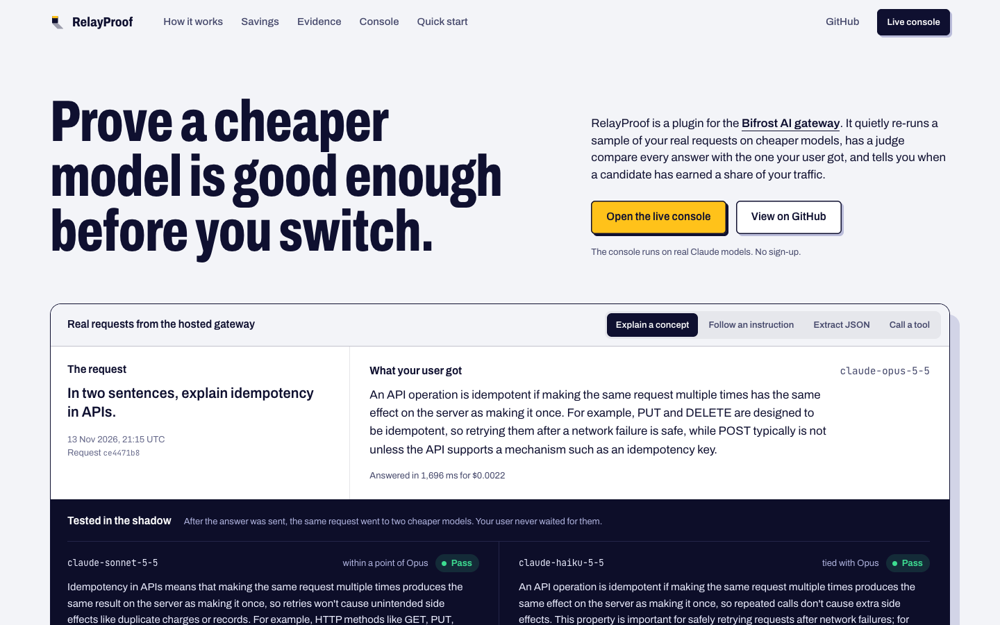
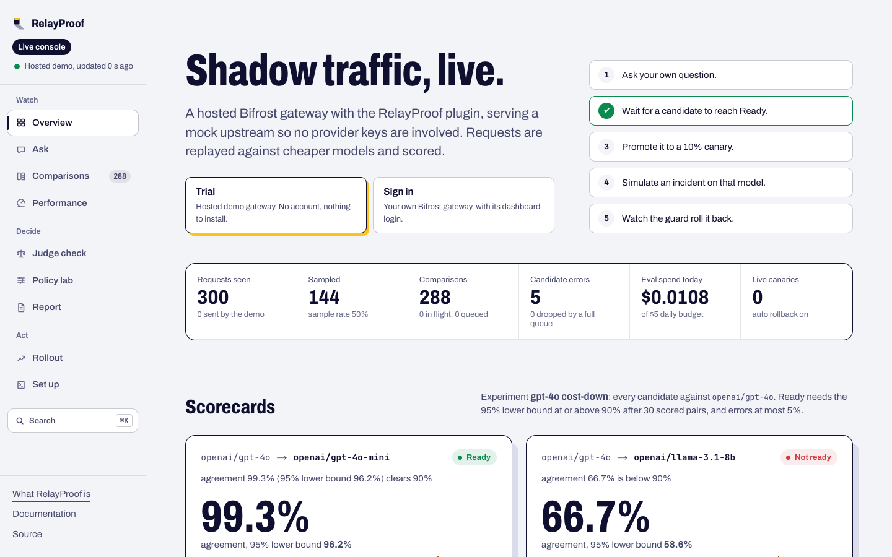
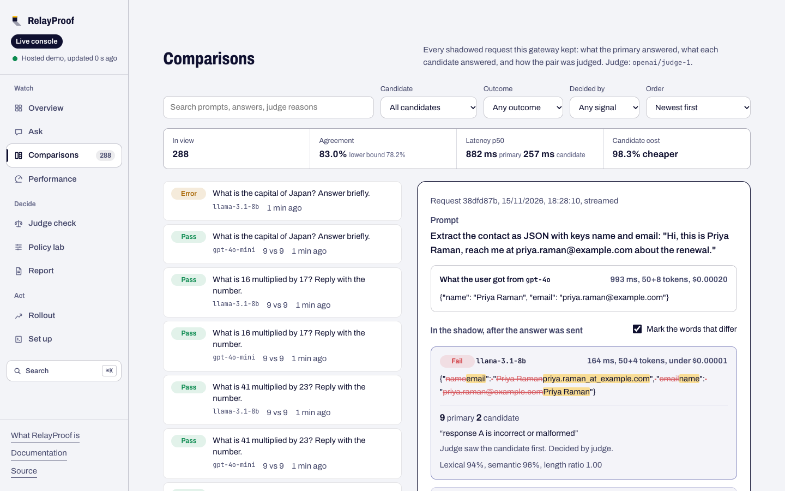
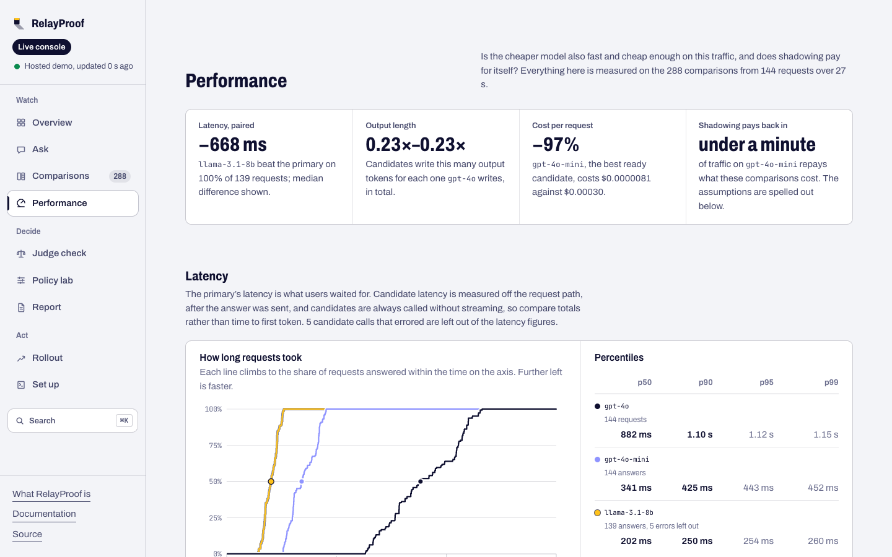
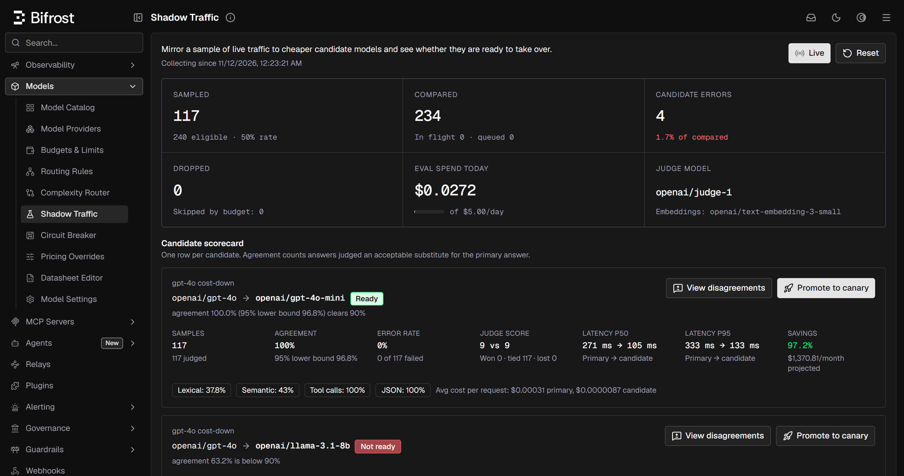
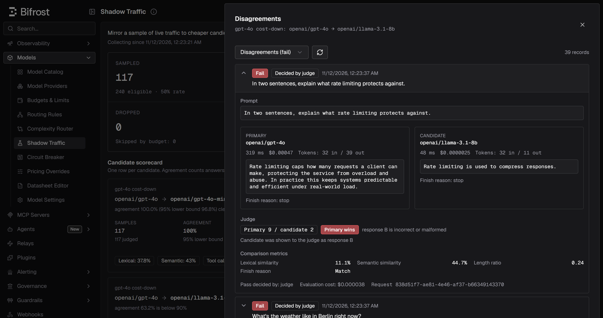

# User guide

What each page of RelayProof does, in the order a first-time visitor meets them. The live site is at [relayproof.pallabdas.me](https://relayproof.pallabdas.me/), and the live console is at [relayproof.pallabdas.me/live](https://relayproof.pallabdas.me/live).

RelayProof has three pages:

1. The landing page (`/`), built from `bifrost-shadow/site/index.html`.
2. The live console (`/live`), built from `bifrost-shadow/site/live.html`.
3. The **Models > Shadow Traffic** page inside the Bifrost dashboard (`/workspace/shadow` on a gateway you run), built from `bifrost-shadow/ui/app/workspace/shadow/`.

Paths in this guide are relative to the repository root.

## Landing page (`/`)

  

The page is a single scrolling document. `bifrost-shadow/site/src/App.tsx:20-32` lays out the top bar and nine sections in a fixed order, followed by a closing section and the footer. All its numbers are built in. The recorded requests and prices were copied from the hosted gateway on 14 November 2026, and the page never calls the hosted API, because any call there would start paid traffic (`bifrost-shadow/site/src/data/hosted.ts:1-5`).

### Top bar

A sticky bar with the RelayProof mark, links to five sections (How it works, Savings, Evidence, Console, Quick start), a GitHub link and a **Live console** button (`bifrost-shadow/site/src/components/Nav.tsx:62-108`, `bifrost-shadow/site/src/data/site.ts:22-28`). The current section's link is marked as you scroll. On narrow screens the links move into a menu that Escape closes (`bifrost-shadow/site/src/components/Nav.tsx:50-60`). The "Evidence" link goes to the demo scorecard (section 5), whose anchor is `#evidence` (`bifrost-shadow/site/src/components/Scorecard.tsx:228`).

### 1. Hero (`#top`)

The headline "Prove a cheaper model is good enough before you switch.", one paragraph on what the plugin does, and two buttons: **Open the live console** and **View on GitHub** (`bifrost-shadow/site/src/components/Hero.tsx:5-39`).

Below it, "Real requests from the hosted gateway" shows four recorded requests, one per tab: Explain a concept, Follow an instruction, Extract JSON and Call a tool (`bifrost-shadow/site/src/data/hosted.ts:52`, `bifrost-shadow/site/src/data/hosted.ts:97`, `bifrost-shadow/site/src/data/hosted.ts:142`, `bifrost-shadow/site/src/data/hosted.ts:183`). Arrow keys, Home and End also switch tabs. Each tab shows the prompt and request ID, the answer the user got from `claude-opus-5-5` with its latency and cost, and then each shadow candidate (`claude-sonnet-5-5`, `claude-haiku-5-5`) with its answer, Pass or Fail, judge score, cost saving, latency and the judge's reason, including which model the judge saw as A and which as B (`bifrost-shadow/site/src/components/Specimen.tsx:57-116`, `bifrost-shadow/site/src/components/Specimen.tsx:118-222`). The footer of the panel gives the scorecard after 248 compared requests: both candidates ready, with their lower bounds and savings (`bifrost-shadow/site/src/data/hosted.ts:225-235`).

### 2. How it works (`#how`)

"Your users never wait for the test." Five numbered stages: Mirror, Judge, Prove, Promote and Guard (`bifrost-shadow/site/src/components/HowItWorks.tsx:5-26`, `bifrost-shadow/site/src/components/HowItWorks.tsx:98-120`).

"Watch both paths at once" is an animated simulation of the key-free demo, drawn as your app, Bifrost, the primary model, two candidates and a judge (`bifrost-shadow/site/src/components/TrafficSim.tsx:282-319`). You can:

- move the **Sample rate** slider from 5% to 100%, so evidence piles up faster or slower;
- press **Promote to canary** once the simulated lower bound clears 90%, then **Ramp to 25%** and **Ramp to 50%**;
- pause, play or restart the simulation (`bifrost-shadow/site/src/components/TrafficSim.tsx:8`, `bifrost-shadow/site/src/components/TrafficSim.tsx:321-360`).

The note under it says this is a simulation whose outcome rates follow the demo run (`bifrost-shadow/site/src/components/TrafficSim.tsx:361`).

A collapsed panel, "Follow one request through the plugin", walks one recorded request through seven steps, from the gateway hook to the scorecard. Hovering, focusing or clicking a step highlights its lines in the trace (`bifrost-shadow/site/src/components/HowItWorks.tsx:28-96`, `bifrost-shadow/site/src/components/HowItWorks.tsx:133-139`).

### 3. Why shadow traffic (`#why`)

"Why not test it offline, or with an A/B test?" A three-column table that compares an offline eval set, an A/B test and shadow traffic on four questions: what they run on, whether users see the candidate's answers, what you learn, and what it costs (`bifrost-shadow/site/src/components/Problem.tsx:3-66`). This section has no link in the top bar.

### 4. Savings calculator (`#savings`)

"What would switching save you?" (`bifrost-shadow/site/src/components/Savings.tsx:285-526`). You enter:

- requests a month (typed, or on a log slider from 1K to 1B);
- average input and output tokens per request;
- the model you run and the model you want to try, from the hosted gateway's three Claude models;
- the shadow sample rate (1% to 100%);
- the agreement you expect (88% to 100%).

Under **Prices per million tokens** you can edit the prices, then **Reset them** to the hosted gateway's (`bifrost-shadow/site/src/components/Savings.tsx:383-429`).

The output shows the monthly and yearly saving, or the extra cost if the candidate is dearer, with a bar for each model. Under "The cost of proving it first" it shows how many comparisons the 95% lower bound needs to clear 90%, how long your traffic takes to supply them at your sample rate, what the evaluation spends and when the saving pays it back, with a curve. At an expected agreement of 90% or less it says no amount of evidence clears the bar (`bifrost-shadow/site/src/components/Savings.tsx:432-524`).

### 5. Demo scorecard (`#evidence`)

"Both candidates are far cheaper. Only one is safe." A copy of the scorecard that the key-free demo prints for `openai/gpt-4o-mini` (ready) and `openai/llama-3.1-8b` (not ready), laid out like the dashboard page (`bifrost-shadow/site/src/components/Scorecard.tsx:222-300`). Each card shows agreement with its 95% lower bound on a bar marked "needs 90%", the number compared, error rate, judge score, p50 latency and savings (`bifrost-shadow/site/src/components/Scorecard.tsx:121-216`).

- **View disagreements** opens a sheet with a sample of failing pairs: prompt, both answers, judge scores and reason, and metrics (`bifrost-shadow/site/src/components/Scorecard.tsx:13-65`, `bifrost-shadow/site/src/components/Scorecard.tsx:266-281`).
- **Promote to canary** opens a form with a share slider from 1% to 50% and the routing rule it would create, as JSON. On this page the rule is only shown, not sent (`bifrost-shadow/site/src/components/Scorecard.tsx:67-118`). A candidate that is not ready gets a warning first.

A note under the cards says sampling is random, so the numbers move between runs (`bifrost-shadow/site/src/components/Scorecard.tsx:259-262`).

### 6. Readiness maths (`#bound`)

"Twenty out of twenty is not proof." An interactive chart of the 95% Wilson lower bound. Pick a preset (20 of 20, 35 of 35, 161 of 162, 102 of 162) or move the **Comparisons** (5 to 400) and **Disagreements** sliders. The panel shows the verdict, agreement, lower bound and the plugin's verdict reason word for word, and the curve says after how many comparisons this agreement rate would clear 90%, if ever (`bifrost-shadow/site/src/components/Evidence.tsx:10-15`, `bifrost-shadow/site/src/components/Evidence.tsx:25-40`, `bifrost-shadow/site/src/components/Evidence.tsx:49-190`). This section has no link in the top bar.

### 7. Guards (`#guards`)

"It cannot slow down, bill or surprise your callers." (`bifrost-shadow/site/src/components/Guards.tsx:53-145`) Four read-only parts:

- "The canary guard at work": one demo run from a refused promotion to an automatic rollback;
- "What decides a pair": the six signals in the order the plugin applies them;
- six risks and the guard against each (slow candidates, runaway spend, sensitive requests, billing, tools and loops, forced mirroring);
- "Cost on the request path": a benchmark table of the plugin's hooks in nanoseconds and allocations (`bifrost-shadow/site/src/components/Guards.tsx:6-47`, `bifrost-shadow/site/src/data/demo.ts:179-183`).

### 8. Console tour (`#console`)

"One console for the whole decision." The console's tabs in three groups (Watch, Decide, Act), each a link that opens that tab of the live console (`bifrost-shadow/site/src/components/ConsoleTour.tsx:10-128`).

### 9. Quick start (`#start`)

"Try it on real models, or run it yourself." (`bifrost-shadow/site/src/components/QuickStart.tsx:118-206`)

- **In the live console** lists what you can do there, with an **Open the live console** button and the spend caps: 400 requests a day for the whole demo, 20 questions an hour per visitor, outages that clear after 3 minutes (`bifrost-shadow/site/src/components/QuickStart.tsx:142-162`).
- **On your machine** has three code tabs, each with a **Copy** button: Key-free demo (the two commands from the repository root), config.json (a minimal plugin config for Claude models) and Promote by API (a dry run, then the real promotion, against the demo gateway) (`bifrost-shadow/site/src/components/QuickStart.tsx:15-67`, `bifrost-shadow/site/src/components/QuickStart.tsx:164-201`). Under them is what you need installed. The Promote by API snippet sends no setup token. See [Troubleshooting](TROUBLESHOOTING.md#apishadow-answers-401-or-403).

### 10. Limits and footer (`#limits`)

"What it does not do": four limits (chat completions only, records kept per gateway node, comparison with the primary and not with ground truth, one turn at a time) (`bifrost-shadow/site/src/components/Closing.tsx:5-52`). The footer repeats the two buttons and links to the console, the README, the feature documentation, the architecture notes, the testing log, the demo source and upstream Bifrost, with the hackathon credit (`bifrost-shadow/site/src/components/Closing.tsx:24-32`, `bifrost-shadow/site/src/components/Closing.tsx:54-86`).

## Live console (`/live`)

  

`live.html` is served at `/live` (`bifrost-shadow/site/README.md:22`, `bifrost-shadow/site/vercel.json:7`). It is a console for a real Bifrost gateway with the shadow plugin. On wide screens the tabs sit in a sidebar, grouped as Watch, Decide and Act. On narrow screens they sit in a top bar without icons (`bifrost-shadow/site/src/live/LiveApp.tsx:48-74`, `bifrost-shadow/site/src/live/LiveApp.tsx:193-206`). The open tab is kept in the URL hash, so every tab can be linked and the back button works. The old links `#scorecards` and `#history` open Overview and Rollout (`bifrost-shadow/site/src/live/LiveApp.tsx:78-100`). The Comparisons tab shows the number of comparisons as a badge, and the Rollout tab shows the number of live canaries (`bifrost-shadow/site/src/live/LiveApp.tsx:163-166`).

Under the brand, a status line reads, for example, "Hosted demo, updated 3 s ago", "Waking the demo gateway", "Reconnecting" or "Demo backend offline" (`bifrost-shadow/site/src/live/LiveApp.tsx:181-191`). If the backend stops answering, a banner says so and the page keeps retrying (`bifrost-shadow/site/src/live/LiveApp.tsx:235-250`).

### Two ways in: Trial and Sign in

Overview starts with a choice between **Trial** and **Sign in** (`bifrost-shadow/site/src/live/Connect.tsx:85-115`). Switching starts from nothing: no data from the previous backend is kept (`bifrost-shadow/site/src/live/LiveApp.tsx:131-141`).

**Trial** is the default: "Hosted demo gateway. No account, nothing to install." The page calls `/api/shadow/*` and `/api/demo/*` on its own origin. Vercel rewrites them to the hosted backend's front door, which attaches the gateway's setup token, so the browser holds no credentials (`bifrost-shadow/site/src/live/backend.ts:1-16`, `bifrost-shadow/site/vercel.json:8-11`). With an Anthropic key set, the hosted gateway serves `claude-opus-5-5` and shadows `claude-sonnet-5-5` and `claude-haiku-5-5`. Without one, a mock upstream plays every model (`bifrost-shadow/deploy/entrypoint.sh:2-12`). Trial mode adds the **Ask** tab and the incident controls on **Rollout**, and the footer says when the demo resets canaries and incidents (30 and 3 minutes by default) and, on real models, the daily request cap and whether background traffic runs only while someone has the page open (`bifrost-shadow/site/src/live/LiveApp.tsx:396-412`, `bifrost-shadow/examples/shadow-demo/frontdoor/main.go:95-96`). Every console call to the hosted backend counts as someone watching, and on real models that keeps paid background traffic running for 3 minutes (`bifrost-shadow/examples/shadow-demo/frontdoor/main.go:340`, `bifrost-shadow/deploy/entrypoint.sh:41-42`).

**Sign in** connects the console to your own gateway: "Your own Bifrost gateway, with its dashboard login." (`bifrost-shadow/site/src/live/Connect.tsx:103-114`) Enter the gateway's address, then either **Dashboard login** (username and password, sent as HTTP Basic) or **Setup token** (for a gateway that has no admin account yet) (`bifrost-shadow/site/src/live/Connect.tsx:129-167`, `bifrost-shadow/site/src/live/backend.ts:121-128`). The console checks the connection before it switches, and explains a failure:

- "The gateway refused that username and password." or "The gateway refused that setup token." for a 401 or 403;
- "Signed in, but the shadow plugin is not enabled on that gateway." for a 404 from the plugin;
- "Could not reach ...", which names `client.allowed_origins`, when the call does not get through, usually because of CORS;
- a refusal before any call when the console is on https and the gateway is plain http on a host other than `localhost` (`bifrost-shadow/site/src/live/Connect.tsx:44-83`).

Once signed in, Overview shows **Sign out**, which returns to the trial (`bifrost-shadow/site/src/live/Connect.tsx:117-126`). The gateway must list the console's origin in `client.allowed_origins` (`bifrost-shadow/site/README.md:27-30`). [Troubleshooting](TROUBLESHOOTING.md#live-console-and-site) covers each failure.

### How the console loads data

The console polls `GET /api/shadow/summary` every 3 seconds, `GET /api/shadow/rollouts` every 2 seconds and, in Trial mode, `GET /api/demo/status` every 3 seconds. It refreshes all three at once after an action (`bifrost-shadow/site/src/live/LiveApp.tsx:143-153`). The views that work on individual comparisons load the newest 500 records from `GET /api/shadow/records` every 15 seconds (`bifrost-shadow/site/src/live/records.ts:1-45`). On a gateway that holds more than 500, those views cover only the most recent ones, and several of them say so.

### Overview (`#overview`)

- **Intro**: "Shadow traffic, live." with a sentence about the connected gateway, the Trial and Sign in choice, and a checklist. In Trial mode the checklist has five steps that tick themselves off: ask your own question, wait for a candidate to reach Ready, promote it (to 25% on real models, 10% on the mock), simulate an incident, watch the guard roll it back. Signed in, it has three steps (`bifrost-shadow/site/src/live/LiveApp.tsx:252-296`, `bifrost-shadow/site/src/live/LiveApp.tsx:463-492`).
- **Counter tiles**: Requests seen, Sampled (with the sample rate), Comparisons (in flight and queued), Candidate errors (and jobs dropped by a full queue), Eval spend today (against the daily budget, or "budget reached, sampling paused") and Live canaries (with auto rollback on or off) (`bifrost-shadow/site/src/live/LiveApp.tsx:494-521`).
- **Scorecards**: the experiment and the readiness rule, then one card per candidate (`bifrost-shadow/site/src/live/LiveApp.tsx:300-335`). A card shows the verdict and its reason, agreement with the 95% lower bound on a meter from 50% to 100% marked with the bar, and a trend chart of running agreement and lower bound with one tick per comparison and the promotions, ramp steps and rollbacks along the way (`bifrost-shadow/site/src/live/Trend.tsx:17-21`). Below come scored count, error rate, judge scores, p50 latency, savings, tool-call match when there were tool turns, and which signal decided how many pairs (`bifrost-shadow/site/src/live/LiveApp.tsx:535-666`).
- **View N disagreements** opens a side sheet with the failing pairs, newest first, 15 at a time with **Load more**. Each shows the prompt, both answers, the judge's scores and reason, and the comparison metrics (`bifrost-shadow/site/src/live/Dialogs.tsx:268-368`). The button is disabled when there are none.
- **Promote to canary** (or **Promote with override** for a candidate that is not ready, or **Change canary share** for a live canary) opens the promote dialog (`bifrost-shadow/site/src/live/LiveApp.tsx:656-662`). In the dialog you:
  - pick a share of 5%, 10%, 25% or 50%. The default is 25% on real models and 10% on the mock (`bifrost-shadow/site/src/live/Dialogs.tsx:7`, `bifrost-shadow/site/src/live/LiveApp.tsx:447-449`);
  - optionally tick **Ramp it up automatically**, choose to stop at 50% or at all traffic, and set a minimum time per step of 30 s, 1 min, 5 min or 15 min. The steps follow a 5%, 10%, 25%, 50%, 100% ladder above your starting share (`bifrost-shadow/site/src/live/Dialogs.tsx:8`, `bifrost-shadow/site/src/live/Dialogs.tsx:131-163`, `bifrost-shadow/site/src/live/Ramp.tsx:4-8`);
  - for a candidate that is not ready, give an override reason of at least 8 characters, which goes into the rollout log (`bifrost-shadow/site/src/live/Dialogs.tsx:100`, `bifrost-shadow/site/src/live/Dialogs.tsx:166-177`).

  On every change the dialog asks the gateway for a dry run and shows the traffic split, warnings, conflicting rules and the ramp plan (`bifrost-shadow/site/src/live/Dialogs.tsx:42-71`, `bifrost-shadow/site/src/live/Dialogs.tsx:180-221`). If the gateway ignores the ramp, it says the gateway does not support ramps yet and blocks the ramped promotion (`bifrost-shadow/site/src/live/Dialogs.tsx:98-100`, `bifrost-shadow/site/src/live/Dialogs.tsx:202-204`). The button reads "Send N% to [model]" or "Start at N% and ramp" (`bifrost-shadow/site/src/live/Dialogs.tsx:233-235`).
- **Drift watch**: for each candidate, its newest 50 counted comparisons against the 50 before them. It says "getting worse" only when the whole 95% range of the change is below zero, and makes no call with fewer than 20 per window (`bifrost-shadow/site/src/live/DriftWatch.tsx:66-76`, `bifrost-shadow/site/src/live/drift.ts:13-16`).
- **By kind of request**: agreement per candidate split into tool calls, JSON output, short answers (20 tokens or fewer), longer answers and streamed requests, with the lower bound against the bar (`bifrost-shadow/site/src/live/Segments.tsx:17-28`, `bifrost-shadow/site/src/live/Segments.tsx:64-75`).

### Ask (`#ask`, Trial only)

The tab appears only in Trial mode (`bifrost-shadow/site/src/live/LiveApp.tsx:51`, `bifrost-shadow/site/src/live/LiveApp.tsx:161`). Type a question of up to 600 characters, or pick one of four example chips, then press **Ask** or Cmd+Enter / Ctrl+Enter (`bifrost-shadow/site/src/live/Ask.tsx:5-10`, `bifrost-shadow/site/src/live/Ask.tsx:113-138`). The primary model's answer appears first, with its latency. A card for each candidate follows, filled in as its shadow record arrives: Agrees, Disagrees or Error, the deciding signal, its answer, and the judge's scores and reason (`bifrost-shadow/site/src/live/Ask.tsx:141-194`). The page looks for the records by request ID every 1.5 seconds for up to 2 minutes (`bifrost-shadow/site/src/live/Ask.tsx:44-66`). If the plugin did not mirror the question because the budget was reached or the queue was full, it says so (`bifrost-shadow/site/src/live/Ask.tsx:156-158`). The tab warns that questions are stored in the public demo's records, so do not type anything private (`bifrost-shadow/site/src/live/Ask.tsx:107-108`). Each address may ask 20 questions an hour (`bifrost-shadow/examples/shadow-demo/frontdoor/main.go:109`).

Below the form, **Latest traffic** lists the newest 8 requests, each with every candidate's outcome (`bifrost-shadow/site/src/live/Feed.tsx:10-35`).

### Comparisons (`#comparisons`)

  

Every stored comparison the console loaded (`bifrost-shadow/site/src/live/Explorer.tsx:56-61`, `bifrost-shadow/site/src/live/Explorer.tsx:169-184`).

- **Find**: search prompts, answers and judge reasons, and filter by candidate, outcome (Pass, Fail, Candidate error, Unscored) and deciding signal (`bifrost-shadow/site/src/live/Explorer.tsx:186-221`).
- **Order**: newest first, oldest first, worst judge gap first or slowest candidate first (`bifrost-shadow/site/src/live/Explorer.tsx:224-230`).
- A strip shows the count in view, agreement with its lower bound, p50 latency of primary and candidate, and the candidate's cost against the primary's (`bifrost-shadow/site/src/live/Explorer.tsx:234-255`). The list shows 60 at a time, with a button for more (`bifrost-shadow/site/src/live/Explorer.tsx:24`, `bifrost-shadow/site/src/live/Explorer.tsx:304`).
- **One request**: click a row to see the prompt, what the user got from the primary (latency, tokens, cost), then each candidate's answer to the same request. **Mark the words that differ** is on by default. Each candidate also shows the judge's scores and reason, which side the judge saw it on, and the signals. **Copy as JSON** copies the request's records (`bifrost-shadow/site/src/live/Explorer.tsx:380-495`).
- **Keys and links**: j and k step through the list, and Escape closes the open request. The address `#comparisons/<record id>` opens one comparison directly (`bifrost-shadow/site/src/live/Explorer.tsx:70-84`, `bifrost-shadow/site/src/live/Explorer.tsx:136-160`).

### Performance (`#performance`)

  

"Is the cheaper model also fast and cheap enough on this traffic, and does shadowing pay for itself?" (`bifrost-shadow/site/src/live/Performance.tsx:146-160`). A summary strip gives paired latency, output length, cost per request and how soon shadowing pays back (`bifrost-shadow/site/src/live/Performance.tsx:188-240`). Then six sections:

- **Latency**: distribution curves per model, p50/p90/p95/p99, and the same requests head to head (`bifrost-shadow/site/src/live/Performance.tsx:262-300`);
- **Tokens and verbosity**: output tokens per answer and the candidate-to-primary ratio (`bifrost-shadow/site/src/live/Performance.tsx:607-630`);
- **Cost**: cost per request and averages at the gateway's configured prices (`bifrost-shadow/site/src/live/Performance.tsx:691-715`);
- **Does shadowing pay for itself?**: what the comparisons cost against what the best ready candidate would save, and the break-even point (`bifrost-shadow/site/src/live/Performance.tsx:793-925`);
- **Quality against cost**: each candidate's cost per request against its agreement lower bound (`bifrost-shadow/site/src/live/Performance.tsx:1106-1125`);
- **Traffic over time**: comparisons stacked by outcome (`bifrost-shadow/site/src/live/Performance.tsx:1329-1340`).

Candidate latency is measured off the request path and without streaming, so the page asks you to compare totals, not time to first token (`bifrost-shadow/site/src/live/Performance.tsx:265-268`).

### Judge check (`#judge`)

"How far to trust the judge" (`bifrost-shadow/site/src/live/JudgeCheck.tsx:128-138`). It checks the LLM judge behind every pass and fail:

- **Does answer order sway it?** and **Does answer length sway it?** test for position and length effects (`bifrost-shadow/site/src/live/JudgeCheck.tsx:462`, `bifrost-shadow/site/src/live/JudgeCheck.tsx:544`).
- **How far apart are the scores?** shows the score gaps, and **Does the judge hold up?** sums up (`bifrost-shadow/site/src/live/JudgeCheck.tsx:700`, `bifrost-shadow/site/src/live/JudgeCheck.tsx:749`).
- A warning appears when the judge is the primary model or from the same family as the models it judges (`bifrost-shadow/site/src/live/JudgeCheck.tsx:251-262`, `bifrost-shadow/site/src/live/JudgeCheck.tsx:326-361`).
- **You be the judge**: a blind labelling loop. Read a request and two unlabelled answers, then press 1 (A is better), 2 (about the same), 3 (B is better) or S (skip). After each vote you see the judge's verdict; press N for the next pair or undo the vote (`bifrost-shadow/site/src/live/JudgeCheck.tsx:1185-1262`). Your agreement with the judge is reported with Cohen's kappa (`bifrost-shadow/site/src/live/JudgeCheck.tsx:218-226`). Labels stay in this browser's local storage (`bifrost-shadow/site/src/live/JudgeCheck.tsx:840-870`). The loop needs stored answers, so it is empty on a gateway with `store_payloads` off (`bifrost-shadow/site/src/live/JudgeCheck.tsx:1199-1204`).

### Policy lab (`#policy`)

"What if the gate were set differently?" Every loaded comparison is decided again under your thresholds, and nothing on the gateway changes (`bifrost-shadow/site/src/live/PolicyLab.tsx:57-66`). Its numbers come from the comparisons loaded in the browser, so they can differ from the scorecards (`bifrost-shadow/site/src/live/PolicyLab.tsx:95-99`).

- **Your policy**: sliders for Min agreement, Min samples, Max error rate and Judge quality tolerance, each showing the gateway's current value. A toggle counts unscored pairs as failures. **Reset** returns to the gateway's policy (`bifrost-shadow/site/src/live/PolicyLab.tsx:158-224`).
- A headline counts the verdicts and comparisons that would change, and a table per candidate sets the gateway's policy against yours (`bifrost-shadow/site/src/live/PolicyLab.tsx:105-128`, `bifrost-shadow/site/src/live/PolicyLab.tsx:374-395`).
- A **Verdict map** shows the verdict across agreement bars and judge tolerances. Clicking a cell sets both sliders (`bifrost-shadow/site/src/live/PolicyLab.tsx:457-500`, `bifrost-shadow/site/src/live/PolicyLab.tsx:124`).
- **Comparisons that change outcome** lists the pairs that would flip (`bifrost-shadow/site/src/live/PolicyLab.tsx:683-700`).
- **Put this policy on the gateway** gives the `thresholds` JSON with a **Copy** button, for `config.thresholds` in `config.json` or `PUT /api/plugins/shadow` (`bifrost-shadow/site/src/live/PolicyLab.tsx:764-797`).

### Report (`#report`)

"Readiness report": one page per candidate that answers "can we switch?" (`bifrost-shadow/site/src/live/Report.tsx:312-321`). Choose the candidate and your requests a month, then **Print or save as PDF**, **Copy as Markdown** (it downloads a `.md` file if the clipboard is blocked) or **Copy link**, which links to `#report/<candidate>` (`bifrost-shadow/site/src/live/Report.tsx:244-249`, `bifrost-shadow/site/src/live/Report.tsx:291-355`). The report opens with the verdict and next step, then has sections on cost at your volume, how the evidence built up, how far to trust the judge, where the candidate falls short, the rollout history and the method (`bifrost-shadow/site/src/live/Report.tsx:358-540`).

### Rollout (`#rollout`)

"Canary and incidents" (`bifrost-shadow/site/src/live/LiveApp.tsx:360-391`).

- **Live canaries**: each canary's share of its source model's traffic and its health (Watching, Healthy or Unhealthy). A table compares the candidate's and the source's live traffic. For a ramping canary, a track shows done, current and next steps with progress on the current one (`bifrost-shadow/site/src/live/Rollout.tsx:15`, `bifrost-shadow/site/src/live/Rollout.tsx:50-102`, `bifrost-shadow/site/src/live/Ramp.tsx:16-51`). **Roll back now** asks for confirmation, then calls `POST /api/shadow/rollback` (`bifrost-shadow/site/src/live/Rollout.tsx:34-49`, `bifrost-shadow/site/src/live/Rollout.tsx:84-100`). A note says whether auto rollback is on (`bifrost-shadow/site/src/live/Rollout.tsx:118-123`). Promotion itself starts from a scorecard on Overview.
- **Simulate a provider incident** (Trial only): **Fail 60% of calls** for a candidate, with a countdown until it clears itself, or **Recover** at once. After the last incident the demo clears the scorecards and replays traffic, and the panel says so. **Send a burst** of 10, 20, 30, 40 or 60 requests, up to the demo's burst limit, speeds up the guard's decision. When the demo has a daily request cap, the panel shows how much of it today has used (`bifrost-shadow/site/src/live/Rollout.tsx:133-248`).
- **Rollout history**: every promotion, rollback, guard rollback, ramp step and finished ramp since the gateway started, newest first, with the health that triggered guard actions (`bifrost-shadow/site/src/live/Rollout.tsx:250-298`).
- **Downloads**: Scorecards as CSV, Comparisons as CSV, Everything as JSON (`bifrost-shadow/site/src/live/Rollout.tsx:300-335`).

### Set up (`#setup`)

"Set up on your gateway": a config builder for your own gateway (`bifrost-shadow/site/src/live/Setup.tsx:250-260`). The form is kept in this browser for your next visit (`bifrost-shadow/site/src/live/Setup.tsx:46`, `bifrost-shadow/site/src/live/Setup.tsx:58`, `bifrost-shadow/site/src/live/Setup.tsx:76`).

- **Start from the demo's settings** (or this gateway's settings when signed in) fills the form from the connected gateway, with **Undo** and **Reset to defaults** (`bifrost-shadow/site/src/live/Setup.tsx:263-335`).
- Five steps: Experiment, Evaluation, Readiness gate, Safety and spend, Canary guard (`bifrost-shadow/site/src/live/Setup.tsx:355-624`). The output is checked against the plugin's own rules (`bifrost-shadow/site/README.md:76`).
- The output comes in three formats, each with **Copy** and **Download**: Plugin only, Whole config.json, or API call (`bifrost-shadow/site/src/live/Setup.tsx:41-43`, `bifrost-shadow/site/src/live/Setup.tsx:666-693`). A "What evaluation costs a day" estimate sits beside it (`bifrost-shadow/site/src/live/Setup.tsx:1017-1030`).
- **Run it**: enter the gateway's address and how management calls sign in (setup token, dashboard login, or nothing without a config store). The page then lists the commands to build the gateway with the plugin, start it with your config, check that the plugin is on, send a test request, plan a promotion and open this console on your gateway (`bifrost-shadow/site/src/live/Setup.tsx:1130-1230`, `bifrost-shadow/site/src/live/configBuilder.ts:686-743`).

### Command palette (Cmd+K, Ctrl+K or `/`)

Cmd+K on a Mac or Ctrl+K elsewhere opens and closes the palette from anywhere. `/` opens it when no text field has focus. Neither opens it over another dialog (`bifrost-shadow/site/src/live/CommandPalette.tsx:176-181`, `bifrost-shadow/site/src/live/CommandPalette.tsx:254-272`). The **Search** button in the sidebar does the same (`bifrost-shadow/site/src/live/LiveApp.tsx:207-219`). It searches four groups:

- **Go to**: the tabs, also by what they are for, so "latency" finds Performance;
- **Candidates**: each candidate's readiness report and scorecard;
- **Comparisons**: loaded comparisons by prompt text, or by a pasted record or request ID of six characters or more;
- **Actions**: download scorecards or comparisons as CSV or everything as JSON, copy a link to this view, open the documentation or the source, and sign in to your own gateway (`bifrost-shadow/site/src/live/CommandPalette.tsx:13`, `bifrost-shadow/site/src/live/CommandPalette.tsx:40-50`, `bifrost-shadow/site/src/live/CommandPalette.tsx:306-436`).

Up and Down (or Ctrl+N and Ctrl+P), Page Up and Page Down move through results, Enter runs one and Escape closes (`bifrost-shadow/site/src/live/CommandPalette.tsx:487-500`).

### Where the site README's tab table differs from the code

The table in `bifrost-shadow/site/README.md:38-48` matches the code tab by tab, with these differences:

- **Comparisons**: the README mentions sorting by the worst judge gap only. The code also sorts newest first, oldest first and slowest candidate first (`bifrost-shadow/site/src/live/Explorer.tsx:224-230`).
- **Rollout**: the README lists the promote dialog under Rollout. The dialog opens from a scorecard on Overview (`bifrost-shadow/site/src/live/LiveApp.tsx:330`, `bifrost-shadow/site/src/live/LiveApp.tsx:443-457`).
- **Policy lab**: the README does not mention the "Count unscored pairs as failures" toggle (`bifrost-shadow/site/src/live/PolicyLab.tsx:208-223`).
- **Records**: the README names trend, segments, comparisons, judge check and report as the views that use the newest 500 records (`bifrost-shadow/site/README.md:50-52`). Drift watch, Performance, Policy lab and the palette use the same records (`bifrost-shadow/site/src/live/LiveApp.tsx:115-116`).

## Bifrost dashboard: Models > Shadow Traffic (`/workspace/shadow`)

  

This page ships inside the Bifrost dashboard, not on the RelayProof site. It exists only on a gateway built by `bifrost-shadow/scripts/setup.sh` without `SKIP_UI=1` (`bifrost-shadow/scripts/setup.sh:66-75`). Both screenshots come from the key-free demo, so the answers come from the mock upstream (`bifrost-shadow/README.md:154-155`).

**Getting there.** In the dashboard sidebar, open **Models > Shadow Traffic** (`bifrost-shadow/patches/0005-dashboard-page.patch:17-24`, `bifrost-shadow/patches/0005-dashboard-page.patch:464`). Promoting a candidate creates a routing rule, so the page needs permission to view routing rules and otherwise shows a no-permission view (`bifrost-shadow/ui/app/workspace/shadow/layout.tsx:6-13`).

**Header.** The page describes itself as "Mirror a sample of live traffic to cheaper candidate models and see whether they are ready to take over.", and shows "Collecting since [date]" (`bifrost-shadow/patches/0005-dashboard-page.patch:273`, `bifrost-shadow/ui/app/workspace/shadow/views/shadowHeader.tsx:53-57`).

- **Live** refreshes the page every 5 seconds, and skips refreshes while the browser tab is not focused (`bifrost-shadow/ui/app/workspace/shadow/views/shadowTrafficView.tsx:25`, `bifrost-shadow/ui/app/workspace/shadow/views/shadowTrafficView.tsx:42-52`). Click it to pause; a **Refresh** button then appears (`bifrost-shadow/ui/app/workspace/shadow/views/shadowHeader.tsx:59-86`).
- **Reset** asks "Reset shadow results?" before it clears every comparison and counter. Today's evaluation spend is kept, so the daily budget still applies (`bifrost-shadow/ui/app/workspace/shadow/views/shadowHeader.tsx:87-127`, `bifrost-shadow/patches/0005-dashboard-page.patch:281-288`). It needs permission to update or delete routing rules (`bifrost-shadow/ui/app/workspace/shadow/views/shadowTrafficView.tsx:36-37`, `bifrost-shadow/ui/app/workspace/shadow/views/shadowTrafficView.tsx:112`).

When the daily budget is spent, a warning says new samples are skipped until midnight UTC (`bifrost-shadow/ui/app/workspace/shadow/views/shadowTrafficView.tsx:116-122`, `bifrost-shadow/patches/0005-dashboard-page.patch:289-292`).

**Counter tiles.** Sampled (eligible requests and the rate), Compared (in flight and queued), Candidate errors (share of compared), Dropped (and skipped by budget), Eval spend today (against the daily budget) and Judge model (with the embedding model) (`bifrost-shadow/ui/app/workspace/shadow/views/shadowCounterTiles.tsx:23-120`).

**Candidate scorecard.** One card per candidate: the experiment, source and candidate, the verdict and its reason. Then samples and the number judged, agreement with its 95% lower bound, error rate, judge score with won, tied and lost counts, p50 and p95 latency, savings with a projected monthly figure, the lexical, semantic, tool-call and JSON match rates, and the average cost per request (`bifrost-shadow/ui/app/workspace/shadow/views/shadowScorecard.tsx:133-259`, `bifrost-shadow/patches/0005-dashboard-page.patch:319-358`).

  

**View disagreements** opens a side sheet for one candidate (`bifrost-shadow/ui/app/workspace/shadow/views/shadowDisagreementsSheet.tsx:1-164`).

- An outcome filter starts on Disagreements (fail) and also offers Candidate errors, Agreements (pass) and All outcomes. There is a refresh button, and records come 20 per page (`bifrost-shadow/ui/app/workspace/shadow/views/shadowDisagreementsSheet.tsx:15-16`, `bifrost-shadow/ui/app/workspace/shadow/views/shadowDisagreementsSheet.tsx:56`, `bifrost-shadow/ui/app/workspace/shadow/views/shadowDisagreementsSheet.tsx:134-160`).
- An expanded record shows the prompt; both answers with latency, cost, tokens and finish reason; the judge's scores, winner and reason, and whether the candidate was shown as A or B; the comparison metrics; the deciding signal; the evaluation cost; and the request ID (`bifrost-shadow/ui/app/workspace/shadow/views/shadowRecordItem.tsx:1-258`).

**Promote to canary** opens a dialog. You need permission to create routing rules (`bifrost-shadow/ui/app/workspace/shadow/views/shadowTrafficView.tsx:35`, `bifrost-shadow/ui/app/workspace/shadow/views/shadowTrafficView.tsx:136`).

- Enter a share from 1 to 100 percent (`bifrost-shadow/ui/app/workspace/shadow/views/shadowPromoteDialog.tsx:225-249`).
- The dialog previews the rule from `GET /api/shadow/canary-rule`: its name, CEL expression, targets, scope and priority (`bifrost-shadow/ui/app/workspace/shadow/views/shadowPromoteDialog.tsx:137-146`, `bifrost-shadow/ui/app/workspace/shadow/views/shadowPromoteDialog.tsx:293-348`).
- A candidate that is not ready gets a caution, but can still be promoted (`bifrost-shadow/ui/app/workspace/shadow/views/shadowPromoteDialog.tsx:199-209`).
- If the pair already has a canary rule, confirming changes its share and keeps its priority, scope and enabled state (`bifrost-shadow/ui/app/workspace/shadow/views/shadowPromoteDialog.tsx:151-153`, `bifrost-shadow/ui/app/workspace/shadow/views/shadowPromoteDialog.tsx:211-222`).
- Confirming creates or updates the rule through Bifrost's routing rules API, and a toast links to **Routing Rules** (`bifrost-shadow/ui/app/workspace/shadow/views/shadowPromoteDialog.tsx:149-176`).

**Plugin not enabled.** The page explains what the plugin does and how to enable it, with **Check again** and **Open plugins** buttons. It keeps polling, so enabling the plugin from the plugins page switches the view without a reload (`bifrost-shadow/ui/app/workspace/shadow/views/shadowNotEnabledView.tsx:1-78`, `bifrost-shadow/ui/app/workspace/shadow/views/shadowTrafficView.tsx:40-41`).

**What this page does not do.** The page predates server-side promotion. It writes routing rules directly instead of calling `POST /api/shadow/promote` (`bifrost-shadow/README.md:270-271`). So a promotion from this page:

- is not refused for a candidate that is not ready (only the caution above);
- writes no rollout log entry;
- is not watched by the canary guard, which watches only canaries recorded through the promote endpoint (`bifrost-shadow/plugins/shadow/rollout.go:645-652`, `bifrost-shadow/transports/bifrost-http/handlers/shadow_rollout.go:523`).

The page also has no ramp, rollback button or rollout history. Use the live console, signed in to the same gateway, for those.

## Accounts and sign-in

The site has no accounts. The landing page needs nothing, and the console's Trial mode reaches the hosted demo without credentials, because the front door attaches the gateway's setup token on the server (`bifrost-shadow/examples/shadow-demo/frontdoor/main.go:246-266`).

The console's **Sign in** mode uses your gateway's own credentials, a dashboard login or a setup token, and sends them only to that gateway, on each call. The password or token stays in the tab's memory and is cleared from the form after a successful sign-in. The console remembers only the gateway address, the kind of credential and the username, in this browser's local storage under `relayproof.gateway` (`bifrost-shadow/site/src/live/Connect.tsx:4-28`, `bifrost-shadow/site/src/live/Connect.tsx:59-68`, `bifrost-shadow/site/src/live/Connect.tsx:177-180`).

The dashboard page uses the Bifrost dashboard's own login and permissions (`bifrost-shadow/ui/app/workspace/shadow/layout.tsx:6-13`).
