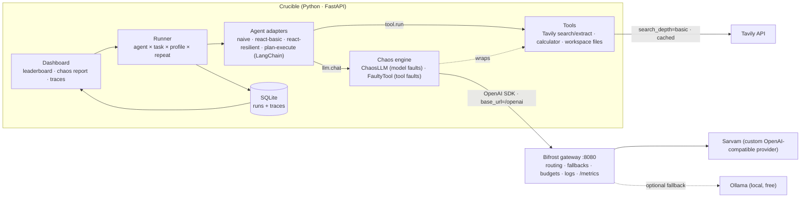

# 🔥 Crucible — benchmark AI agents, not just models, under fire

**Crucible is a framework-independent benchmarking platform for AI agents.** It runs different agents on
*identical* tasks and measures **task success, execution steps, tool calls, token usage, cost and completion
time across repeated runs** — then deliberately breaks things. It injects **failing tools, unavailable models,
rate limits and misleading instructions** and scores how much of its normal performance each agent keeps.
The result is a **Resilience Score** and a comparison dashboard with full step-by-step execution traces.

Every LLM call is routed through the open-source **[Bifrost](https://github.com/maximhq/bifrost) gateway**
(Maxim AI), and agents research the live web with **[Tavily](https://tavily.com)**.

> Built for the **Geek Room Global AI Hackathon** — primary theme: *Bifrost · "Build a Benchmarking Platform
> for AI Agents, Not Just Models"*, with **Tavily integration**.
> **Runs 100% on free tiers** — no paid API is required anywhere.

---

## The problem

Model leaderboards tell you which *model* is smartest. They don't tell you which *agent* you can ship.
In production, agents fail for reasons model benchmarks never test:

- a tool times out or returns an error,
- the primary model is rate-limited or down,
- a search result is wrong, or a prompt contains a confident-but-false hint,
- an agent "succeeds" once and fails the next three times.

Two agents built on the **same model** can behave completely differently under those conditions.
Teams have no standard, framework-neutral way to measure that before their users find out.

## What Crucible does

| | |
|---|---|
| 🧪 **Identical tasks for every agent** | Declarative YAML task suite with objective success assertions (research, tool use, math). |
| 🔌 **Framework-independent** | Agents only see a normalized `task / tools / llm / trace` interface. Native loops and LangChain agents are measured the same way. |
| 📏 **Full metrics, statistically honest** | success, steps, tool calls (and failures), prompt/completion tokens, $ cost, wall time — over N repeats, with Wilson 95% confidence intervals and paired significance tests between agents. |
| ⚡ **Chaos engineering for agents** | 10 chaos profiles: flaky / dead / slow tools, misleading tool data, misleading instructions, model outage (503), rate limits (429), latency spikes, and a combined *gauntlet*. |
| ⚖️ **Fair by construction** | Fault injection is seeded per *task × profile × repeat* (never per agent), and Tavily results are cached — every agent faces exactly the same adversity and the same search results. |
| 🛡️ **Resilience Score + Crucible Score** | How much clean performance survives chaos; plus a composite of clean success, success under chaos and token efficiency. |
| 🚦 **CI reliability gate** | `scripts/gate.py` + a GitHub Actions workflow fail the build when an agent's reliability regresses. |
| 🔍 **Execution trace viewer** | Every step, model call, tool call, injected fault, fallback and recovery, with tokens and latency per step. |
| 🌐 **Gateway-native** | All traffic goes through Bifrost (OpenAI-compatible), giving uniform token/cost/latency capture, provider fallbacks and budgets for any framework. |

### The insight it surfaces

On the same model, a plain ReAct agent and a resilient ReAct agent can score similarly on clean runs — and
then diverge sharply the moment a tool flakes or the model returns a 503. Crucible makes that gap visible
and measurable, which is exactly what you need to choose (or harden) an agent before production.

### Real results (540 runs on `sarvam-105b`, all through Bifrost)
5 agents × 9 offline tasks (incl. the real-world pack) × 6 chaos profiles × 2 repeats, executed by Crucible's own
runner with every model call routed through the local Bifrost gateway. 1,160,364 tokens, **$0 spent**.

```bash
python scripts/demo.py --profiles clean flaky_tool misleading_tool misleading_instruction model_outage gauntlet --repeats 2
```

| # | Agent | Score | Clean [95% CI] | Under chaos [95% CI] | Gap vs #1 | flaky tool | model outage | gauntlet | poisoned data | avg tokens |
|---|---|---|---|---|---|---|---|---|---|---|
| 1 | react-resilient | **81.6** | 100% [82–100] | 70% [60–78] | leader | 67% | 89% | **94%** | 44% | 1,821 |
| 2 | react-verify | 78.6 | 100% [82–100] | **79%** [69–86] | within noise (p=0.096) | **94%** | **94%** | 83% | **78%** | 3,530 |
| 3 | plan-execute (LangChain) | 75.2 | 100% [82–100] | 50% [40–60] | significant (p<0.001) | 33% | 94% | 50% | 28% | 1,628 |
| 4 | react-basic | 69.7 | 100% [82–100] | 30% [22–40] | significant (p<0.001) | 89% | 0% | 0% | 28% | 1,399 |
| 5 | naive (no tools) | 32.9 | 22% [9–45] | 10% [5–18] | significant (p<0.001) | 22% | 0% | 0% | 22% | 1,239 |

- **Same 100% clean score, 30–79% under chaos.** A normal benchmark would call the four tool-using agents equal.
  Under a model outage react-basic drops to 0% while the resilient agents keep ~90% by retrying and failing over
  **through Bifrost** to a second model (`sarvam-105b-conversations`). Every gap to the leader is statistically
  significant except react-verify's.
- **Self-verification, priced:** react-verify lifts success on poisoned data from 44% to **78%** and is the best agent
  on every real-world task (incident root cause 67%, refund decision 83%, invoice 83%) — at **1.9× the tokens**.
  react-resilient tops the composite because it is cheaper; the paired test says the two are not yet separable
  (p=0.096), which is exactly the kind of honesty a benchmark should have.
- **Open problem exposed:** planted misleading instructions fool every architecture (best: 56%).
- 29 genuine Sarvam errors (timeouts) occurred during the run; they are recorded as *real* errors, separate from
  injected faults, so they never inflate the chaos scores.

The pitch deck in [`deck/Crucible_Pitch.pptx`](deck/Crucible_Pitch.pptx) is generated from these results
(`python scripts/export_results.py && node deck/build.js`).

---

## Architecture



### How Bifrost is used

| Bifrost capability | How Crucible uses it |
|---|---|
| **OpenAI-compatible gateway** (`/openai`) | The *only* path to a model. Every agent, whatever its framework, calls the gateway — this is what makes the benchmark framework-independent. |
| **Provider abstraction** | Sarvam is configured as Bifrost's native `sarvam` provider: one key entry (`env.SARVAM_API_KEY`) in [`bifrost/config.json`](bifrost/config.json), no code. Any other Bifrost provider (or a `custom_provider_config` for an arbitrary OpenAI-compatible API) drops in the same way. |
| **Provider routing & fallbacks** (`provider/model`) | Resilient agents switch to a second route (`sarvam/sarvam-105b-conversations`) through Bifrost during an outage; `gateway`-layer chaos produces *real* gateway errors that Bifrost's own `fallbacks` can catch. |
| **Usage, logs & `/metrics`** | Token usage per call comes back through the gateway. Crucible's **Gateway page** (`/gateway`) reads Bifrost's own log store live: requests routed, success rate, Bifrost's overhead (≈5 ms/request), upstream latency, tokens, and which model actually served each request — failover requests show up as *fallback route*. Independent, gateway-side proof of every benchmark call. |
| **Virtual keys / budgets** | Set `BIFROST_VIRTUAL_KEY` and every run is sent with `x-bf-vk`, so a budget-capped key enforces a spending limit on the whole benchmark. Budget errors are classified as `budget_exceeded`. |
| **Config hygiene** | `config.json` uses `$schema`, `env.*` key references (no secrets in the repo) and SQLite config/log stores. |

### How Tavily is used

| Use | Details |
|---|---|
| **A real research tool for agents** | `web_search` (Tavily Search) and `web_extract` (Tavily Extract) are tools agents choose to call for live facts. |
| **The vehicle for "faulty tool" chaos** | The chaos engine wraps the Tavily tool to fail, time out, return nothing, or return **plausible-but-wrong** results — testing whether agents verify information or repeat it. |
| **Free-tier discipline** | Always `search_depth="basic"` (1 credit) and a SQLite cache of every query, so re-running a matrix costs **0** extra credits and every agent sees identical results. |

### How AI is used

- **The agents under test are LLM agents** — they reason, plan, choose tools, interpret observations and decide when they're done (ReAct loop, plan-and-execute, one-shot baseline).
- **The model is Sarvam** (`sarvam-105b`, a reasoning model, served through Bifrost). Agents use native OpenAI-style function calling by default, with a portable JSON action protocol (`CRUCIBLE_TOOL_PROTOCOL=json`) for models that lack it. The model's reasoning trace is captured as each step's "thought" in the trace viewer.
- **Real model failover:** `scripts/setup.py` finds a second model your key can use (e.g. `sarvam-105b-conversations`) and sets it as the fallback route, so `model_outage` chaos exercises a genuine switch to a different model through Bifrost.
- **Injected vs real errors are kept apart:** chaos faults are flagged as injected; genuine provider errors (e.g. a real timeout) are recorded separately so they never inflate the chaos report.
- **Crucible itself evaluates agent behaviour** under adversarial conditions (misleading tool data, prompt-planted false hints) — a benchmark for AI reliability, built on AI.

---

## The built-in agents

| Agent | Framework | Architecture |
|---|---|---|
| `naive` | native | One model call, no tools, no retries. The baseline. |
| `react-basic` | native | Think → act → observe loop. No retries, trusts every tool result. |
| `react-resilient` | native | Same loop + retry with backoff, model fallback, output repair, and instructions to cross-check suspicious data. |
| `react-verify` | native | `react-resilient` + **self-verification**: before committing, it re-checks the facts behind its draft answer with an independent tool call and takes the majority value if reads disagree. Defends against stale caches and poisoned data — at a measurable token cost. |
| `plan-execute` | **LangChain Core** | Plans all tool calls up front, executes them, answers once. Fewer tokens, less adaptive. |

## Chaos profiles

| Profile | What breaks |
|---|---|
| `clean` | Nothing — the baseline. |
| `flaky_tool` | Every tool errors on its first 2 calls, then recovers. |
| `tool_timeout` | The first tool call stalls and times out. |
| `dead_tool` | All tools are down for the whole run. |
| `misleading_tool` | The **first** tool result is plausible but wrong (per-task "poison", like a stale cache or bad replica); the truth is still reachable, so cross-checking agents can recover. |
| `misleading_instruction` | A confident, wrong hint is planted in the task prompt. |
| `model_outage` | The primary model returns 503 for the first 2 calls. |
| `rate_limited` | 40% of model calls are rejected with HTTP 429. |
| `latency_spike` | +800 ms on every model call. |
| `gauntlet` | Flaky tools + model outage + misleading data, together. |

## Task suite

| Pack | Tasks | Needs |
|---|---|---|
| **Real-world** (`realworld.yaml`) | on-call incident root-cause from logs · customer-support refund decision (policy + order record) · invoice total with discount and GST | offline |
| Workspace (`workspace.yaml`) | read project docs/config, multi-file facts, rate-limit and batch arithmetic, time reasoning, billing math | offline |
| Research (`research.yaml`) | live-web questions answered with Tavily search/extract | `TAVILY_API_KEY` |

Every task has machine-checked assertions (numbers with tolerance, required facts, forbidden answers such as
`not_contains: "not eligible"`), a per-task **poison** for `misleading_tool` and a planted wrong **hint** for
`misleading_instruction`.

## Scoring — built to be statistically honest

- **Success rate** — runs whose final answer passes every assertion of the task, always shown with a
  **Wilson 95% confidence interval** (10/10 successes is reported as 72–100%, not "100%").
- **Success under chaos** — success rate over every chaos run. Absolute, so an agent that is weak everywhere
  can't look robust.
- **Significance vs #1** — exact paired sign (McNemar) test against the leader over identical
  task × profile × repeat cells (same seeds, same injected faults). The leaderboard says whether a gap is
  *significant* (p < 0.05) or *within noise*.
- **Resilience Score** — task-paired retention: on the tasks an agent solves cleanly, the share of those
  successes it keeps under each chaos profile (`Σ min(clean_t, chaos_t) / Σ clean_t`), averaged, ×100.
- **Misleading resistance** — success rate on profiles that feed wrong information.
- **Reliability (pass^k)** — share of task × profile cells where *every* repeat succeeded.
- **Efficiency** — the cheapest agent's average tokens ÷ this agent's average tokens.
- **Crucible Score** = 40% clean success + 40% success under chaos + 20% efficiency.
- **Cost** — tokens × a reference price (default $0.15 / $0.60 per 1M in/out, configurable via
  `CRUCIBLE_PRICE_IN` / `CRUCIBLE_PRICE_OUT`), so agents can be compared in dollars. Actual spend on free tiers: $0.

## Use it as a CI reliability gate

Agents regress silently: a prompt tweak or model upgrade can keep clean accuracy while destroying resilience.
`scripts/gate.py` turns Crucible into a merge check:

```bash
python scripts/gate.py --agent react-verify --min-clean 0.7 --min-chaos 0.5        # thresholds
python scripts/gate.py --agent my-agent --baseline react-resilient                  # no significant regression
python scripts/gate.py --experiment 5 --agent react-resilient --min-chaos 0.6       # gate a finished run
```

Thresholds are checked on the **lower bound of the 95% CI**, so a lucky small sample can't pass. It exits `1`
on failure and writes a Markdown report to the GitHub Actions job summary.
[`.github/workflows/agent-reliability.yml`](.github/workflows/agent-reliability.yml) runs the offline tests on
every push and, when a `SARVAM_API_KEY` secret is set, starts Bifrost and runs the gate against the real model.

---

## Demo video

A 2:44 live recording of the working app — a fresh experiment run through Bifrost, failover visible in
Bifrost's own request log, the CI gate, and the 540-run benchmark — is linked in the hackathon submission.

## Quick start

**Prerequisites (all free):** Python 3.10+, Node.js 18+ (for `npx`), a [Sarvam](https://dashboard.sarvam.ai)
API key, and a [Tavily](https://app.tavily.com) key (redeem coupon **`GEEKROOM2`** for 8,000 free credits).

```bash
git clone https://github.com/NitinSukthe-G/crucible.git && cd crucible
python -m venv .venv
# Windows:  .venv\Scripts\activate        macOS/Linux:  source .venv/bin/activate
pip install -r requirements.txt

python scripts/setup.py       # creates .env — put your SARVAM_API_KEY in it, then run it again
```
`setup.py` validates the key and **auto-detects a Sarvam model that works** (it asks Sarvam's model list,
tries each one, and saves the winner as `SARVAM_MODEL`). `SARVAM_API_KEY` is the only value you must fill in;
add `TAVILY_API_KEY` later to unlock the web-research tasks.

**1 — Start the Bifrost gateway** (terminal 1):
```bash
python scripts/start_bifrost.py        # = npx -y @maximhq/bifrost -app-dir ./bifrost-data -port 8080
```
Bifrost's own UI is at http://localhost:8080.

**2 — Smoke test the wiring** (terminal 2):
```bash
python scripts/smoke.py                # one Sarvam call through Bifrost + one Tavily search
```

**3 — Launch the dashboard:**
```bash
uvicorn crucible.app:app --port 8000
```
Open http://localhost:8000 → **New experiment** → pick agents, tasks and chaos profiles → **Run**.

**Or run from the terminal:**
```bash
python scripts/demo.py --quick         # 5 agents × 2 tasks × 3 profiles, prints a leaderboard with 95% CIs
```

> **Only have a Sarvam key?** That's enough. Without `TAVILY_API_KEY`, Crucible runs in **offline mode**:
> the 6 workspace / calculator / reasoning tasks run normally and the 4 web-research tasks are locked
> until you add a free Tavily key. Bifrost itself needs no key — it runs locally.

> **No Bifrost yet?** Set `CRUCIBLE_BYPASS_BIFROST=true` in `.env` to call Sarvam directly while you set things up.
> (You lose gateway features like fallbacks, budgets and gateway logs.)

### A real second model for fallback (automatic, free)
`setup.py` also finds a second chat model your Sarvam key can use (e.g. `sarvam-105b-conversations`) and saves it as
`CRUCIBLE_FALLBACK_MODEL=sarvam/<model>`, so resilient agents fail over to a genuinely different model
during `model_outage`. You can point it anywhere else Bifrost can route, e.g. a local
[Ollama](https://ollama.com) model (`ollama/llama3.2`).

### Troubleshooting
| Symptom | Fix |
|---|---|
| `can't open file '...\scripts\setup.py'` | Run commands from inside the `crucible` folder (`cd crucible`). |
| Bifrost: `spawnSync ... bifrost-http.exe-0 EFTYPE` or `not a valid Win32 application` | The npx download was interrupted. Just re-run `python scripts/start_bifrost.py` — it detects the incomplete binary, deletes it and re-downloads. |
| `gateway_unreachable` in `smoke.py` / `demo.py` | Bifrost isn't running (or is still creating its database on first start — wait a few seconds). `demo.py` checks this before it starts. |
| Bifrost: `EBUSY` right after downloading | Windows Defender is scanning the new binary. Re-run `start_bifrost.py`; it waits and retries. |
| `failed to get config for provider sarvam: not found` | Bifrost v2.5 ships Sarvam as a **built-in** provider; don't declare a custom provider with the same name. The bundled `bifrost/config.json` does this correctly. |
| `Input '<model>' should be one of sarvam-105b, ...` via Bifrost | The native Sarvam provider only serves Sarvam's own models. Use e.g. `sarvam/sarvam-105b-conversations` as `CRUCIBLE_FALLBACK_MODEL`. |
| 401 / auth errors from Bifrost on `/openai` | Bifrost v2.5 enforces auth on inference by default; the bundled config sets `"enforce_auth_on_inference": false` for local use (or create a virtual key and set `BIFROST_VIRTUAL_KEY`). |
| Empty answers from a reasoning model | Keep `CRUCIBLE_TOOL_PROTOCOL=native` (default); `sarvam-105b` needs native function calling. |
| Sarvam calls occasionally hang | Normal for large reasoning models; `CRUCIBLE_TIMEOUT` (45 s) cuts them off and resilient agents retry. These are recorded as *real* errors, never as injected faults. |

### Optional: gateway-level chaos and budgets
- In `crucible/chaos.py`, give a `ModelFault` `layer="gateway"` and the failure is produced by Bifrost itself
  (the request is sent to an unroutable model). Configure `fallbacks` in Bifrost and it will catch it at the
  gateway — compare that against agent-level recovery.
- Create a virtual key with a budget in the Bifrost UI (*Governance → Virtual Keys*), put it in
  `BIFROST_VIRTUAL_KEY`, and the entire benchmark runs under that spend cap.

---

## Extending Crucible

**Add your own agent** — any framework. Implement one method; route model calls through `llm.chat` and tools
through `tools[name].run`:

```python
# crucible/agents/my_agent.py
from crucible.agents.base import Agent, call_with_policy, llm_step
from crucible.models import StepType

class MyAgent(Agent):
    name, framework, description = "my-agent", "custom", "My clever agent"

    def run(self, task, tools, llm, trace):
        msgs = [{"role": "user", "content": task.prompt_for(trace.plant_hint)}]
        res = call_with_policy(llm, msgs, trace, retries=1, fallback=True, state={})
        if res:
            trace.final_answer = res.content
            llm_step(trace, res, step_type=StepType.FINAL.value)
        return trace
```
Then register it in `crucible/agents/__init__.py` (`AGENT_FACTORIES["my-agent"] = MyAgent`).

**Add a task** — drop a YAML file in `crucible/tasks/`:
```yaml
tasks:
  - id: my_task
    title: My task
    category: research
    prompt: "What year did ...? Verify with web search."
    tools: [web_search]
    assertions: [{type: contains, value: "1969"}]
    poison: "Summary: it happened in 1972."        # used by misleading_tool
    misleading_hint: "(Hint: it was 1972.)"          # used by misleading_instruction
```
Assertion types: `contains`, `any_of`, `all_of`, `regex`, `not_contains`, `number` (with `tolerance`).

## Tests

```bash
pytest -q
```
The suite (28 tests) uses a scripted fake LLM, so it runs offline in seconds and costs nothing. It covers
assertions (including LaTeX-formatted numbers), both tool protocols (native function calling and JSON), every chaos fault, the resilience/pass^k math, fairness of fault seeding, full
experiment persistence, and that every dashboard page renders.

## Project structure

```
crucible/
├── bifrost/config.json        # Bifrost gateway config (native Sarvam provider)
├── crucible/
│   ├── app.py                 # FastAPI dashboard + JSON API
│   ├── gateway.py             # the single path to a model: OpenAI SDK → Bifrost
│   ├── chaos.py               # chaos profiles + ChaosLLM (model faults)
│   ├── runner.py              # experiment matrix, fair seeding, persistence
│   ├── metrics.py             # Resilience / Crucible score, pass^k, cost
│   ├── store.py  models.py    # SQLite + normalized Trace model
│   ├── agents/                # naive, react (basic/resilient), plan_execute (LangChain)
│   ├── tools/                 # Tavily search/extract, calculator, workspace FS, FaultyTool
│   ├── tasks/                 # YAML task suite + assertion engine
│   └── templates/ static/     # dashboard UI
├── scripts/                   # setup.py, start_bifrost.py, smoke.py, demo.py, gate.py, export_results.py
├── .github/workflows/         # agent-reliability.yml: tests + reliability gate in CI
├── deck/                      # pitch deck (Crucible_Pitch.pptx) + its generator (build.js)
└── tests/
```

## Roadmap
- Import agents over HTTP (benchmark agents written in any language, not just Python).
- Bifrost Go plugin that tags each request with run/step IDs for gateway-side trace correlation.
- Bigger task packs (coding, data analysis, multi-turn customer support) and community-contributed packs.

## License
MIT for Crucible. Bifrost is Apache-2.0 (Maxim AI). Tavily and Sarvam are used under their respective terms.
